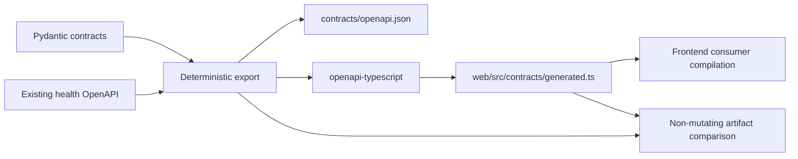

# F03 contract decisions and review guide

**Status:** Implementation for review; no human/scientific approval implied. **Scope:** SRS PV-01, AN-01–10, DA-08 and related data/region/mode requirements; TDD §§3–5, 7–8; implementation plan F03. This is the authorized local practice build. Approved source documents are unchanged.

## Authority and generation

`backend/src/earth_trend/api/schemas/` owns the scientific wire shapes. `export.py` exports every public model and its supporting definitions through Pydantic JSON Schema into an OpenAPI 3.1 document. It includes only the actual health route under `paths`; unused model components do not advertise endpoints. F03 adds no analysis, capability, job or acquisition endpoint.

Run `python scripts/dev.py contracts` to regenerate both committed artifacts. Run `python scripts/dev.py contracts-check` to compare both against freshly generated in-memory output without writing files. The normal `check` workflow invokes drift checking first. Outputs contain no generation timestamp, absolute path, machine ID or random value; CRLF/LF differences are normalized for comparison.

The focused development dependency is `openapi-typescript` 7.13.0 (MIT). Its declared TypeScript 5.x peer uses pinned TypeScript 5.9.3 at the workspace root; the web application's pinned TypeScript 7.0.2 remains its compiler. Peer validation remains strict. The generator operates on the in-memory local document and never fetches NASA metadata or remote schemas. See [Pydantic schema export](https://docs.pydantic.dev/latest/concepts/json_schema/) and [openapi-typescript Node API](https://openapi-ts.dev/node).

Generated types provide compile-time structure, unions and nullability. They do not execute Pydantic cross-field rules in the browser. Future U02 adapters must validate untrusted artifacts/responses; do not replace runtime validation with a TypeScript cast. The existing health validator remains, using its generated Python type.

## Wire decisions

| Area | F03 representation / invariant | Deferred work |
| --- | --- | --- |
| Version | Scientific requests/documents require literal `schema_version: "1.0"`; method profile is `srs-p0-v1`. Health retains `health.v1` and false analysis readiness | H1 and consuming owners review version changes; a profile ID is not a validation certificate |
| Months | Zero-padded Gregorian `YYYY-MM`, years 0001–9999; inclusive ordered windows, maximum 600 monthly positions. No `latest`, partial date or reversed range | Resolve release coverage and latest complete month in providers/catalog |
| Baseline | Discriminated `analysis_window` or `explicit` with a separate window; an explicit baseline can lie outside the analysis interval | Climatology support, minimum counts and required additional source data |
| Region | WGS84 `[longitude, latitude]`; global, cell with grid/layer IDs, bbox, Polygon/MultiPolygon, versioned preset | Geometry canonicalization, area, grid membership, self-intersections, mask eligibility and scientific support in D14 |
| Dateline | Crossing bbox requires west > east and `dateline: crossing`. Crossing polygon edges must be split into a MultiPolygon with `dateline: split`; `interior: bounded/complement` makes large-region intent explicit. ±180 is permitted at cut boundaries | D14 normalizes internal longitudes, verifies actual split topology and applies the declared interior; flags are not proof of a valid split |
| Input bounds | Reject extras, unknown P0 variable IDs, non-finite values, out-of-range coordinates/alpha and >2,000 vertices / 50 rings. Bbox uses `global` for an entire-world request | Raw HTTP 256 KB limit, provider allowlists, rate limits and operation-specific eligibility belong at future transport/application boundaries |
| Series | Monthly or annual consecutive positions with equal-length value/coverage/valid/reason arrays. Missing positions remain null rows with reasons; true zero is a valid number. Unknown coverage is null, never implicit 100% | Conversion, QA, aggregation, calendar decoding and eligibility in D13/D15/S01 |
| Units and branches | Closed canonical/display unit vocabulary, native units retained separately, explicit transform order, branch ID, estimator (`sen`, `ols`, `derived`) and version. Regional anomaly branches retain separate Sen/OLS slope states | Confirm actual source headers/QA in F05/D01. F03 does not populate a NASA catalog |
| Estimate availability | Available values are finite with no missing reason. Unavailable values are null with reasons. CIs require both ordered bounds, confidence and versioned method, or an explicit CI-unavailable reason | Rank rounding, covariance estimation and empirical CI calibration in F04/S02–S05/S13 |
| Tests | Method/name/version, validation status/report ref, role, branch, sample count, lag settings and relevant df/effective_n. Pending/failed method validation cannot produce an available p-value. Synthetic method evidence cannot authenticate scientific analyses/scans | A report ID's existence/authenticity and actual numerical validity must be verified by F04 and application/provenance tasks |
| FDR | Separate regional, seasonal and whole-layer family kinds; SHA-256 family ID, complete included/excluded membership, member branch/p/q/actual window, requested window/baseline/release/profile context. Regional/seasonal membership is inline; global membership/exclusions use checksummed artifact refs | Compute BH and canonical family hashes in S06/D02/A03; F03 validates shape/identity, not the numerical adjustment or actual hash |
| Different windows | Shared-window requests reject analysed rows with different dates. Explicit per-variable defaults retain `different_windows`, policy and every member's actual window; opening a case preserves that member's own dates and parent family context | H1/H3 review this optional path before U11 enables it; no window selection or FDR computation is implemented |
| Completed vs unavailable | `AnalysisResult.status: completed` can contain `analysis_status: unavailable`, unavailable tests/CI/grade and explicit reasons. Numerical unavailability is not a fabricated grade D or a server failure | Actual grade/eligibility decisions and scientific interpretation in S08/application |
| Scans | Exactly one row per requested variable: analysed result reference or excluded row/reason. Complete family membership/exclusions match rows independently of display sorting | Ranking computation and the ≥8-eligible-variable benchmark in A02; no fabricated eighth result |
| Seasonality | Twelve ordered calendar months, explicit test/slope states, separate Seasonal Kendall method and own FDR family | Actual seasonal methods, minimum record and gap handling |
| Detectability | Nullable/unbounded horizon, first valid month, noise units, ordered k=1/2 emergence states, fixed 5% / 90% labels and “if the trend continues” | Weatherhead coefficient/sampling convention and gap calibration remain F04/S09; no formula is implemented |
| Outlook | Projection/forecast have separate discriminated states; permanent labels, versioned model, seed, dated nested 80/95% quantiles, horizons and independent skill metadata. A forecast marked available must have a passed skill state | S11/S12 must establish covariance, model validity, training-only preprocessing, actual horizon support and skill gates; structural `passed` metadata is not evidence of skill |
| Comparison | Exactly two regions, one binding/variable/branch/window, same versioned slope estimator, ordered common support, consistent units, difference CI and paired-bootstrap configuration | S10 computes/validates paired blocks, confidence limits and numerical differences; no independent-SE shortcut is introduced |
| Layers | Grid/cell ordering, little-endian typed arrays, checksummed refs, explicit scales/masks/units/transforms, annual branch, alpha-independent p/q, whole-layer family and frame hashes | D16/A03 verifies bytes and array contents. Chlorophyll raw-unit slope remains distinct from log inference/standardized relief |
| Jobs | Accepted 202 shape is distinct from full job state. Full records retain UTC creation/update times, stage, attempts/provider IDs, result/error references and cancellation scope. Unknown provider progress stays null | Durable state transitions, polling, deduplication and transport Location headers in D03/A04 |
| Errors | `application/problem+json` shape with stable code, safe detail, request ID and sanitized field locations; no raw Pydantic input/provider body field. Invalid inputs/auth cannot be blindly retried | A04 installs transport handlers/redaction. Valid but scientifically insufficient queries use completed unavailable results, not validation errors |
| Snapshot | Capability metadata supports prepared reads/exports and explicitly excludes arbitrary-region computation. Unbundled queries have `SNAPSHOT_NOT_BUNDLED` | U02/R02 implement the provider; no snapshot capability is advertised by the existing runtime |

## Fixtures, verification and review

`backend/tests/contracts/fixtures/` contains labelled **synthetic structural examples**, not observations, golden scientific results, working snapshots or proof of source/method validity. Invented values, hashes and report/artifact IDs are disclosed. The fixture README explains their independence. They remain outside product assets. Every public contract has a round-trip specimen; invalid specimens declare expected errors.

Python tests cover dates/limits, finite values, arrays/gaps/zeros, status contradictions, units, CI confidence, method/branch/release identity, FDR families/exclusions, modes, job URLs/times, comparison metadata, quantiles and layer layout. Node tests run the real generator twice and deliberately stale enum, unit, nullability and TypeScript artifacts in isolated temporary directories. Checking must fail without repairing them or creating missing output. Compile-only frontend consumers include required negative type assertions, so widening enums/units/nullability causes TypeScript diagnostics.

Human review remains mandatory: H1 owns shared contracts/export; H2 reviews source units, calendars, domains and geometry; H3 reviews estimands, branch/FDR context, null reasons and scientific gates; H5 reviews generated consumers/state handling; H6 independently reruns checks. No self-review or successful test run closes D0.

Open scientific decisions remain F04: gap-aware Hamed–Rao conventions, Sen rank interval/covariance validity, effective-df approximation calibration, Weatherhead sampling coefficient and paper reproduction coordinates/window. Structural models reserve explicit method versions/status/reasons without resolving those decisions. F03 claims no scientific acceptance and adds no numerical algorithm.
