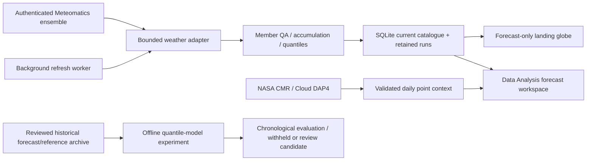

# Forecast-first discovery and workspace

Implemented following the team's explicit authorization on 15 November 2026. This extends the trend application with future weather predictions. It does not amend historical trend-significance methodology. The team subsequently elected to proceed **without EWDS access**, so river-flow forecasts remain disabled.

| Capability | Current status |
| --- | --- |
| Live future precipitation / forecast-only discovery | Working and verified at six points |
| Ensemble charts, freshness, snapshots and source exports | Working |
| Recent NASA IMERG point context | Working; seven authentic days verified for Colombo |
| Iris ML training/evaluation code | Implemented offline experiment; genuine training is blocked by the missing matched archive; no production model |
| River-flow forecasts | Deferred by user choice; EWDS not configured |

## User journey

The landing globe contains six **precipitation forecast** links, replacing generic location links and historical disaster labels. Cards read a cached catalogue and show the ensemble median for the wettest complete rolling 24-hour window, the point location and availability. These are six configured points, not a global significance or hazard scan. No provider request runs because a landing-page visitor arrives.

Each link opens `/workspace/data-analysis?forecastId=<id>&run=<artifact-id>`. The future forecast loads automatically. A pinned run resolves the exact retained snapshot; a missing/expired retention record returns 410 instead of silently selecting another forecast. Opening without `run` selects the current forecast. Historical Data Analysis remains available without `forecastId`; historical case studies remain in their library.

The forecast workspace supports three-hour accumulations, rolling 24-hour totals and three consecutive forecast-day totals. Users can select a median/range ribbon, median bars or all 51 member curves; inspect an interval; change location and detail timezone; inspect values; and export the complete forecast/member evidence. The chart uses UTC explicitly. A separate interactive map marks the exact forecast point; it does not interpolate a regional precipitation or flood surface. Optional NASA observations have their own dates, units and provenance.

MapLibre 6's worker is copied from its pinned package to `public/` by postinstall and configured explicitly; Next.js chunk URLs do not preserve the default sibling-worker path. The generated worker is ignored by Git and carries the upstream licence header. Rerun `node scripts/copy-maplibre-worker.mjs` after a MapLibre upgrade.

## Scientific meaning and confirmed access

Protected checks returned genuine 51-member responses for all six configured points. The request is `precip_3h:mm`, `source=ecmwf-ens`, `ens_select=member:0,member:1-50`. The response identifies control member 0 with the base parameter and members 1–50 with `-m1` through `-m50`. Source: [Meteomatics model documentation](https://www.meteomatics.com/en/api/request/optional-parameters/data-source/), [ensemble selection](https://www.meteomatics.com/en/api/request/optional-parameters/ensemble-member-selection/).

These are enhanced/downscaled ECMWF ensemble predictions supplied by Meteomatics. Precipitation includes liquid/frozen water equivalent. Each value is the accumulation during the preceding three hours, in millimetres. The service requests 24 contiguous intervals, aligned to UTC three-hour boundaries, with the first interval wholly after retrieval. The valid window is displayed explicitly; it may begin several hours after the current instant.

For each requested window, sum the constituent accumulations **within each member first**, then calculate linear 10th, 50th and 90th percentiles across all 51 totals. There are 17 overlapping 24-hour windows in a complete 72-hour series. Summing subdaily marginal percentiles is mathematically incorrect and is prevented by regression tests. The wettest-window headline ranks window medians; it does not promise that the event will attain that amount.

The ribbon is the ensemble's central 80% range, not a demonstrated calibrated 80% prediction interval. A user-supplied amount can reveal the fraction of members exceeding that amount; this is **not a flood probability**, an official threshold or a safety determination. Complete member coverage is required for displayed distribution statistics. Reserved values (-999, -888, -777, -666), missing timestamps and nulls remain missing; zeros remain zero. Wrong units/parameter, coordinates, duplicate/member identities, dates and invalid/nonfinite values fail validation.

`dateGenerated` is retained as provider response-generation time. Model initialization is not supplied by this response and remains null. Retrieval time is recorded separately. Iris currently publishes these provider forecasts without an Iris ML adjustment; no trained flood/landslide/cyclone classifier is claimed.

## NASA observational context

The new adapter uses CMR to discover **GPM IMERG Early daily V07**, product `GPM_3IMERGDE.07`, then Earthdata Cloud DAP4 to download only the nearest 0.1-degree sample of `precipitation`, latitude, longitude and time. The actual metadata returned units `mm/day`, dimensions `time,lon,lat`, and daily granules including the V07C suffix. Exact granule names and SHA-256 hashes are retained, rather than assuming every V07 granule has the same processing suffix.

Seven genuine recent daily samples were retrieved for Colombo with the user's existing local Earthdata authentication. CMR search and every subset URL are retained. NetCDF units, dates, size and nearest-cell coordinates are checked; missing source fills remain missing. Daily mean-rate units are preserved and these values are separately labelled as satellite estimates, not future predictions or gauges. Recent means latest available product days, not an assumed live/zero-latency measurement. Sources: [NASA GPM directory](https://gpm.nasa.gov/data/directory), [NASA Earthdata Cloud subsetting guidance](https://forum.earthdata.nasa.gov/viewtopic.php?t=8140).

Credentials are read from local `.netrc` and sent only to the explicitly allowed HTTPS Earthdata data/authentication hosts. Redirect hosts are checked before every request; auth redirect bodies/cookies are never persisted. This is an on-demand context action and is not silently presented as an input to a trained model. `as_of_availability_verified=false` prevents later-retrieved observations being represented as historically available predictors.

## Architecture and contracts



- `shared/forecast-regions.json`: allowlisted IDs, coordinates and IANA timezones.
- `backend/forecasts/ensemble.py`: deterministic QA and aggregation.
- `weather.py`: protected streaming download; provider URLs never contain credentials.
- `store.py`: durable SQLite results, bounded snapshot retention, attempt status and atomic daily request budget.
- `service.py`: one download per point at a time; publication, retry cooldown and refresh worker.
- `nasa.py`: independently bounded recent observational context, source retention and nearest-cell validation.
- `learning.py`: offline model training/validation; no model is enabled for production inference.
- `glofas.py`: explicit disabled capability following the team's EWDS decision.
- `src/features/forecasts`: runtime-validated contracts, forecast view, cached catalogue reader and point map. Existing ECharts and MapLibre dependencies are reused.

| Route | Behaviour |
| --- | --- |
| `GET /api/v1/forecasts/catalogue` | Cache only; six typed freshness/availability records |
| `GET /api/v1/forecasts/capabilities` | Weather, NASA, ML and river-flow status |
| `GET /api/v1/forecasts/{id}` | Current forecast; bounded retrieval if absent/stale |
| `GET /api/v1/forecasts/{id}?artifact_id=<sha256>` | Exact retained normalized snapshot; 410 if absent |
| `POST /api/v1/forecasts/{id}/refresh` | Explicit refresh, with a 15-minute minimum download interval |
| `GET /api/v1/forecasts/{id}/observations` | Authentic NASA daily point context; explicit user action |

Next.js forwards only supported route shapes to `FASTAPI_URL` (default `http://127.0.0.1:8000`). Unknown forecast IDs return 422; busy/quota responses use 429/503; invalid source data use 502. Failed downloads do not manufacture predictions. Old real results remain inspectable with their actual expiry time; expired results cannot supply a current exceedance screen or landing headline.

## Refresh, storage and startup

Run the backend with `visualization_app:app`. Its composed lifespan preserves the original app lifespan and starts/stops one daemon refresh worker. It polls every minute and downloads each point only when its three-hour freshness window expires. Failed attempts cool down for 15 minutes. Set server environment `FORECAST_REFRESH_ENABLED=false` to disable automatic publication while retaining explicit retrieval.

The six-point schedule normally needs 48 HTTP forecast requests per day. A persistent SQLite transaction caps this module at 100 requests per UTC day, including failed attempts. Provider/account-wide quota accounting and parameter/member charging must still be monitored; this local safeguard is not a claim about the provider's billing rules. Opening the landing page never refreshes provider data. Multiple local requests for the same point do not create parallel downloads.

`artifacts/runtime/forecasts/catalogue.sqlite3` stores the current result per point and up to 1,500 normalized snapshots. Artifact IDs hash normalized snapshot content, including retrieval metadata; raw-response hashes are separate provenance fields. Old snapshot links may become unavailable after retention pruning. Export important evidence before pruning. Source payload account fields are discarded, and raw account-bearing Meteomatics responses are not retained. JSON exports include member arrays and provenance.

NASA context caches for six hours; requests are serialized because the NetCDF library requires care with concurrent access. Point response streaming is limited to 2 MiB. Source subsets are atomically retained under a 20 MiB budget; full storage fails visibly and preserves existing evidence. Runtime files, credentials and validation screenshots remain ignored by Git. The existing durable backend store is not used by these modules.

## Iris ML: implemented experiment, no fabricated trained model

`learning.py` implements CPU histogram-gradient-boosted quantile regression at 0.1, 0.5 and 0.9, using pinned scikit-learn. Features are raw forecast quantiles, antecedent seven-day precipitation, forecast lead and calendar season. The target is explicitly **UTC daily precipitation at a matched IMERG reference cell**; this model is not silently applicable to arbitrary three-hour point totals or river discharge.

Training requires a genuine forecast/reference archive in `iris.forecast-training.v1` format. The top level declares `region_id`, `synthetic=false`, `reference_product=GPM_3IMERGDE.07`, `reference_units=mm/day`, `spatial_support=matched_imerg_cell`, source-file paths and SHA-256 hashes, and rows. Each row contains:

```text
retrieved_at, features_available_at, target_start, target_end,
observation_available_at, forecast_sha256, observation_sha256,
raw_p10_mm, raw_median_mm, raw_p90_mm, antecedent_7d_mm,
lead_hours, month_sin, month_cos, observed_mm
```

Source files must be within the archive directory and match their pinned digests. Every pair references pinned source artifacts. The archive must explicitly document spatial support matching and the conversion from a complete one-day `mm/day` reference to that day's `mm` accumulation. A declared manifest is necessary but not independent proof of data authenticity; scientific review is still required.

Predictor availability must be no later than forecast retrieval, which must precede the target; UTC daily support and declared lead must agree. At least four target years are required by this initial engineering policy: training years, one calibration year and one untouched test year. Each split requires 90 distinct target days. Labels unavailable at the next fold's first forecast are embargoed. Missing features are rejected, not imputed. Target-year splits keep overlapping forecasts for the same target out of different folds.

A calibration-only nonnegative scale is fixed before test evaluation. The report measures held-out MAE against the raw ensemble median, quantile pinball scores, empirical central-range coverage and crossing quantiles. Initial gates require at least 5% MAE improvement, improved combined pinball score, no crossing and 70–90% coverage for the nominal central 80% range. These are declared engineering policies, not universal scientific guarantees. The test set is not for repeated tuning. Even a passing candidate remains `human_reviewed=false` and `production_enabled=false`; local/horizon and event-level validation are still required. The dataset/report hashes and training timestamp are recorded.

```powershell
# From backend/ after obtaining the genuine, reviewed input archive:
.venv/Scripts/python.exe -m forecasts.learning --region colombo --dataset PATH_TO_ARCHIVE.json
```

No such historical issue-time/support-matched training archive is available in this workspace. Therefore no genuine Iris model has been trained or promoted; the UI reports this honestly. Synthetic data exercise the code only in isolated tests and are never exported as production models. Meteomatics notes historical ensemble-storage limitations; a retrospective weather-history request does not establish an archived forecast. Source: [Meteomatics ensemble archive limitations](https://www.meteomatics.com/en/api/request/optional-parameters/ensemble-member-selection/).

## Remaining external/scientific work

1. EWDS access is deferred by user choice. A future river-flow increment needs actual GloFAS access, verified river cells/upstream area and local skill checks; it must not reuse the city point as a basin average. No live river forecast is currently claimed.
2. Iris ML training and deployment need the genuine matched archive and independent scientific review. The current outputs are real provider forecasts, not claims of locally proven disaster-warning skill.
3. Regional forecast heatmaps require a real gridded forecast product and a separate spatial-support contract. This release displays honest point maps. No continuous field is synthesized from the six points.
4. No automatic public warnings, official-warning status checks, casualty counterfactuals or emergency notifications are implemented.

## Verification commands

```powershell
# From backend/
.venv/Scripts/python.exe -m pytest forecasts/tests hazards/tests visualization/tests tests/test_science_pipeline_statistics.py -q
# From repository root
npx --yes pnpm@12.18.0 test:visualization
npx --yes pnpm@12.18.0 build
npx tsc --noEmit
npx playwright test -c playwright.visualization.config.ts forecasts.spec.ts landing.spec.ts hazards.spec.ts immersive.spec.ts mapWorkspace.spec.ts
```

Live checks confirmed six current point forecasts, exact retained-snapshot retrieval and seven authentic IMERG days for Colombo. Statistical software tests compare member-first accumulation with independent prefix-sum calculations and test the anti-correlated-member counterexample. These establish arithmetic and transport correctness, not local forecast reliability or flood-warning skill.

Verification: **136 Python tests, 98 frontend tests and 22 browser tests passed**; the four new forecast browser tests were also rerun after final worker-path integration. Production build, separate TypeScript check, Ruff, whitespace and client-asset credential checks passed. Live screenshots show genuine forecast values; all synthetic fixtures remain restricted to tests. Python tests retain the existing Starlette/httpx test-client deprecation notice.
