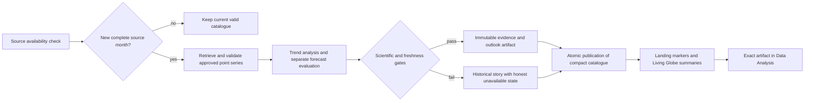

# Forecast discovery and monthly outlooks — proposal for review

Implementation update: [FORECASTS.md](FORECASTS.md) documents the now-implemented future-weather forecast flow and offline regional ML experiment. Monthly statistical outlooks remain a separate proposal. River-flow access is deferred by the user's explicit EWDS decision.

Status: monthly-outlook proposal retained for later scientific review. The user subsequently authorized a bounded disaster-awareness implementation focused on the Nepal September 2024 floods and Cyclone Ditwah in Sri Lanka. See [DISASTER_EVIDENCE.md](DISASTER_EVIDENCE.md) for that increment's implemented scope, real provider checks and limitations. Monthly statistical forecasting, operational warnings and scheduled analysis are not implemented by that increment. This exploration supplements the existing design; it does not amend approved requirements.

## Recommendation

Build two connected products: **featured historical investigations** and **experimental monthly statistical outlooks**. NASA historical/reanalysis variables remain the scientific foundation. A forecasting service would produce Iris forecasts *using* those inputs; these would not be presented as official NASA forecasts.

ML is optional. Start with seasonal-naive and calendar-month climatology baselines, plus a small candidate set such as seasonal ETS and constrained seasonal ARIMA. The proposed implementation library is the open-source, CPU-based [StatsForecast](https://github.com/Nixtla/statsforecast) (Apache-2.0); review/pin its dependency changes before implementation. Existing NumPy/pandas/SciPy remain useful, with an independent statsmodels reference for numerical verification. No GPU, model API key, LLM forecast generation or neural-model training is needed for this first experiment.

Initial scope should be **monthly T2M at one approved sample point**, evaluating leads of one, two and three months. Admit a lead only after it independently passes the declared checks. Expand to a small set of point investigations after feasibility is demonstrated. A temperature model does not automatically qualify precipitation, snow depth or bounded soil-wetness variables; each has different distributions, constraints and scientific meaning.

## What the repository supports today

Confirmed by reading current code:

- `backend/services/science_pipeline.py` already calculates an Outlook. It creates trend-continuation points and conditionally exposes three annual future points.
- Its backtest uses approximately the first 78% of complete annual means for training and the final block for testing, comparing a Theil–Sen annual fit with a constant training-mean baseline. The gate also depends on the historical Mann–Kendall p-value.
- Its published future central values instead start from the **last valid monthly value** plus the full-record deseasonalized slope. These are not the same prediction rule or temporal support as the annual model evaluated by the holdout.
- The displayed short-term range uses `±1.96 × holdout RMSE`; it is not demonstrated to be a calibrated, horizon-specific prediction interval. Trend-slope confidence bounds in the continuation section are also not future-observation prediction intervals.
- The model-selection/validation evidence is therefore insufficient to promote these outputs as trustworthy public forecasts. A historical p-value does not establish forecasting skill. This proposal calls for an explicit scientific revision, not a new presentation label on the existing numbers.
- `src/features/landing/CobeGlobe.tsx` already has six illustrative study spots, front-facing anchor labels, keyboard links and reduced-motion/fallback behaviour. Its current links prefill a location in Living Globe. It does not carry validated forecasts or significance claims.
- Living Globe displays authentic bounded NASA historical spatial fields. That is not yet a gridded forecast capability. A point-series extraction remains a point sample even when named after a region.
- Data Analysis already owns Outlook. Keep the full forecast detail there; do not reintroduce the removed Outlook tab on Plot & Visualize.

## The proposed user journey

1. **Landing globe — “Earth stories.”** Feature three to six curated, source-backed investigations. A marker can represent a historical trend, a seasonal pattern or an eligible outlook. Avoid “the most significant places on Earth”: a small curated scan cannot support that claim.
2. **Select a marker.** Pause rotation while the story is inspected. Show location/support, variable/units, observed period, data cutoff, forecast valid period when eligible, and a short evidence-based summary. Provide the same choices as an accessible list, so hover, WebGL and globe position are never required.
3. **Open the same investigation in the workspace.** A structured `insightId` resolves the exact source/result/model artifact. A proposed route is `/workspace/data-analysis?insightId=...&mode=outlook`. Add route handling during implementation; it does not exist yet. Do not regenerate the analysis from a natural-language prompt.
4. **Prefill the question as optional context.** Example: “Inspect monthly temperature at this sample point and evaluate a three-month outlook against the seasonal baseline.” SI can explain or extend that investigation, but the structured artifact is authoritative. Opening an existing published artifact does not trigger a model run.
5. **Data Analysis → Outlook.** Show observed values, a clearly separated forecast origin, a short forecast path and future-value prediction ranges. Display method, baseline errors, test sample sizes, empirical coverage, issue time, valid dates and source lineage. A user-requested new analysis runs explicitly, using the existing extraction workflow and a bounded job.
6. **Living Globe — point outlook inspector.** Keep historical layers as the default. An optional Outlook marker layer reveals eligible *points* and links to Data Analysis. No smooth global prediction heatmap may be constructed from these points. A continuous future layer is a separate proposal requiring a genuine gridded forecast product and its own validation.

### Visual approach

- Use COBE as a lightweight discovery/navigation illustration, with compact labelled story markers. Retain its accessibility, occlusion, performance and reduced-motion safeguards.
- Use the existing ECharts renderer for the forecast detail: solid historical line, dashed future line, visible cutoff, and subtle nested nominal 80%/95% prediction bands. Show exact units and calendar dates. Labels and line styles must carry meaning alongside colour.
- Give the forecast origin, selected future month and uncertainty range stronger visual emphasis than decorative scores. Show freshness and validation states without suggesting certainty.
- Keep a detailed model card under an expandable section. Explain that a slope interval estimates historical rate uncertainty, while a forecast interval describes uncertain future values.
- Creative depth belongs primarily in the landing globe, transitions and optional scene presentation. The default numerical forecast view should stay a readable 2D chart. A later 3D future-month/ribbon view must preserve the same values and units, identify predictions separately from observations, and never imply calibrated ensemble probabilities that the model does not supply.
- Support three honest states: **eligible experimental outlook**, **forecast withheld because added skill was not demonstrated**, and **current outlook unavailable because the input is stale**. Historical evidence remains useful in each state. A seasonal reference may be offered separately with its baseline identity and limits clearly labelled.

## Scientific feasibility and release checks

The following are proposed initial policies, not universal scientific guarantees. H3 must approve the numerical thresholds and protocols before publication.

1. **Input admission.** Verify NASA product/parameter, units, time standard, cadence, spatial support, QA, timestamps, coverage and provenance. Do not mix API-community units with direct-Zarr units. Use a regular monthly calendar; never silently replace absent or flagged data with zero. For the first model family, require a sufficiently long contiguous recent training window rather than introducing unvalidated imputation. A candidate starting policy is ten years of history with a usable five-year recent window; eligibility and validation support may require more.
2. **Freshness and real calendar lead time.** Record the last complete source month separately from retrieval time. Forecast targets are anchored to that month, not shifted to today's date. If the source is old, either refresh and validate it or label the result as a historical experiment. The gap from data cutoff to a present/future target counts toward the evaluated lead; a three-month model cannot bridge an untested year-long gap. Check availability for this exact product and endpoint; daily-provider latency does not prove the selected monthly product is complete.
3. **Same prediction rule in testing and publication.** Backtest precisely the model, aggregation, units, forecast horizons and fitting procedure used for published outputs. Remove the current annual-test/monthly-anchor mismatch.
4. **Chronological evaluation.** Use rolling forecast origins with training data strictly before each target. Fit transformations, seasonal references and tuning inside each training fold. Reserve a final chronological test period that is not used to choose models, thresholds or headlines. Account for overlapping targets and serial dependence when expressing uncertainty in performance estimates.
5. **Compare appropriate baselines.** At minimum, same-month-last-year seasonal naive and training-only calendar-month climatology; add persistence when relevant. Compare errors on exactly the same eligible target timestamps. Use MAE and RMSE by lead time, a clearly defined relative skill score, and honest sample sizes. Avoid MAPE for values near zero and temperatures measured in Celsius.
6. **Publication gate.** Predeclare the skill improvement required over the strongest baseline. A candidate engineering starting point is a 5% relative error improvement plus adequate validation support and stable performance, but this threshold must be reviewed and cannot be derived from the historical trend's p-value. A model that fails should not receive a reassuring “AI forecast” badge. Do not select a model on the final test set and then advertise that same test score as independent evidence.
7. **Prediction intervals.** Evaluate nominal ranges separately at each lead using held-out coverage, interval width and an interval scoring rule. Model-based or calibrated intervals are candidates; time dependence and nonstationarity limit simple conformal/exchangeability guarantees. Show measured coverage as counts/periods when sample size is small. Never call `±1.96 × RMSE` a calibrated 95% interval by assumption. If bounds are not scientifically defensible, do not publish probabilistic claims or decorative confidence fans.
8. **Variable constraints.** Forecast precipitation rates in the declared units, not automatically monthly totals; do not forecast negative precipitation or unconstrained wetness outside its domain. Any transform must be fitted per training fold and invert correctly for central values and intervals. Start with temperature rather than quietly clamping invalid outputs from a generic model.
9. **Reproducibility.** Keep source artifact SHA-256, exact sample/region support, source version, data cutoff, QA policy, training/calibration/test splits, model configuration/version, dependencies, random seeds where used, baselines and evaluation outputs. Do not identify an Iris statistical output as an official NASA forecast.
10. **Independent checks.** Compare seasonal-naive predictions with hand calculations; compare candidate model outputs with an independent implementation on reproducible inputs. Test missing months, all-missing/constant records, insufficient years, stale cutoffs, mismatched units, failed provider access, interval ordering and withheld states. Passing software tests alone does not establish scientific usefulness.

Historical trend significance and forecast skill are separate dimensions. For a featured trend catalogue, predefine the family of locations, variables, periods and methods; review multiple-comparison correction across that family. Do not reuse the current per-case q-value as a catalogue-wide correction. Rank eligible stories by data quality, supported effect size within comparable units, uncertainty, freshness, relevance and geographic diversity; never by the smallest p-value alone. Describe the scan's actual coverage.

## Refresh strategy — no constant analysis

The landing page should read a small **published insight catalogue**, not run forecasts for every visitor or train over the globe.

For the local build, begin with a manually invoked refresh job. A later local scheduler may check for new data daily while the machine is running, and recompute only when the admitted source/config/model version changes. Monthly inputs do not require continuous retraining. An online schedule is a later hosting decision, not something the local laptop can promise while switched off.

Keep the last good artifact on provider failure, label its cutoff and evaluation date, and remove a “current forecast” badge when its valid period/freshness policy expires. Never silently extend an expired forecast. Cache by source hash, variable, support, cadence, model version, protocol and horizon; serve immutable artifacts with a small latest-manifest pointer updated atomically. Use locks and a bounded worker pool; publish no partially written outputs.

## Proposed technical additions

These are additive design proposals requiring approval before implementation:

| Area | Proposed responsibility |
| --- | --- |
| `backend/forecasting/` | Source admission, model adapters, rolling evaluation, interval validation, release gate and immutable artifacts |
| Insight catalogue publisher | Combine reviewed historical stories and eligible outlooks; track stale/withheld states and refresh policy |
| `GET /api/v1/insights/featured` | Read only a compact published manifest with provenance and freshness; no model execution |
| `GET /api/v1/insights/{id}` | Resolve the exact immutable historical/forecast artifact for navigation and reproducibility |
| Bounded forecast job endpoint | Explicit user-requested forecasts and status, using validated inputs and server-side allowlists; no arbitrary user code/model URLs |
| Existing landing `CobeGlobe` | Cached insight-marker summaries and accessible links keyed by immutable insight IDs |
| Existing Data Analysis Outlook | Reuse the full-detail location for the new evaluated result contract; retire or clearly quarantine the old annual/monthly-mismatched outputs |
| Living Globe inspector | Small point-outlook summary and link to the same artifact, separate from observed spatial rasters |

The forecast result contract must distinguish source/observation origin from model output: `insight_id`, `source_job_id`, input product/variable/unit, point or region support, `input_data_through`, `issued_at`, `target_timestamps`, `lead_from_cutoff`, model/protocol versions, point estimates, named quantile bounds when validated, per-lead test errors/coverage/sample counts, baseline identity, gate state/reasons, expiry policy and source/output hashes. A short narrative or prefilled SI prompt is derived context, not the source of forecast numbers.

Use the current modular Python backend, existing frontend chart stack and local artifact storage first. Do not add microservices, streaming infrastructure, a GPU service or a second chart engine for this feature. All credentials stay server-side if a protected provider is introduced later. The planning work and a public NASA POWER/CPU-model feasibility experiment do not require new user credentials.

## Implementation sequence after approval

1. **Feasibility first:** audit/quarantine the legacy Outlook mismatch, admit one recent authentic T2M point record, define the temporal protocol and benchmark baselines/candidates. Deliver a reproducible model-versus-baseline report. A valid result may be “no demonstrated added skill.”
2. **Reproducible forecast result:** implement one horizon, validation/gating, future-value intervals if justified and unavailable/stale states. Verify independently; ask H3 to review scientific interpretation before promotion.
3. **Data Analysis detail:** implement the approved fan view/model card using the genuine result. Extend to leads two/three only if supported. Keep the removed duplicate Outlook tab out of Visualize.
4. **Landing discovery:** publish three to six curated investigations, add accessible cached globe markers and structured deep-link handoff. Initially run catalogue refresh manually.
5. **Living Globe summary and refresh reliability:** add point markers/inspector, atomic publication, freshness expiry and failure recovery. Add scheduling after manual refresh is reliable.
6. **Later proposals:** additional scientifically eligible variables, a genuine operational gridded forecast source, carefully validated ML/exogenous models or optional 3D prediction presentations. These are not part of the first forecast milestone.

## Decisions and blockers

- Confirmed: monthly Earth-system outlooks are preferred to short-range weather forecasts.
- Proposed: first variable T2M; first display uses a 2D fan chart and model card, with globe-based discovery and point summaries.
- Still needed before implementation: final sample points, accepted input product/time standard and freshness policy, scientific owner approval of the evaluation/interval/publication protocol, and dependency approval for the selected forecasting implementation.
- Unknown until tested: whether any candidate offers useful out-of-sample skill for the selected point/lead, whether sufficiently recent complete monthly input is available through the chosen endpoint, and whether enough independent validation support exists for the advertised uncertainty ranges.
- Meteomatics is a separate possible future source of operational forecasts. Its API supports forecast models/ensembles, but current account entitlements, duration, redistribution, limits and exact products must be checked. It is not needed for this monthly NASA-based first experiment, and its outputs would remain separately attributed.

## Preview artefacts

The interactive proposal and static views are in `artifacts/design/forecast-exploration/`. They are design-only and are deliberately outside application code. **Every numeric value, validation metric and eligibility state is simulated. No actual forecast or NASA-derived finding is claimed.** The geographic basemap is published Natural Earth geometry projected with D3; positions correspond to the existing study-point coordinates, not region averages.

- `forecast-journey.html`: self-contained interactive proposal; choose a site and explore landing, Data Analysis and Living Globe concepts.
- `preview.html`: local browser inspection wrapper.
- `landing-globe.png`, `forecast-workspace.png`, `living-globe.png`, `forecast-withheld.png`: intended review screenshots generated from that proposal.
- `geometry.json`: geometry source, projection, projected pin coordinates and counts.

Review images: [landing globe](../artifacts/design/forecast-exploration/landing-globe.png), [forecast detail](../artifacts/design/forecast-exploration/forecast-workspace.png), [Living Globe](../artifacts/design/forecast-exploration/living-globe.png), and [withheld forecast](../artifacts/design/forecast-exploration/forecast-withheld.png).

Prototype verification: desktop and mobile layouts, marker selection, landing-to-workspace handoff, horizon changes, insufficient-skill and stale-source states were exercised in a browser. No client/console errors or application API requests were recorded. This verifies only the proposal's interactions and drawing; no forecasting model was trained or scientifically validated during planning.

## Primary references

- [StatsForecast source and licence](https://github.com/Nixtla/statsforecast): statistical models, baselines and prediction-interval support.
- [StatsForecast temporal cross-validation](https://nixtlaverse.nixtla.io/statsforecast/docs/tutorials/crossvalidation.html): sliding/rolling evaluation.
- [StatsForecast conformal prediction](https://nixtlaverse.nixtla.io/statsforecast/docs/tutorials/conformalprediction.html): possible calibration tooling, not an unconditional Earth-system coverage guarantee.
- [NASA POWER data FAQs](https://power.larc.nasa.gov/docs/faqs/data/): input-source descriptions and community/API versus direct-store unit cautions; availability must be checked for the selected monthly endpoint.
- [ECMWF seasonal forecasts](https://www.ecmwf.int/en/forecasts/documentation-and-support/seasonal): authoritative forecast-product context, including model-climatology anomalies and probabilities. No ECMWF data integration is proposed for the first milestone.
- [Meteomatics model selection](https://www.meteomatics.com/en/api/request/optional-parameters/data-source/): possible separate operational forecast-provider route.
- [Published world atlas](https://esm.sh/@d3-maps/atlas@1.0.0/world/countries/countries-110m): prototype geography only.
