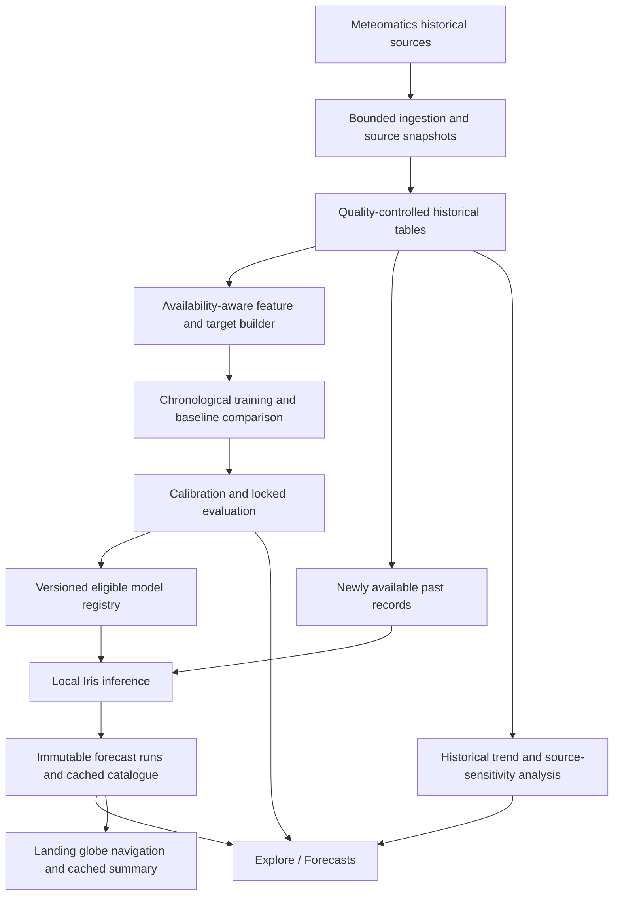

# Implementation handoff: Meteomatics historical records → Iris ML forecasts and trend analysis

Prepared: 15 November 2026. This is an implementation specification for the next coding model. Preparing this document does not implement the system, download historical records, or train a model.

## 1. Instructions to the implementing model

Implement the complete workflow below in the existing Iris repository. Meteomatics must supply historical weather records; Iris must train and run its own forecasting models on those records. The new workflow must not fetch Meteomatics future predictions, use provider forecast values as features, or relabel provider forecasts as Iris predictions.

Keep all new interfaces in **Explore → Forecasts**, at `/workspace/forecasts`. Include historical data management, preparation, training status, model forecasts, evaluation, explanations, trend analysis, and exports there. Keep landing-globe navigation connected to this section. Do not add these workflows to Data Selection, Data Preview, Data Analysis, System Intelligence, Living Globe, or case studies.

Read repository instructions, inspect the current checkout and user changes, then implement in the dependency order in section 16. Preserve unrelated work. Complete all feasible software work and report actual results. If account access, source coverage, or scientific validation prevents a trained model from being published, leave a working pipeline and an explicit unavailable/candidate state with the precise reason. Do not substitute example records, invented metrics, or a provider forecast.

Treat model quality as an empirical outcome. Success means a reproducible, honestly evaluated implementation; it does not mean manufacturing an accuracy target.

## 2. Product scope and defaults

Use these defaults unless repository evidence or the user supplies a different requirement. Put them in a versioned configuration rather than burying them in code.

| Decision | Initial implementation |
| --- | --- |
| Primary prediction | Precipitation accumulation, in millimetres, over each of three future 24-hour windows |
| Training inputs | Past weather records obtained through Meteomatics only |
| Future provider inputs | Prohibited in this workflow, including archived provider forecasts used as predictor columns |
| Initial pilot | Colombo, followed by each eligible location in the existing six-point registry |
| Long history | Request 1991 through the latest available complete period where entitled and suitable; prefer 30+ years for climate trend context |
| Operational records | Recent measured station records, or another explicitly verified historical observational product available through Meteomatics |
| Historical reference candidate | Explicit-source `ecmwf-era5`; evaluate observational rainfall products where entitled and appropriate |
| ML approach | CPU gradient boosting with lagged historical features, direct forecasts by window, and predictive quantiles |
| Forecast schedule | Initially daily; publish an explicit valid window and actual input age |
| Forecast display | Three predicted 24-hour blocks, uncertainty, input freshness, model status, and links to supporting historical evidence |
| Trend analysis | Historical seasonal/annual changes, effect sizes, uncertainty, corrected significance, and source sensitivity |
| Spatial scope | Configured points or explicitly mapped stations/cells; no regional surface inferred from six points |

Temperature, humidity, pressure, and wind are candidate historical predictors. Additional forecast targets are extensions after the rainfall pipeline is evaluated. Subdaily rainfall prediction is an extension requiring suitable subdaily records and its own validation. Do not retain a three-hour chart by inventing three-hour values from daily predictions.

Define the three forecast blocks as `[s, s+24h)`, `[s+24h, s+48h)`, and `[s+48h, s+72h)`, where `s` is an explicit scheduled future boundary in UTC. Record actual issue time separately. Display actual lead hours relative to issue time; a 72-hour valid window does not necessarily begin immediately. Ensure publication occurs before the first block starts. If the job misses its boundary, recompute for the next permitted boundary instead of silently publishing partly historical targets.

Keep UTC as the canonical aggregation clock. Local time is a display preference. Do not redefine a 24-hour accumulation as a local calendar day during daylight-saving transitions.

## 3. Existing repository context

The current code publishes raw ECMWF ensemble forecasts supplied by Meteomatics. Its learning experiment corrects provider quantiles; it does not implement the history-only forecasting requested here.

| Existing file | Current role and required action |
| --- | --- |
| `shared/forecast-regions.json` | Six configured points and timezones; retain identifiers and audit station/cell mappings |
| `src/app/workspace/forecasts/page.tsx` | Dedicated Forecasts route; keep as the sole entry for new workflows |
| `src/app/workspace/layout.tsx` | Explore navigation and workspace context; retain Forecasts navigation and remove ensemble-specific context for the new mode |
| `src/features/forecasts/ForecastWorkspace.tsx` | Current forecast UI; refactor into the new Forecasts workspace |
| `src/features/forecasts/model.ts` | Current runtime contract assumes `ecmwf-ens`, 51 members, three-hour intervals, and no Iris ML; introduce separate versioned contracts |
| `src/features/forecasts/useCatalogue.ts` | Landing catalogue reader; update the catalogue to reflect published Iris model forecasts and availability |
| `src/features/landing/CobeGlobe.tsx` | Landing links/cards; preserve location and run navigation, update summaries to the new actual output |
| `src/app/api/v1/forecasts/[...path]/route.ts` | Allowlisted Next.js proxy; extend deliberately for the new endpoints and methods |
| `backend/forecasts/weather.py` | Current future-ensemble downloader; disconnect from the new production path |
| `backend/forecasts/service.py` | Current provider refresh loop; replace its forecast publication behavior with historical ingestion and local inference jobs |
| `backend/forecasts/learning.py` | Existing provider-quantile correction experiment; keep as legacy or replace under an explicit contract migration, not by accepting its incompatible feature schema |
| `backend/forecasts/store.py` | SQLite current catalogue and retained runs; migrate without reinterpreting old artifacts |
| `backend/forecasts/router.py` | API boundary; add typed historical-data, job, model, inference, evaluation, and trend endpoints |
| `backend/hazards/meteomatics.py` | Existing server credential loader and bounded transport patterns; reuse carefully without changing hazard behavior |
| `backend/services/science_pipeline.py` | Existing trend statistics; reuse audited numerical functions through adapters, not its NASA-specific caveats or old job assumptions |
| `backend/visualization_app.py` | Forecast router/lifespan integration; preserve existing application lifespan and shutdown behavior |
| `tests/visualization/` and `backend/forecasts/tests/` | Existing tests and fixtures; retain regression coverage and add tests for the new contracts |

The existing Meteomatics credential loader reads environment variables and `backend/.env`. Keep credentials server-side. Do not put credentials into URLs, browser bundles, exports, job logs, or test traces.

## 4. Select the best historical data for each role

There is no universal source that is best for every variable, location, time scale, and purpose. Implement a documented source-selection experiment rather than choosing the highest advertised spatial resolution.

Meteomatics documents `ecmwf-era5` as a global reanalysis source and lists `chc-chirps3` as a daily rainfall-history candidate. It also documents `mix-obs` for station observations. Availability under this account and suitability at each point remain unverified. Use the explicit source identifier supported by a tested request. [Meteomatics source catalogue](https://www.meteomatics.com/en/api/request/optional-parameters/data-source/)

Use three source roles:

1. **Long-term context:** a stable, named historical source for seasonal patterns and long-term trends. ERA5 is the initial multivariate candidate. Preserve the distinction between reanalysis estimates and direct measurements.
2. **Forecast predictors:** past records that would actually have been available before each issue time, including the latest observations when entitled. Use a consistent station or cell mapping.
3. **Verification target:** later-arriving records of the outcome for the declared point/station/cell. A model scored against reanalysis has demonstrated agreement with that reference, not automatically accuracy against measured rainfall.

For rainfall, compare an eligible station record with the reanalysis and other entitled historical rainfall products on their overlapping development period. Report completeness, wet-day frequency, seasonal totals, bias, error, high-quantile behavior, continuity, and spatial representativeness. A station used in source production is not automatically an independent verification source; document known dependencies.

The source catalogue describes CHIRPS v3 daily values as a partition of longer-period rainfall totals using ERA5. Account for that dependency when testing daily extremes or claiming independent verification; it is not an hourly rainfall source. [CHIRPS source description](https://www.meteomatics.com/en/api/request/optional-parameters/data-source/)

Meteomatics' automatic `mix` may select different underlying sources over time. Do not use an unidentified changing mix as the primary climate-trend series. Fix source and processing options, retain their identity, and flag discontinuities. Station queries should use a stable station ID rather than assuming a coordinate query always resolves to the same station. The documented station workflow supports `mix-obs` and `temporal_interpolation=none`; verify that behavior with sample responses. [Station documentation](https://www.meteomatics.com/en/api/request/advanced-requests/api-request-weather-station-mos-data/), [Meteomatics FAQ](https://www.meteomatics.com/en/api/faq/)

Do not treat downscaled output spacing as independent measurement density or demonstrated local rainfall accuracy. Prefer reproducible, locally evaluated data over a marketing claim about resolution.

### Availability is part of the model design

ERA5T is released about five days behind real time, while final ERA5 follows later. Meteomatics' delivery and revision behavior must be measured separately. A model trained using yesterday's finalized reanalysis as though it were available yesterday would have invalid operational backtests. [ECMWF release timing](https://www.ecmwf.int/en/about/media-centre/news/2026/era5t-reanalysis-data)

Implement two clearly distinguished modes:

- **Operational history-only forecasting:** predict future targets from source vintages and observations available by issue time. Delayed reanalysis features may only use sufficiently old lags. Train, calibrate, and test with the same latency constraints.
- **Retrospective research:** finalized historical records can support exploratory prediction experiments and trend analysis. Label retrospective scores explicitly. They cannot establish live forecast skill when historical input availability is unknown.

Do not silently bridge a recent reanalysis gap with provider forecasts. If suitable recent observations are unavailable, evaluate a genuinely delayed-input history-only model or withhold operational predictions. Report which route was attempted and why it passed or failed.

## 5. Source capability discovery and pilot

Build a bounded discovery command and status report before bulk downloading.

For each source, variable, location, and time resolution:

1. Check credentials, source entitlement, historical date bounds, and supported parameters.
2. Use the documented metadata route where applicable: `/get_time_range?source=<source>&parameters=<parameters>`. Treat this as an availability hint, then verify with small actual requests. [Meteomatics metadata API](https://www.meteomatics.com/en/api/request/meta-requests/)
3. Query representative historical, recent, wet-season, and dry-season samples.
4. Discover and freeze eligible station IDs, returned coordinates, station distance/elevation where available, and parameter coverage.
5. Verify accumulation semantics, timestamp convention, missing-value handling, interpolation, calibration options, and response limits. The initial hourly rainfall candidate is `precip_1h:mm`; confirm source support rather than assuming every product provides it.
6. Record observed ingestion latency and whether historical publication/vintage metadata exists.
7. Estimate total values, response volume, request count, runtime, storage, and account quota impact before queuing a backfill. Metadata endpoints may count toward account limits.
8. Check the account's applicable storage, model-training, and redistribution permissions; document restrictions without assuming public documentation establishes account-specific rights.

Persist a machine-readable capability report and a readable source-selection report inside Forecasts. Missing access must name the unavailable source/parameter/date span, not merely say "training failed".

Start with a genuine Colombo sample. Freeze the source policy using development data. Do not select sources by comparing them on the final locked test period.

## 6. Architecture and storage



Use the existing Python/FastAPI, pandas, NumPy, SciPy, statsmodels, and scikit-learn stack. Use Parquet for historical tables if its measured benefits justify adding a pinned Parquet engine. SQLite remains appropriate for local job, manifest, model, and publication metadata. Avoid introducing a distributed queue or GPU framework for the initial six-point implementation.

Suggested package structure; adapt names to existing conventions:

```text
backend/forecasts/
  historical/           # capability discovery, transport, normalization, source policy
  datasets/             # QA, immutable manifests, feature/target construction
  ml/                   # baselines, fitting, calibration, evaluation, explanations
  trends/               # aggregation, statistical adapters, robustness, reports
  jobs.py               # durable jobs, progress, resume, cancellation
  registry.py           # candidate/eligible/active model metadata
  inference.py          # history-only feature loading and local predictions
  schemas.py            # explicit v2 contracts
  service.py            # scheduling and publication
  router.py             # API contracts
  cli.py                # reproducible administrative operations
  tests/

artifacts/runtime/forecasts/
  historical/raw/       # bounded, sanitized source snapshots with hashes
  historical/curated/   # canonical, partitioned historical records
  datasets/             # frozen manifests and reproducible feature datasets
  models/               # model bundles, preprocessing, evaluation, model cards
  reports/              # trends, source comparisons, calibration, explanations
  catalogue.sqlite3    # jobs, revisions, model state, current and archived runs
```

Ingestion requirements:

- Chunk by a tested time span and modest parameter/location batches. Use checkpoints and content hashes; resume without redownloading completed chunks.
- Separate historical backfill budgets from normal refresh budgets while respecting one shared account-wide request budget.
- Bound concurrency, response size, retries, disk use, and training memory. Honor rate-limit responses and `Retry-After`; use backoff and jitter.
- Distinguish unavailable data from transport failures. Retry transient errors; do not repeatedly retry invalid credentials or unsupported parameters.
- Preserve immutable normalized revisions. Never overwrite a dataset used by an archived model when revised history arrives.
- Retain only required source fields. Sanitize account-bearing response metadata before persistence and distinguish original response hashes from sanitized artifact hashes.
- Serialize non-thread-safe source libraries when applicable, write atomically, and recover jobs safely after restart.
- Existing library/model artifacts must only be loaded from trusted local registry entries whose hashes match; do not load user-supplied pickle/joblib files.

## 7. Canonical data and provenance contracts

Use typed Python and TypeScript contracts with runtime validation. Preserve both event time and information availability.

| Artifact | Required fields |
| --- | --- |
| Historical record | `location_id`, source/station/cell ID, requested and returned coordinates, variable, unit, `interval_start`, `interval_end`, `value`, quality flags, source version/options, spatial support, publication/availability metadata, revision, source artifact hash |
| Dataset manifest | Dataset ID/hash, source-role policy, date coverage, variables, aggregation definition, record counts, completeness, excluded spans, station mappings, feature schema, QA report, transform/code versions |
| Feature row | Location, scheduled target origin, simulated/actual issue time, feature values, each source cutoff, `max_input_available_at`, availability verification mode, target window, feature artifact hashes |
| Training run | Config, dataset hash, feature schema, code commit, seeds, dependencies, folds, source selection, preprocessing, baselines, fitted models, calibration artifact, metrics, model hash, status/reasons |
| Forecast run | `schema_version=iris.ml-forecast.v2`, run ID, model ID/hash, dataset revision, `issued_at`, target windows, `input_cutoff`, latest observation time, input age, validity/expiry, target support, units, predictions, uncertainty method, evaluation reference |
| Trend report | Source/dataset ID, variable/index, aggregation, period, valid count, coverage, slope and unit, interval and method, test name, raw p, adjusted q, hypothesis-family ID, diagnostics, limitations |

For records with unknown original publication time, store it as unknown. `retrieved_at` means when Iris downloaded the record; it is not proof that the value was available at a historical issue time. Store the origin of availability estimates and conservative latency assumptions.

Enforce these invariants:

- Features contain no record available after issue time.
- Targets occupy explicit future intervals; target labels enter training only after their outcomes would have been available at that training cutoff.
- Station identity, units, spatial support, temporal support, source options, and preprocessing match the model's declared contract.
- Finalized reanalysis revisions are not silently used as initial-release historical inputs in an operational backtest.
- Missing and sentinel values remain distinct from valid zero rainfall. Preserve `-666`, `-777`, `-888`, and `-999` handling where supported by actual provider responses.
- Duplicate, out-of-order, nonfinite, and impossible values are rejected or quarantined with reasons.
- Never convert a precipitation rate into an accumulation without a documented integration interval. Do not sum overlapping accumulations.
- Only complete target windows enter supervised training. An incomplete daily sum must not be represented as a full day's rainfall. Predictor missingness may use model-supported handling with indicators and a declared policy.
- Forecast quantiles are finite, nonnegative, and ordered. The v2 contract contains no fictitious 51-member ensemble.

Keep the v1 provider-ensemble parser and old archive records explicitly separate from v2. Return an explicit legacy status or compatibility response for pinned old links. Never change old run contents to pretend they were ML outputs.

## 8. Data preparation and features

Build one deterministic feature pipeline shared by training and inference.

For daily-window models, candidate features include:

- Past precipitation lags at 1, 2, 3, 7, 14, and 28 days, subject to actual source latency.
- Trailing rainfall totals and variability over 3, 7, 14, 30, and 90 days.
- Wet-day frequency, dry-spell length, and recent maxima from complete trailing records.
- Historical temperature, humidity/dew point, pressure, wind components, and their trailing changes where supported and available.
- Cyclic calendar features and a training-only seasonal climatology.
- Explicit input age, quality, missingness, and source identity where the model design permits them.
- Optional nearby-point historical predictors only after a cost/skill experiment and explicit spatial-support contract.

All windows must trail the permitted information cutoff. Fit imputation, scaling, climatology, anomaly normalization, source bridging, and feature selection on the training fold only. Calendar features for a future target are known in advance; future weather values are not.

Do not let a whole-record STL smoother, centered rolling mean, future-filled gap, globally selected change point, or final full-history trend become a predictive feature. Predictive trend features must be calculated causally inside each fold. Full-record trend analysis remains a separate retrospective output.

Add redundant-feature and ablation reports. Compare short-history and longer-history training windows because a longer record can improve seasonal context while also reflecting changing climate, source systems, and station operations.

## 9. Model candidates and uncertainty

Train one direct model per future 24-hour block initially. Compare local models for eligible points; add a pooled multi-location candidate only when it improves valid development scores without hiding weak locations.

Required baselines:

1. Seasonal climatology computed only from the training period, including its historical distribution.
2. Persistence and a recent moving-history baseline when the needed observations are available under the same latency policy.
3. A simple regularized autoregression or seasonal statistical model using the same permitted inputs.

The initial ML candidate uses `HistGradientBoostingRegressor` for median and 0.1/0.9 quantiles. Keep preprocessing and fitted parameters in the bundle. Tune a small, bounded search on chronological development folds. Disable random internal early-stopping splits; use an explicit chronological validation period or choose iterations within temporal CV. scikit-learn documents both lagged-feature forecasting and the time-series limitation of default internal early stopping. [Lagged forecasting example](https://scikit-learn.org/stable/auto_examples/applications/plot_time_series_lagged_features.html), [Histogram boosting guidance](https://scikit-learn.org/stable/auto_examples/ensemble/plot_hgbt_regression.html)

Rainfall has many zeros and a skewed wet tail. Compare a two-part wet/dry-plus-amount model if direct quantiles do not perform adequately. Define the wet-day threshold in the configuration and disclose it. If a mixture model is used, derive its quantiles from the mixture distribution; multiplying a wet-amount quantile by a wet probability is not generally a valid mixture quantile.

Use a dedicated chronological calibration period for prediction-interval adjustment and any probability calibration. Evaluate empirical coverage, width, and interval score by location, horizon, season, and wet/dry conditions. Temporal dependence and distribution shift limit generic conformal guarantees; describe the implemented method and measured coverage without claiming universal validity.

If quantile crossing occurs, apply a documented monotonic rearrangement or other validated correction and evaluate the final published output. Record its impact. Do not estimate calibrated exceedance probabilities from only three quantiles; train/evaluate an appropriate probabilistic model or omit that control.

The UI may display each predicted 24-hour block. For 48/72-hour total quantiles, train and validate explicit cumulative-target models or a joint trajectory model. Never sum marginal quantiles. Do not calculate a moving wettest 24-hour window from daily-only outputs. Do not fabricate member curves by adding noise to quantiles.

Large LSTM/Transformer/global-weather models are not the default for a six-location dataset. Add complexity only after a reproducible skill and resource comparison justifies it. External pretrained forecasting systems are outside this history-only Iris-model implementation unless the user expands scope.

## 10. Chronological evaluation and eligibility

Use expanding/rolling-origin development folds, followed by a separate calibration block and an untouched final test block. All locations must share chronological cutoffs in pooled experiments. Remove training samples whose target windows or label-availability times cross the next evaluation origin. Use an embargo at least sufficient for the maximum target span and actual label publication delay. Overlapping targets within the scored period require dependence-aware uncertainty estimates; they do not create independent samples.

For a sufficiently complete record, an initial example is training through 2018, development through 2021, calibration during 2022, and a locked 2023–2024 test. This is an example, not permission to invent those years of available data. Derive actual dates from coverage, freeze them before model selection, and reserve 2025 onward for genuinely prospective evaluation where possible. A model trained later using revised records is not a time-travel production model; describe retrospective and prospective evidence separately.

For each location and horizon report:

- MAE, RMSE, mean bias, and skill relative to each relevant baseline.
- Pinball loss at each published quantile, interval coverage, interval width, and interval score.
- Brier score and reliability for any published occurrence probability.
- Wet-day and season-specific error, upper-tail performance, event counts, and missing-input sensitivity.
- Sample sizes, effective dependence considerations, and time-block bootstrap confidence intervals for differences versus baselines.

Avoid MAPE for rainfall because true zero values make it unsuitable. Do not use a single aggregate R² or a pooled six-location score as proof of skill.

Initial configurable eligibility policy, explicitly an engineering policy rather than a scientific guarantee:

| Gate | Proposed starting rule |
| --- | --- |
| Provenance | All production source/dataset/model hashes and target support are valid; no synthetic production records |
| Leakage | No known input/label availability violations; operational claims require verified vintages or a documented conservative simulation plus prospective validation |
| Evaluation length | Prefer at least two complete test years and multiple seasonal development folds; otherwise mark evidence limited and block ordinary promotion |
| Accuracy | At least 5% lower combined quantile loss versus the strongest applicable baseline, with median MAE no more than 1% worse |
| Evidence | A dependence-aware confidence interval supports positive skill for the primary score; otherwise candidate/insufficient evidence |
| Intervals | Predeclared empirical coverage and width/interval-score criteria pass; examine zero-heavy seasons rather than blindly applying a generic coverage band |
| Robustness | No material concealed failure at the location/horizon being promoted; insufficient extreme-event samples are disclosed |
| Runtime | Reproducible feature construction, bounded inference, compatible dependencies, and input-freshness checks pass |

Freeze thresholds and test definitions before unlocking final scores. Failed gates must not trigger repeated tuning on the same test set. Promote a new generation against a newly reserved test block or an honestly identified development report.

Maintain `candidate`, `eligible`, `active`, `rejected`, `stale`, and `retired` model states. Eligibility is per location and horizon. Preserve review/promotion controls already present in the application, but do not invent an extra user-approval workflow. Until an eligible model is active, display model availability and historical analysis honestly; do not silently fall back to a provider forecast or relabel a baseline as ML.

## 11. Significant trends and ML explanations

Implement both outputs in Forecasts, using the same versioned historical evidence but different claims.

### Historical trend evidence

Compute source-consistent monthly/seasonal/annual summaries and supported rainfall indices: totals, wet-day counts, wet-day intensity, dry-spell length, and high daily accumulations where temporal resolution and completeness permit. Keep indices and thresholds in a versioned specification. Do not infer hourly extremes from daily data.

For eligible series:

- Show seasonal structure and descriptive decomposition; specify whether it is retrospective.
- Estimate Theil–Sen change rates using actual elapsed time, with explicit units and an interval method that accounts for serial dependence where needed.
- Apply a documented seasonality-aware and autocorrelation-aware trend test. Audit existing Hamed–Rao and Seasonal Kendall functions against independent numerical references before reuse, including missing intervals and ties.
- Define the multiple-testing family before inspecting results: all predeclared location/variable/index tests in the report. Correct raw p-values together, not only those shown in a filtered view. Use BH under justified dependence assumptions, or a more conservative suitable method when those assumptions do not hold. [statsmodels multiple-testing methods](https://www.statsmodels.org/stable/generated/statsmodels.stats.multitest.multipletests.html)
- Show slope, confidence interval, raw p, adjusted q, sample size, period, completeness, method assumptions, and source caveats. Display significance only if the declared corrected threshold and data-quality conditions pass.
- Check sensitivity to period, source, station moves, instrument changes where documented, and source revisions. Mark change-point candidates exploratory unless their significance is assessed under an appropriate dependence-aware procedure.

Require configurable annual/monthly completeness rules. Do not scale partial rainfall totals into full totals by default. Prefer 30+ years of context, and label shorter records as limited; a minimum length alone does not establish validity. If insufficient data or assumptions prevent a valid test, return `not_tested` with reasons instead of `p=1`, `slope=0`, or "no trend".

Do not call a feature "statistically significant" because the ML model assigns high importance to it. Do not label a three-day predicted increase as a significant long-term climate trend. Do not equate statistical significance with large practical effect or causal attribution.

### Model behavior and explanations

Implement held-out grouped/block permutation importance for feature families and ablation experiments across temporal folds. Correlated lag features should not receive misleading individual causal rankings. Add an optional local explanation only if it is supported and validated for the selected estimator; its background data must come from training records.

Each explanation should distinguish historical association, model sensitivity, and measured trend evidence. Include the actual model/run, feature window, input age, comparison period, and evaluation support. Use deterministic templates populated from stored results. Any optional LLM narrative may summarize those fields but must not calculate or invent p-values, causes, probabilities, or forecast values.

Trend features may improve a forecasting candidate, but only through causal fold-specific computation and an ablation showing added skill. Trend analysis remains available even when no forecasting model passes evaluation.

## 12. Forecasts workspace design

Use a single location selector and persistent section navigation inside `/workspace/forecasts`:

| View | Required content |
| --- | --- |
| Overview | Current model availability, forecast windows, median/interval cards, issue time, latest input time, input age, and model/version |
| Historical records | Source selection, history chart, measured-versus-modeled labels, date filters, missingness, source revisions, station/cell map, download/ingestion status |
| Data preparation | Variable coverage, excluded periods, feature descriptions, dataset manifest, availability assumptions, QA problems |
| Training and models | Bounded training controls, job progress/cancel/resume, candidate comparisons, eligibility reasons, model card, active version |
| Forecast details | Three future blocks, valid quantiles/intervals, exact timestamps, model explanations, past forecast runs, export |
| Evaluation | Baselines, rolling-origin scores, test periods, errors by horizon/season, calibration, event sample sizes, prospective results |
| Trends | Seasonal/annual charts, slopes, uncertainty, corrected significance, multiple-test scope, source and period sensitivity |
| Data and model provenance | Source requests without secrets, hashes, processing configuration, model/dataset versions, readable reports and exports |

Keep technical training metadata in details/report views; the overview should answer what is predicted, for when and where, from which inputs, and how well the model has performed.

Remove current ECMWF/51-member labels and incompatible controls from the new active-model view. Replace the ensemble-ribbon explanation with the model's actual quantile/calibration explanation. NASA context is not a training dependency for this workflow; existing unrelated NASA functionality can remain outside it. Preserve legacy data behind clearly identified archive handling if retained.

No training, backfill, or provider download should start because a visitor opens the landing page. The globe reads a cached Iris forecast catalogue. If a point lacks an eligible model, show that status rather than a fabricated rainfall headline. A valid globe run link must open that exact archived model run. Source, history period, aggregation, location, and model selections must clear or replace stale dependent results.

Preserve accessibility, keyboard navigation, dark mode, responsive behavior, understandable empty/error states, and downloadable evidence. Store shareable location/run/view state in validated URL parameters where appropriate.

## 13. API, jobs, and publication

Keep the `/api/v1/forecasts` namespace if convenient, using new explicit payload schema versions. The exact route names may follow repository conventions; the behaviors below are required.

| Endpoint | Behavior |
| --- | --- |
| `GET /capabilities` | History-source access, input freshness, dataset readiness, model/trend availability, and structured reasons |
| `GET /catalogue` | Cached location summaries from active Iris model runs only; no remote retrieval |
| `GET /{id}` | Current published ML run or typed unavailable state; allow exact retained run lookup |
| `GET /{id}/history` | Bounded/paginated historical records with source and support metadata |
| `GET /{id}/datasets` | Immutable dataset versions, QA, and coverage |
| `GET /{id}/models` | Model candidates, evaluation summaries, active state, and model cards |
| `GET /{id}/trends` | Versioned trend report tied to an explicit dataset and hypothesis family |
| `POST /{id}/ingest` | Queue validated historical backfill/update; return job ID, never block until completion |
| `POST /{id}/datasets` | Queue preparation of a frozen dataset from selected historical revisions and a validated configuration |
| `POST /{id}/train` | Queue training against a frozen dataset and versioned config |
| `POST /{id}/trends` | Queue a report for an explicit source, period, index specification, and full hypothesis family |
| `POST /{id}/models/{model_id}/activate` | Activate only a compatible eligible artifact through existing application access/promotion controls |
| `POST /{id}/predict` | Queue or run bounded local inference with an eligible active model |
| `POST /{id}/refresh` | Refresh newly available historical inputs and local inference; never fetch future provider predictions |
| `GET /jobs/{job_id}` | Persisted progress, checkpoints, failure reasons, runtime and resource information |
| `POST /jobs/{job_id}/cancel` | Cooperative cancellation preserving completed artifacts |
| `POST /jobs/{job_id}/retry` | Create a traceable retry/resume attempt using valid checkpoints and the original immutable inputs |
| `GET /runs/{run_id}` | Exact forecast/evaluation artifact metadata and permitted exports |

Register static routes before catch-all identifier routes where required. Validate source IDs, locations, date bounds, pagination, model IDs, methods, and payload sizes. Avoid accepting arbitrary external URLs or filesystem paths from the UI. Reuse application access controls and enforce server-side quotas on expensive mutations. Do not expose administrative training actions to anonymous/public visitors if the site is public.

Use durable jobs with idempotency keys, a bounded worker, and transaction/lease protection against duplicate execution. On restart, recover or explicitly fail interrupted work; do not leave permanent "running" states. Background inference and retraining must be separate operations.

Publish only after feature freshness, model compatibility, and prediction checks pass. Update current-run pointers atomically; retain the last real result with a visible stale state on failure. Distinguish training-dataset age, latest input age, prediction expiry, and model retirement. A model trained last month may still be current if inputs are fresh and monitoring remains satisfactory.

## 14. Scheduling, monitoring, and reproducibility

Use separate schedules for historical updates, forecasting, verification as labels arrive, trend recomputation, and candidate retraining. Set update cadence from observed source latency. Avoid downloading decades of history at every refresh or retraining every time the page loads.

Log structured operational metrics: source latency, missingness, ingestion completeness, quota use, failures, job duration, inference latency, active model, forecast age, and prospective skill. Monitor feature drift and seasonal calibration changes; compare against seasonally appropriate reference windows. Drift alone should not trigger automatic replacement by an unvalidated candidate.

Retain a reproducible model bundle with configuration, code commit, dependency lock, input manifests, split definitions, preprocessing, fitted parameters, calibration, model card, and exact artifact hashes. Record compute environment and random seeds. Determinism is a goal; document unavoidable platform differences and numeric tolerances.

On regression, preserve historical evidence, roll back the active model pointer to a compatible eligible artifact if one exists, or mark predictions unavailable. Do not restore provider forecasts as a hidden fallback.

## 15. Required verification

Use isolated synthetic fixtures for software tests and genuine, clearly identified source records for data/model acceptance. Passing fixture tests is not evidence of weather forecasting skill.

| Test layer | Required cases |
| --- | --- |
| Provider transport | Source selection, metadata parsing, entitlement failure, quota/backoff, response bounds, sample requests, checkpoint resume, no credentials in persisted/public artifacts |
| Historical QA | Sentinels, valid zero rainfall, missing timestamps, duplicates, units, accumulated versus rate values, non-overlapping windows, station/cell identity changes, leap years and timezone display |
| Availability/leakage | A deliberately late record is excluded; revised final reanalysis cannot masquerade as an early vintage; label-availability embargo; fold-only scaling/climatology; random early stopping disabled; online/offline feature parity |
| Training/evaluation | All-zero/zero-heavy rainfall, nonnegative ordered outputs, baseline comparison, insufficient seasons/events, deterministic seeds, rejected models, calibration separation, overlapping-target confidence intervals |
| Aggregation | Independently checked target sums; incomplete targets excluded; cumulative quantiles not calculated by summing marginal quantiles; no invented three-hour values/member trajectories |
| Trend statistics | Known slope, constant/no-trend series, seasonality without trend, autocorrelated nulls, ties, irregular missing periods, source step changes, independent reference calculations, multiple-test family correction |
| Persistence/jobs | Cancellation, crash/restart, idempotency, concurrent duplicate jobs, atomic publish, invalid model hashes, retention and exact archived-run resolution |
| API/contracts | v1/v2 separation, unavailable-state parsing, route/method allowlists, invalid inputs, pagination, exact run lookup, expensive-job access control |
| Browser | Globe → correct Forecasts location/run, every new view inside Forecasts, no provider future requests, training progress, unavailable model, historical source labels, daily output labels, trends and corrected significance, exports, mobile/dark mode/keyboard navigation |
| Regression | Historical Data Analysis, NASA workflows, hazards/case studies, navigation, existing archive links, unrelated user data |

Add a network-level regression test that fails if the new workflow requests a future Meteomatics timestamp or an ensemble-forecast parameter/source. Add a training-schema test rejecting provider forecast feature columns. Precipitation accumulations must have ended before the permitted feature cutoff; merely having a past response timestamp is insufficient.

For trend null simulations, assess false-positive behavior across a seeded ensemble rather than demanding that every single random null sample return nonsignificant. Cross-check slope intervals under autocorrelation; existing arithmetic tests alone do not validate statistical coverage.

Run the applicable Python suites, frontend contract tests, TypeScript validation, production build, and targeted Playwright journeys. Use project scripts and installed tools, not invented commands. Document the exact commands and results. Keep live API verification bounded and report its source, dates, entitlement limits, and whether it established retrieval, retrospective skill, or prospective skill.

## 16. Implementation sequence and deliverables

| Phase | Work | Concrete exit condition |
| --- | --- | --- |
| 0. Audit and contracts | Review repo, scope boundaries, forecast semantics, credentials, source entitlements, data roles, job strategy, v1 migration | Written configuration and capability report; all unknown external prerequisites identified |
| 1. Genuine pilot history | Bounded Colombo samples, source/station mapping, availability policy, QA and cost estimate | Reproducible genuine sample and source comparison; no future provider values |
| 2. Historical store | Resumable backfill, immutable revisions, manifests, coverage, pagination, UI historical view | A selected history period can be ingested, resumed, inspected and exported with provenance |
| 3. Feature datasets and baselines | Availability-aware folds, complete targets, shared feature builder, baseline suite | Leakage tests pass; reproducible baseline report on actual eligible records |
| 4. ML candidates | Direct horizon models, bounded search, calibration, locked evaluation, explanations | Genuine model artifacts and model cards; pass/reject decision per location/horizon |
| 5. Local forecasting | Active registry, fresh-history inference, scheduler, archive, cached catalogue, run links | Every published forecast is produced by a named local model from permitted past inputs |
| 6. Trends | Audited statistical adapters, predeclared families, dependence-aware uncertainty, source sensitivity | Reproducible historical trend reports with defensible labels and withheld states |
| 7. Complete Forecasts UI | Overview, history, preparation, models, forecasts, evaluation, trends, provenance | All requested workflows operate inside Forecasts; landing navigation opens matching results |
| 8. Expansion and hardening | Evaluate remaining points, resource limits, recovery, monitoring, rollback, regression tests | Eligible points work end to end; ineligible points report precise reasons; tests/build pass |

Do not postpone UI failure states until after model success. The product must remain usable when a source is inaccessible, history is incomplete, no model beats baseline, a job is interrupted, or observations are late.

Required handoff artifacts:

- Source entitlement/selection and availability report, including account-specific unresolved limits.
- Versioned configuration, history manifests, QA summaries, data dictionary and feature/target definitions.
- Reproducible CLI or documented equivalent for discover → ingest → build dataset → train → evaluate → activate eligible model → predict → analyze trends.
- Baseline report, model bundles, calibration/evaluation report, source-sensitivity report, and model cards.
- Updated backend/frontend contracts, APIs, scheduled services, migrations, and Forecasts interfaces.
- Regression and acceptance tests plus exact validation results.
- Updated setup/runbook explaining credentials, storage, quota budgets, recovery, retraining, model rollback, and current limitations.

## 17. Definition of done

The software implementation is complete when historical Meteomatics records can be discovered, ingested, quality-checked, versioned, transformed into availability-correct datasets, used to fit/evaluate local models, and inspected through Forecasts; valid local inference, archive, trend, evaluation, explanation, and unavailable states are implemented and tested.

An **operational model** is a separate acceptance outcome: genuine data, appropriate source-vintage/live inputs, chronological evidence, eligibility gates, and prospective checks must support the published location/horizon. If they do not, finish the software and clearly report that operational model acceptance remains unmet. Do not claim the entire operational objective succeeded merely because code and synthetic tests pass.

Final delivery must state what was implemented, what real data was obtained, which models actually trained, measured baseline-relative performance, locations/horizons eligible for publication, trend methods and corrected results, tests run, and exact outstanding external/scientific limitations.

## 18. Research boundaries and assumptions

Public documentation was reviewed for this plan; this turn did not inspect account entitlements, download a new historical dataset, establish which source is locally best, or train/evaluate any model. Source documentation and API details can change; recheck the cited official pages during implementation.

The target variable, three-day windowing, pilot location, date range, statistical policy, and initial algorithms above are engineering defaults inferred from the existing rainfall application. They are not claims that rainfall-only local history can reproduce a full atmospheric forecast model. Richer permitted historical inputs may improve skill; the backtests and prospective results must decide whether a usable forecasting model exists.

All weather inputs for the new workflow remain historical records obtained from Meteomatics. A retrospective source record, a statistical trend, and an Iris model prediction must retain distinct labels and provenance throughout storage, API responses, charts, and exports.
