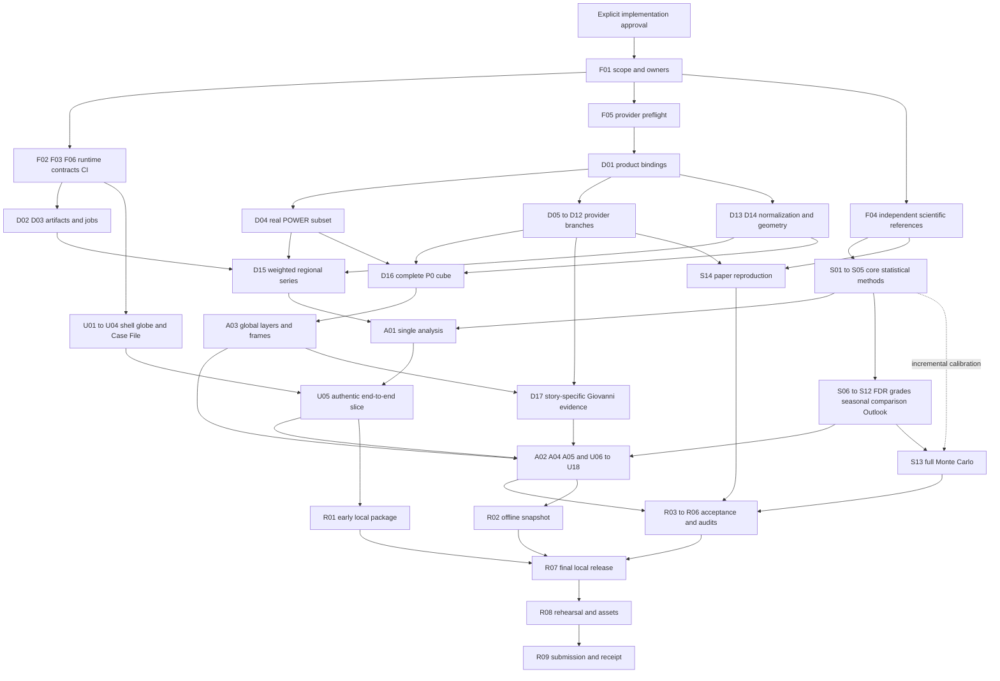

# Implementation Plan: Earth Trend Detective

**Version:** 1.0 — 14 November 2026, Asia/Colombo.  
**Status:** Planning deliverable; implementation requires explicit approval.  
**Baseline:** Complete [README](../README.md), [SRS v0.3](SRS.md), and [TDD v0.3](TECHNICAL_DESIGN.md).  
**Team:** Six humans; at most two active Devin tasks.  
**Deployment:** Full local application, with offline snapshot and second local copy. Public hosting is deferred.

This plan creates no application files, scaffolding, dependencies, provider jobs or infrastructure. Paths below are expected future deliverables. The team explicitly authorized targeted SRS/TDD reconciliation before planning; their scientific scope and validation gates remain authoritative. No additional product features are proposed here. Process artifacts, test fixtures and release checks support those requirements.

## 1. Delivery rules and feasibility

Deliver a real NASA-data workflow first, then finish the approved P0. Synthetic fixtures may support development and numerical testing but must never appear as environmental findings. A functioning interface is not evidence of validated science. A snapshot is not evidence that arbitrary-region analysis works.

The P0 is unusually broad for two days: V01–V12 global cube variables, V13 vegetation at two presets, at least ten valid globe layers, all core analyses, forecasts with skill gates, comparisons, three stories, exports and validation. Do not demote a missing P0 item to P1. At each checkpoint, record actual completed acceptance criteria, remaining risks and estimated finish. If delivery becomes infeasible, the team must explicitly choose a smaller demonstration and list unmet requirements; that decision does not retroactively make the full SRS complete.

The reconciled decisions are: native MERRA-2 grids; labelled cell-level lens previews followed by exact regional analysis; at least eight variables on predeclared eligible benchmark land regions; two-second completed core updates on loaded series with separately pending Outlook; basic P0 2D fallback; distinct chlorophyll branches; linked alpha/FDR thresholds; local hosting. Statistical formula verification, source-header checks, quota availability and measured performance are still open gates.

### 1.1 Planning capacity

Use six differentiated roles, not six interchangeable developers. Budget approximately 18–21 productive person-hours each over the event, including reviews, testing and submission: about 108–126 human hours. This is a planning assumption, not measured team velocity. Protect at least 30% of that capacity for review, integration, scientific sign-off and release. Devin drafts increase throughput but do not replace review capacity or shorten NASA queues.

Task complexity estimates below are active engineering effort before external waiting: **S = 0.5–1 hour**, **M = 1–3 hours**, **L = 3–6 hours**. They include focused tests and one review cycle, but exclude large downloads, service queues and full simulation runs. L tasks must expose reviewable internal checkpoints; stop and split them if they exceed six active hours. Estimates are not additive elapsed time because work overlaps, but this backlog can exceed available human capacity even with agents. Re-estimate using the first four hours; full P0 delivery is a high-risk target, not a promise.

The backlog contains **95 task cards: 69 P0, 16 P1 and 10 P2**. P0 totals roughly **96–243 active engineering hours** from these ranges, across humans and agent-assisted work, before external waiting. The low end barely fits team capacity; the high end does not. The science lead and data lead are the tightest constraints. H1 must allocate qualified backup review and bounded agent implementation rather than assuming one scientist can complete every assigned card alone. A two-day commitment is conditional on the first feasibility gate and actual skill profiles; the plan preserves full scope instead of hiding the shortfall.

### 1.2 Common task definition of done: D0

Every card below requires **D0 plus its named evidence**:

1. Requirement and TDD mapping preserved; no undocumented architecture, dataset or scientific-method change.
2. Inputs, outputs, null/unavailable behavior and provenance meet the agreed contracts.
3. Focused tests pass with evidence attached to the PR; reviewer reruns decisive checks. Mocked provider tests are distinguished from authenticated integration evidence.
4. Human review approves the current commit; scientific changes also receive the domain review described in §5.
5. No credentials, large raw datasets, unlicensed dependency or misleading synthetic data enter the release.
6. Dependency-ordered merge to `main`; the relevant integration smoke passes on the merged commit. Evidence records commit, release/data hashes, method version and environment where relevant.

A task can be code-complete while its scientific or external acceptance remains blocked. It cannot be marked DONE in that state. An unavailable scientific output can be correct behavior; it does not automatically satisfy a requirement that also demands a successfully validated result.

## 2. Development milestones

Times are target event-relative hours, with overlap; the calendar is in §9. These are completion gates, not just work categories.

| Milestone | Target | Required tasks / dependency | Demonstrable completion condition |
| --- | --- | --- | --- |
| M0 — Foundation and source readiness | H0–4; access/feasibility checkpoint H2 | F01/F02/F03/F05/F06; F04 preliminary conventions and first D01/D04 probes | One-command development setup; contract examples validated; independent oracle plan specified; NASA access/quota and storage budgets recorded; owners assigned. Remaining primary-paper verification stays tracked under F04 |
| M1 — Real scientific vertical slice | H4 data/reference/render checkpoint; complete slice target H8–12 | D02/D04/D13–D15, S01–S05, A01, U01–U05; first A03 layer | Real V01 region → weighted monthly series → three test branches, slopes/CI and provenance → visible Case File and one real globe layer; preliminary scientific checks pass. Synthetic render benchmark is separately labelled |
| M2 — P0 data and global layers | H4–12 | Provider branches, D16, A03; S06 | V01–V12 build/resume manifest verified; ≥10 valid globe layers; two QA-validated V13 presets; measured PERF-5 result. D17 finishes story-specific source selection after actual layers exist |
| M3 — Remaining approved P0 workflows | H8–24 | A02–A05, S06–S12/S14, U06–U18 | Regions, scans, all P0 charts, comparisons, Outlook, three stories, levels, exports and accessibility work using authentic artifacts; no missing result disguised as completion |
| M4 — Scientific and integration acceptance | Starts H2; release gate H24–30 | S13/S14, R03–R06; all P0 merged | Full Monte Carlo report, paper comparison, software tests, browser/performance checks, external usability and scientific review accepted; residual failures explicitly listed |
| M5 — Local deployment and recovery | First package after M1, target H8–12; final H30–33 | R01/R02/R07 | Packaged local app passes AC-35, snapshot passes AC-28, restart and second-copy restore succeed with pinned artifacts |
| M6 — Demonstration and submission | H33–36.5; buffer to H38:59 | R08/R09 | Rehearsed demonstration, checked submission assets/links/credits/disclosure, human submits and verifies receipt before deadline |
| MX — Approved advanced capabilities | Only after P0 evidence and before H24 freeze | P1/P2 backlog in §3.6–3.7 | Each selected extension independently passes its own scientific/UI gates. No committed slot or dependency from P0 |

M1 is the earliest complete **single-variable** scientific workflow; it is not full MVP acceptance or completed Monte Carlo certification. Do not demonstrate its inference as validated until the method-specific preliminary oracle and calibration checks pass. If those fail, demonstrate authentic acquisition/visualization with inferential outputs explicitly unavailable while the science lead resolves them.

## 3. Detailed task backlog

All tasks begin TODO. Dependencies mean completed prerequisite interfaces/evidence before task acceptance; independent drafting may start against F03 contracts. A task consuming a provider can test with a labelled fixture while waiting, but its real-data acceptance remains blocked. For incremental data tasks, “first binding” permits the V01 slice; full task completion still requires all listed bindings.

Owner abbreviations refer to §5: H1 integration/backend, H2 NASA/GIS, H3 science, H4 globe, H5 application UI, H6 QA/content. **Devin→Hn** means the agent implements under that human's ownership and review. `B/` means `backend/src/earth_trend/`; `W/` means `web/src/`; `BT/` means `backend/tests/`; `VAL/` means `validation/`. These directories do not exist merely because they appear here.

### 3.1 Foundation

#### F01 — Freeze scope, assignments and acceptance ledger

- **Priority / effort / owner:** P0 / S / H1 with all leads. **Dependencies:** explicit implementation approval.
- **Trace / files:** SRS MNT-1, CMP-3–5, AC-01–35; TDD §10; future `docs/EXECUTION_STATUS.md`, GitHub task board.
- **Work / I→O:** Read reconciled baseline and team skill profiles; assign owners/reviewers, reference laptop, event clock, predeclared benchmark regions and acceptance ledger. Check current event submission guide and required assets.
- **Acceptance / tests:** Every P0 criterion has an owner and evidence destination; no assumed public host or unsupported submission rule. Team walks through five initial assignments and the go/no-go gates.
- **Done:** D0 plus dated baseline/roles/decision record; unresolved choices have owners and deadlines.

#### F02 — Establish the minimal local runtime and isolated test layout

- **Priority / effort / owner:** P0 / M / Devin→H1. **Dependencies:** F01.
- **Trace / files:** MNT-1, CMP-1, DEP-01; TDD §2/§10.1; future `web/`, `backend/`, lockfiles and `scripts/`.
- **Work / I→O:** Selected stack → pinned compatible runtimes, minimal React/FastAPI health path, package boundaries and one-command setup/start instructions. Only this owner changes lockfiles.
- **Acceptance / tests:** Clean setup on reference machine; frontend reaches health route; basic backend/frontend tests run; no NASA download during install and no secrets in generated assets.
- **Done:** D0 plus clean-install log and dependency/license inventory seed.

#### F03 — Freeze versioned scientific and API contracts

- **Priority / effort / owner:** P0 / M / H1 with H2/H3/H5. **Dependencies:** F01; generation check uses F02.
- **Trace / files:** PV-01, AN-01–10, DA-08; TDD §5.2–5.5; `B/api/schemas/`, `W/contracts/`, `BT/contracts/`, contract fixtures.
- **Work / I→O:** TDD schemas → RegionSpec, DatasetBinding, Series, Result, LayerManifest, Job, Capabilities and Error definitions; generated TypeScript; explicit null reasons, units, branch/FDR IDs and schema version.
- **Acceptance / tests:** Completed, pending, excluded, invalid and snapshot-only examples round-trip; enum/unit/null drift fails CI; no frontend reimplementation of statistics.
- **Done:** D0 plus jointly reviewed contract examples and ownership boundary.

#### F04 — Establish independent scientific oracles and method gates

- **Priority / effort / owner:** P0 / L / H3; independent review H2 or another qualified human. **Dependencies:** F01.
- **Trace / files:** SM-02–12, VL-01–02; TDD §4/§9; `VAL/reference/`, fixture manifests and method decision notes.
- **Work / I→O:** Primary papers/TDD → separate reference calculations, hand-checkable datasets, fixed tolerances, gap-aware HR/CI/effective-df conventions, Weatherhead equation check and paper coordinates/window verification.
- **Acceptance / tests:** Oracle does not import production science functions; numerical conventions and unresolved claims are explicit. Visually check the actual paper's table/figures; document nine-year wording versus date range.
- **Done:** D0 plus signed method/fixture review; an unverified method remains a release blocker.

#### F05 — Verify NASA authentication, capabilities and transfer budgets

- **Priority / effort / owner:** P0 / M active plus service waits / H2. **Dependencies:** F01.
- **Trace / files:** DA-02–07, SEC-2–3, DR-C7, PERF-5; TDD §3.3–3.4; sanitized `VAL/reports/provider-preflight.md`, external local secrets.
- **Work / I→O:** User-configured Earthdata and product list → one small successful request per required route, Giovanni quota, supported Harmony operations, AppEEARS task/QA checks, bytes/time/storage projection. Submit slow preset/story probes early and record IDs for adapter reuse.
- **Acceptance / tests:** Credentials stay outside Git/chat/bundle; distinguish metadata visibility from authenticated retrieval; no archive-scale request before budget review.
- **Done:** D0 plus provider evidence matrix and explicit blocked bindings. No credentials are needed to write this plan.

#### F06 — Install quality checks and merge safeguards

- **Priority / effort / owner:** P0 / M / Devin→H6 with H1. **Dependencies:** F02/F03.
- **Trace / files:** MNT-1–2, SEC-2, CMP-1; TDD §9; `.github/workflows/`, future contribution/PR templates and test configuration.
- **Work / I→O:** Runtime/contracts → lint/type/unit/contract checks, precommit secret scan, CI secret/license checks, statistics coverage report and required-review policy.
- **Acceptance / tests:** Deliberately broken contract/test and synthetic secret marker fail the appropriate check; no real credential needed; live NASA requests excluded from ordinary CI.
- **Done:** D0 plus one demonstrably blocked bad PR and passing clean PR; manual equivalent documented if repository plan lacks protections.

### 3.2 Data, storage and processing

#### D01 — Encode the P0 catalog and caveat registry

- **Priority / effort / owner:** P0 / M / Devin→H2. **Dependencies:** F03; live evidence from F05.
- **Trace / files:** VC-01–02, DR-02/06/08, V01–V13; TDD §3.1–3.2; `config/catalog/`, `config/caveats/`, `B/catalog/`.
- **Work / I→O:** Exact TDD bindings → validated configuration for all thirteen variables, versions/DOIs/fields/units/windows/native grids/QA/status/resource links and caveats. Keep SeaWiFS separate.
- **Acceptance / tests:** Required fields nonempty; unknown units/version reject; GPCP/IMERG cutoffs pinned; no source-version splice; unverified metadata labelled.
- **Done:** D0 plus H2 approval of all bindings and automated catalog validation.

#### D02 — Implement immutable artifacts, provenance and cache identity

- **Priority / effort / owner:** P0 / M / Devin→H1. **Dependencies:** F02/F03.
- **Trace / files:** DA-08, PV-01, REL-2–3; TDD §7; `B/repository/`, schema migrations, `BT/integration/`.
- **Work / I→O:** Canonical metadata/bytes → hashed artifacts, SQLite WAL index, provenance edges, result/cache entries and atomic release pointer. Include code/method/QA/grid/FDR identity in keys.
- **Acceptance / tests:** Interrupted write cannot publish partial data; hash mismatch rejected; identical inputs reuse cache; changed baseline/version/mask invalidates it; restart preserves completed results.
- **Done:** D0 plus crash/cache/provenance tests and recoverable local store.

#### D03 — Add durable bounded jobs, retries and quota enforcement

- **Priority / effort / owner:** P0 / M / Devin→H1. **Dependencies:** D02/F03.
- **Trace / files:** PERF-4, SEC-3, REL-3; TDD §5.5/§8; `B/jobs/`, provider-policy interfaces.
- **Work / I→O:** Job requests → persistent state machine, one heavy worker, bounded queue, provider polling, cancellation, timeouts, quota checks and retry policy.
- **Acceptance / tests:** Restart does not duplicate submitted provider jobs; 401/invalid inputs are not blindly retried; 429 honors Retry-After; cancellation distinguishes stopped polling from cancelled remote work.
- **Done:** D0 plus restart, queue-full, retry and cancellation evidence.

#### D04 — Read POWER temperature and radiation through both approved routes

- **Priority / effort / owner:** P0 / M / H2; bounded adapter work may go to Devin. **Dependencies:** D01/D02; F05 public-store probe.
- **Trace / files:** DA-05, V01/V12, AC-25; TDD §3.1/§3.3; `B/providers/power/`, sanitized source fixtures.
- **Work / I→O:** Pinned monthly UTC MERRA and LST SYN Zarr selections plus point REST query → raw envelopes with coordinates, metadata, missing values and hashes. Resolve latest to actual complete month; exclude FLASHFlux mixing.
- **Acceptance / tests:** T2M C stays C; SW W/m² unchanged; Zarr and point access work with throttling; native grid and differing temporal conventions retained.
- **Done:** D0 plus genuine subset artifacts for both variables and a small REST integration result.

#### D05 — Implement shared Earthdata discovery and supported subsetting

- **Priority / effort / owner:** P0 / M / Devin→H2. **Dependencies:** D01/D02/D03/F05.
- **Trace / files:** DA-07, SEC-2–3, DR-C7; TDD §3.3; `B/providers/earthdata/`.
- **Work / I→O:** Approved collection/variable/region → exact CMR granules and supported Harmony or provider HTTPS retrieval, with recorded actual route.
- **Acceptance / tests:** One authenticated subset succeeds; unsupported Harmony operation has explicit bounded fallback; redirects do not leak auth; byte limit and expired-token handling verified.
- **Done:** D0 plus sanitized authenticated evidence and reusable adapter contract.

#### D06 — Decode the four GLDAS variables from shared downloads

- **Priority / effort / owner:** P0 / M / Devin→H2. **Dependencies:** D05/D13.
- **Trace / files:** V04–V07, DA-07, DR-07; TDD §3.1/§3.6; GLDAS binding configuration and provider decoder tests.
- **Work / I→O:** GLDAS_NOAH025_M 2.1 granules → four monthly fields sharing acquisition/mask lineage; implement accumulation semantics only after header confirmation.
- **Acceptance / tests:** Soil/SWE kg/m²→mm, Evap ×86400, Qs monthly mean three-hour accumulation ×8; true zero snow preserved; 2001-03 default and caveats enforced.
- **Done:** D0 plus real header/conversion evidence for all four fields.

#### D07 — Decode GPCP and IMERG precipitation as separate records

- **Priority / effort / owner:** P0 / M / Devin→H2. **Dependencies:** D05/D13.
- **Trace / files:** V02/V03, DA-07, DR-02/07/08; TDD §3.1; precipitation bindings/decoders and fixtures.
- **Work / I→O:** GPCPMON 3.3 and GPM_3IMERGM 07 Final → separate monthly raw/canonical artifacts with pinned default endpoints.
- **Acceptance / tests:** Inspect actual units; convert IMERG mm/hour ×24 only when appropriate; no new version or later GPCP window substituted; validate conservative 0.1° aggregation.
- **Done:** D0 plus one authentic series per product and unit/window tests.

#### D08 — Decode MERRA-2 aerosol without changing native support

- **Priority / effort / owner:** P0 / M / Devin→H2. **Dependencies:** D05/D13.
- **Trace / files:** V10, DA-07, DR-C1, DR-02; TDD §3.1/§3.5; aerosol bindings/decoder fixtures.
- **Work / I→O:** M2TMNXAER 5.12.4 TOTEXTTAU → monthly dimensionless native-grid field; hourly Giovanni binding remains a separate provenance chain.
- **Acceptance / tests:** 0.5°×0.625° coordinates survive analysis; no artificial 0.5° independent resolution or hourly/monthly splice; missing versus zero distinguished.
- **Done:** D0 plus native-grid real-source and lineage checks.

#### D09 — Decode MODIS-Aqua and reference SeaWiFS chlorophyll

- **Priority / effort / owner:** P0 / L / H2. **Dependencies:** D05/D13/F04.
- **Trace / files:** V11, VL-02, DR-02; TDD §3.1/§9.3; ocean bindings, OB.DAAC decoder and ten-box source manifest.
- **Work / I→O:** R2022.0 monthly mapped products → separate MODIS cube input and native-resolution SeaWiFS ten-box subsets; retain fill/valid-range and coastal caveats.
- **Acceptance / tests:** Confirm chosen 9 km product and field; no sensor join; aggregate raw positive concentration before log transformation; exact paper window/boxes recorded.
- **Done:** D0 plus source hashes and separate mission identities verified by H2/H3.

#### D10 — Implement quota-aware Giovanni series and maps

- **Priority / effort / owner:** P0 / L / H2 with Devin on polling/decoding. **Dependencies:** D01/D02/D03/F05.
- **Trace / files:** DA-02, DA-08, AC-26; TDD §3.3–3.4; `B/providers/giovanni/`, sanitized series/map fixtures.
- **Work / I→O:** Quota-checked catalog requests → area CSV and time-averaged GeoTIFF. Demonstrate one small real series and map; expose a reusable interface for AIRS/OMI and later story sources.
- **Acceptance / tests:** Repeated request hits cache with intact provenance; job IDs persisted; quota exhaustion visible; service-derived weighting is not assumed equivalent without evidence.
- **Done:** D0 plus authenticated series/map and cache evidence. Story-specific selection is D17, so AIRS/OMI processing never waits for a story that itself needs the completed cube.

#### D11 — Build AIRS and OMI monthly map inputs

- **Priority / effort / owner:** P0 / M active / Devin→H2. **Dependencies:** D10/D13.
- **Trace / files:** V08/V09, DA-02, DR-C2–4; TDD §3.1/§3.6; AIRS/OMI configuration and decoding tests.
- **Work / I→O:** AIRS3STM 7.0 TotH2OVap_A and OMNO2d 003 cloud-screened tropospheric column → QA/coverage-aware monthly maps.
- **Acceptance / tests:** Never mix AIRS A/D or AIRX3; OMI daily-to-monthly support explicit; NO₂ scaling correct; clear-sky 70% coverage rule applied; missing count/QC semantics block admission.
- **Done:** D0 plus actual source metadata and successful monthly-map results for both variables.

#### D12 — Retrieve and validate NDVI for two presets

- **Priority / effort / owner:** P0 / M active / H2; Devin may implement job parsing. **Dependencies:** D01/D02/D03/D13/F05.
- **Trace / files:** DA-03, V13, AC-27; TDD §3.1/§3.6; `B/providers/appeears/`, preset manifests.
- **Work / I→O:** Two approved polygons and MOD13A3.061 NDVI/QA layers → cached regional series. Use CSV only if QA/area support can be established; otherwise compute from the task's QA rasters.
- **Acceptance / tests:** Scale 0.0001 applied once; already-scaled CSV not rescaled; invalid QA excluded; weighting/coverage reconstructible for both presets.
- **Done:** D0 plus two authenticated results and independently checked sample means.

#### D13 — Normalize calendars, units, QA and missing values

- **Priority / effort / owner:** P0 / M / H2 with Devin fixtures. **Dependencies:** D01/F04; source examples from F05.
- **Trace / files:** DR-C2–4, DR-07, SM-02–03; TDD §3.5–3.6; `B/pipeline/normalize/`, `BT/unit/`.
- **Work / I→O:** Provider envelope → canonical monthly positions, validity/coverage arrays, unit-transform record and QC reasons; retain native calendar/aggregation meaning.
- **Acceptance / tests:** Fill is not zero; no interpolation for inference; reject unknown units/calendar semantics; conversion is idempotent; missing months retain their elapsed-time positions.
- **Done:** D0 plus boundary/negative fixtures covering every conversion family.

#### D14 — Compute geographic masks and exact overlap weights

- **Priority / effort / owner:** P0 / L / H2; review H1. **Dependencies:** F03/F04/D01.
- **Trace / files:** RG-01–03, SM-02, DR-C1/4; TDD §3.5/§5.1; `B/geometry/`, `config/regions/`, mask manifest.
- **Work / I→O:** Cell/box/polygon/preset/world and grid/mask → canonical geometry hash, geodesic area, fractional overlaps and sparse weights; record GSHHG source/license.
- **Acceptance / tests:** Dateline, poles, holes, fractional coasts and native MERRA grid; equivalent geometry stable; invalid/self-intersecting geometry rejected; whole-world weighting independent check.
- **Done:** D0 plus analytic weighted-field tests and documented mask/domain behavior.

#### D15 — Aggregate weighted regional monthly series

- **Priority / effort / owner:** P0 / M / H2/H3. **Dependencies:** D13/D14/D02; D04 supplies first real binding.
- **Trace / files:** AN-01, SM-02, RG-02–03, AC-07; TDD §4.1/§7.4; `B/series/` and aggregation tests.
- **Work / I→O:** Native/analysis cube plus region → weighted monthly means, eligible-area denominators, coverage, counts and lineage; cache weights and exact tile summaries.
- **Acceptance / tests:** Analytic two-cell weighted example; 50%/70% month and 80%/10-year series boundaries; all-missing invalid; no average of cell trends/p-values; independent V01 world mean within 0.01°C.
- **Done:** D0 plus raw-to-regional reconstruction and cache-equivalence evidence.

#### D16 — Build, resume and publish the complete P0 cube

- **Priority / effort / owner:** P0 / L plus external/build time / H2; H1 reviews persistence. **Dependencies:** D02/D03/D13/D14; stream completed D04/D06–D09/D11 inputs.
- **Trace / files:** DA-01, DR-C1–7, PERF-5, AC-25; TDD §3.4–3.7/§7; `B/pipeline/build/`, `B/cli.py`, release manifest.
- **Work / I→O:** Validated monthly fields → chunked native/analysis cubes for V01–V12, checksummed resumable work items and atomic release. Stage V01 first; never wait for every provider to begin.
- **Acceptance / tests:** Interrupt/restart and corrupt-chunk recovery; all required variables/windows accounted for; measured bytes, wall time, RAM/disk; no partial release pointer.
- **Done:** D0 plus full build manifest and PERF-5 evidence. A partial cube is useful progress, not full task completion.

#### D17 — Acquire the three investigations' exact Giovanni evidence

- **Priority / effort / owner:** P0 / M active plus service wait / H2 with H6. **Dependencies:** D10/D08/D09/F04; validated A03 precipitation layer for the opposite-trend selection.
- **Trace / files:** ED-03, DR-01, AC-24; TDD §3.4/§6; `config/investigations/` source manifests and cached service outputs.
- **Work / I→O:** Approved story regions and actual analysis → at least one genuine Giovanni-sourced series per story; Wisconsin includes the classic MODIS-Aqua AOD export. Verify exact classic binding and units; record manual export steps honestly.
- **Acceptance / tests:** Source/version/window/region/QA and resource labels present; wetter/drier case selected only after analysis; no mismatched series presented as a paper reproduction or independent witness.
- **Done:** D0 plus all three authentic cached story source records. This task is downstream of layers, not a prerequisite for building them.

### 3.3 Scientific engine and validation jobs

#### S01 — Build anomaly and annual-series transformations

- **Priority / effort / owner:** P0 / M / Devin→H3. **Dependencies:** F03/F04.
- **Trace / files:** AN-02, SM-03, DR-C3; TDD §4.1; `B/science/anomalies/`, numerical fixtures.
- **Work / I→O:** Monthly series/baseline → climatology, raw/log anomalies and annual anomalies with explicit support and exclusions.
- **Acceptance / tests:** Calendar alignment, baseline gaps, ≥10 valid months/year, minimum baseline support, no log of anomalies; native timestamps retained; fixed fixture matches independent oracle.
- **Done:** D0 plus transformation and missing-support tests.

#### S02 — Implement Sen slope and reference OLS branches

- **Priority / effort / owner:** P0 / M / H3 with Devin on deterministic plumbing. **Dependencies:** S01/F04.
- **Trace / files:** AN-03/04, SM-04/05a, AC-13; TDD §4.2–4.3; `B/science/trend/`, `B/science/reference/`.
- **Work / I→O:** Time-indexed series → Sen slope, monthly raw OLS slope/R²/F/p and annual-anomaly regression, with documented unit/decade conversion.
- **Acceptance / tests:** Actual elapsed times across gaps; F=t²; constant/tied/short series; selected known-slope fixture within 5%; SciPy/reference agreement within fixed tolerances.
- **Done:** D0 plus independent slope/reference output comparison.

#### S03 — Implement and review gap-aware Hamed–Rao MK

- **Priority / effort / owner:** P0 / L / H3, qualified second human review. **Dependencies:** S01/S02/F04.
- **Trace / files:** AN-04, SM-05b/09, VL-01; TDD §4.3; `B/science/mann_kendall/`, lag diagnostics.
- **Work / I→O:** Anomalies/calendar positions → tie-corrected MK, detrended rank correlations, recorded lag selection and corrected variance/p. Preserve real gaps; do not blindly use pyMannKendall's dropped-NaN indexing.
- **Acceptance / tests:** Complete-series reference agreement; gap/tie/zero-variance checks; monthly/annual lag caps recorded; preliminary null calibration passes before inference is demonstrated.
- **Done:** D0 plus signed algorithm review; release still requires S13 calibration.

#### S04 — Implement effective-sample-size OLS inference

- **Priority / effort / owner:** P0 / M / H3. **Dependencies:** S02/F04.
- **Trace / files:** AN-04, SM-05c; TDD §4.3; `B/science/effective_ols/`.
- **Work / I→O:** Regression residuals and adjacent valid month pairs → lag-1 correlation, bounded effective n, adjusted SE/CI and two-sided p with recorded approximation.
- **Acceptance / tests:** ≥24 valid adjacent pairs; effective n≤actual n and >2 for inference; negative correlation/near-one correlation handled; missing positions never compressed into adjacent pairs; independent reference matches.
- **Done:** D0 plus degrees-of-freedom derivation and numerical tests; S13 remains release gate.

#### S05 — Implement reviewed Sen confidence intervals and scale branches

- **Priority / effort / owner:** P0 / M / H3. **Dependencies:** S02/S03/F04.
- **Trace / files:** AN-03, SM-04, GL-02–03; TDD §4.2/§4.4; `B/science/intervals/`, normalization helpers.
- **Work / I→O:** Pairwise slopes/corrected rank variance → approximate rank-based CI, residual-SD standardized magnitude and permitted percentage changes; keep raw/log chlorophyll branches distinct.
- **Acceptance / tests:** Independent-error match to SciPy; rank rounding/ties/invalid variance tested; zero SD/near-zero mean null reasons; Celsius/NDVI percentage suppressed; no label conversion of log slope into raw units.
- **Done:** D0 plus oracle evidence; failed empirical CI coverage blocks release, requiring reviewed fallback/version change.

#### S06 — Implement complete-family FDR

- **Priority / effort / owner:** P0 / S / Devin→H3. **Dependencies:** F03/F04.
- **Trace / files:** SC-03, SM-06, AN-05, GL-02; TDD §4.5; `B/science/fdr/`.
- **Work / I→O:** Family ID, valid p-values and exclusions → monotone BH q-values restored to source order for scan, twelve months and complete global layer.
- **Acceptance / tests:** Hand-calculated fixture; missing p exclusion logged; ties/order invariant; alpha changes decisions but not q; viewport never changes global family.
- **Done:** D0 plus exact family-membership and reference tests.

#### S07 — Calculate seasonal fingerprints and Seasonal Kendall

- **Priority / effort / owner:** P0 / M / H3 or Devin under H3 review. **Dependencies:** S01/S03/S06.
- **Trace / files:** AN-05, SM-05d/06, AC-14; TDD §4.3/§4.5; `B/science/seasonality/`.
- **Work / I→O:** Monthly series → twelve month-specific slopes/tests/q and Seasonal Kendall result, with eligible counts and assumptions.
- **Acceptance / tests:** Deterministic summer-only fixture; insufficient months remain unavailable; no pooled seasonal cycle mistaken for trend; seasonal/reference implementation comparison.
- **Done:** D0 plus complete 12-entry contract and scientific review.

#### S08 — Compute caveat-aware evidence grades

- **Priority / effort / owner:** P0 / M / Devin→H3. **Dependencies:** S02–S06/D01.
- **Trace / files:** AN-06, SM-07, DR-06, AC-15; TDD §4.6; `B/science/grading/`.
- **Work / I→O:** Tests/coverage/caveats → grade and explicit reasons; run ±2-year endpoint sensitivity in P0; apply documented caveat-linked step heuristic.
- **Acceptance / tests:** D precedence; registered step never A; q failure visible even for B; no independent witness assumed; raw/log sign conflict blocks A; exhausted endpoint support explained.
- **Done:** D0 plus decision-table tests for every grade and reason.

#### S09 — Calculate conditional detectability and emergence

- **Priority / effort / owner:** P0 / M / H3. **Dependencies:** S02/S04/F04.
- **Trace / files:** AN-07, SM-08, VZ-07, AC-16; TDD §4.7; `B/science/detectability/`.
- **Work / I→O:** Slope/noise/persistence/sampling rate → Weatherhead horizon and ToE₁/ToE₂, conditional labels and remaining years.
- **Acceptance / tests:** Verified coefficient/time-unit convention; independent notebook within one year; zero slope unbounded; invalid persistence/nonstationarity unavailable; gaps require validated approximation; alpha behavior explicitly labelled.
- **Done:** D0 plus primary-paper equation check and reference comparison; no unverified formula in release.

#### S10 — Calculate paired regional trend differences with uncertainty

- **Priority / effort / owner:** P0 / M / H3. **Dependencies:** D15/S02/F04.
- **Trace / files:** RG-05, AC-09; TDD §4.4/§5; `B/science/comparison/`.
- **Work / I→O:** Two regions, common variable/window/support → both trends and difference CI using seeded paired 12-month residual blocks, 999 replicates and 6/24-month sensitivity diagnostics.
- **Acceptance / tests:** Paired draws preserve cross-region dependence; identical regions give zero difference; disjoint support rejected; never subtract CI endpoints; fixed seed reproducible.
- **Done:** D0 plus independent paired-bootstrap comparison and honest approximation labels.

#### S11 — Produce conditional trend-continuation intervals

- **Priority / effort / owner:** P0 / M / H3 with Devin on packaging. **Dependencies:** S01/S02/S04/F04.
- **Trace / files:** FC-01/05, SM-10, VZ-08, AC-19; TDD §4.9; `B/science/continuation/`.
- **Work / I→O:** Trend/month effects/AR(1) diagnostics → 2,000 seeded paths with parameter uncertainty and prediction intervals; default horizon 10, capped by min(20, half record).
- **Acceptance / tests:** Forecast intervals not confidence bands; bounds, seed, zero-noise and invalid AR behavior checked; extrapolation transform limits respected; permanent conditional wording.
- **Done:** D0 plus interval/parameter-uncertainty tests and approved explanation payload.

#### S12 — Backtest and gate the short-term forecast

- **Priority / effort / owner:** P0 / L / H3; Devin may build report plumbing. **Dependencies:** S01/S11/F04.
- **Trace / files:** FC-02, SM-10, AC-20; TDD §4.9; `B/science/forecast/`, backtest fixtures/reports.
- **Work / I→O:** One approved trend/month/AR(1) candidate and both baselines → ≥60 monthly rolling origins, common-support MAE/MASE and 80/95% coverage, 12–24-month outputs only when skill gates pass.
- **Acceptance / tests:** Training-only transformations each origin; zero MASE denominator unavailable; white-noise fixed fixture suppresses forecast; candidate beats both baseline MAEs, MASE<1 and 95% coverage 85–100%.
- **Done:** D0 plus leakage test and real backtest table. No skill is a valid result; a fabricated forecast is not.

#### S13 — Run the full synthetic calibration suite

- **Priority / effort / owner:** P0 / L active plus compute / H3; H6 independently reruns selected seeds. **Dependencies:** F04; incrementally test S01–S12, final report after relevant methods freeze.
- **Trace / files:** VL-01, SM-12, AC-30, MNT-2; TDD §9.2; `VAL/fixtures/`, `VAL/reports/`, scientific test runner.
- **Work / I→O:** Fixed scenario manifest → ≥2,000 independent 300-month realizations per scenario; FPR, power, bias, CI coverage and grade diagnostics with uncertainty and seeds.
- **Acceptance / tests:** White-noise FPR 3.5–6.5%; AR(.6) corrected FPR≤10%; report naive inflation. Include AR(.3), SNR .5/1/2, season+trend, summer-only, step and 20% gaps; never tune seeds to pass.
- **Done:** D0 plus human-reviewed complete report and published limitations. Coverage acceptance follows §6, not an invented claim of exact calibration.

#### S14 — Reproduce the ten-box SeaWiFS paper comparison

- **Priority / effort / owner:** P0 / L / H3 with H2. **Dependencies:** F04/D09/S02/D15.
- **Trace / files:** VL-02, ED-03b, AC-31; TDD §9.3; `VAL/reference/acker/`, comparison table and source manifest.
- **Work / I→O:** Verified boxes/window and separate SeaWiFS source → reference monthly F-test and annual-anomaly regressions alongside published signs/p/classifications.
- **Acceptance / tests:** All ten boxes listed; Amazon/Congo/Orinoco and Pearl claims checked against paper; no forced agreement with reprocessed data; coordinate/window/method differences documented.
- **Done:** D0 plus signed comparison table with source citations and reproducible inputs.

### 3.4 Application services and interface

#### A01 — Connect one real regional analysis through the API

- **Priority / effort / owner:** P0 / M / H1. **Dependencies:** F03/D02/D04/D15/S01–S05.
- **Trace / files:** AN-01–04, PV-01, RG-02; TDD §5.1–5.5; `B/application/analysis/`, `B/api/analyses/`.
- **Work / I→O:** Region/window/variable request → canonical cache lookup, regional series, all three test branches, slopes/intervals and provenance-backed result. Stage V01 first; incomplete later fields remain explicitly pending/unavailable.
- **Acceptance / tests:** Real V01 request matches independent numerical reference; HTTP errors distinct from scientifically insufficient data; null reasons and no NaN/Infinity JSON; 200 versus 202 semantics correct.
- **Done:** D0 plus reproducible source-to-result integration test for the vertical slice.

#### A02 — Orchestrate complete regional scans and ranking

- **Priority / effort / owner:** P0 / M / Devin→H1. **Dependencies:** A01/S06–S09/D01; full release needs D16.
- **Trace / files:** SC-01–04, RG-03, AC-12; TDD §4.5–4.6/§5; `B/application/scans/`, `B/api/scans/`.
- **Work / I→O:** Region plus available catalog → all eligible results, scan-wide FDR, grades, ordered Case Board and excluded-variable reasons. Rank by grade then absolute standardized magnitude.
- **Acceptance / tests:** No invented eighth variable; predeclared eligible land regions achieve ≥8; FDR family includes all eligible tests; common-window policy visible; warm/cold timing recorded.
- **Done:** D0 plus scan correctness and measured ≤3-second acceptance evidence.

#### A03 — Build global layers, annual frames and opposite components

- **Priority / effort / owner:** P0 / L / H1/H3, H4 reviews binary layout. **Dependencies:** D14/D16 first validated binding; S01–S03/S06.
- **Trace / files:** GL-02/05–07, SM-09, DR-C6; TDD §2.2/§4.8/§7.4; `B/pipeline/layers/`, layer manifests.
- **Work / I→O:** Monthly fields → 1° annual anomalies, cell slopes/p/q/counts/coverage/sparklines, global annual mean ring and signed four-neighbor significant components ranked by spherical area.
- **Acceptance / tests:** Complete global FDR, ≥10 valid years, dateline adjacency, positive/negative top-three areas; ring matches independently weighted means; layer order/dtype/hash round-trip; chlorophyll branches labelled.
- **Done:** D0 plus at least ten authentic complete layers and frame/component test evidence. A V01 artifact unlocks M1 earlier.

#### A04 — Complete API orchestration, capability modes and local protection

- **Priority / effort / owner:** P0 / M / Devin→H1. **Dependencies:** F03/D03/A01; integrate A02/S07–S12 as available.
- **Trace / files:** SEC-1–3, PERF-4, DEP-01; TDD §5/§8; `B/api/`, `B/application/`, error middleware.
- **Work / I→O:** TDD endpoint inventory → catalog/presets/summary/layers/cells/scans/analyses/comparisons/outlooks/results/jobs/provenance/investigations/validation/methods/capabilities/health; acquisition mutations restricted to trusted local session.
- **Acceptance / tests:** Request/queue/vertex/month/horizon limits; strict Host/Origin, loopback and acquisition nonce; SSRF/path traversal/retry tests; superseded jobs cannot overwrite current request results.
- **Done:** D0 plus route-contract/security matrix; no missing route hidden behind a mock.

#### A05 — Generate traceable CSV, JSON and chart-export packages

- **Priority / effort / owner:** P0 / M / Devin→H1/H5. **Dependencies:** D02/A01/F03; U04 for PNG.
- **Trace / files:** PV-01–02, CMP-2, AC-29; TDD §5/§7; `B/exports/`, `W/features/evidence/exports/`.
- **Work / I→O:** Immutable result → CSV series/coverage, JSON analysis/provenance, frontend PNG and citation block linked by result/release ID.
- **Acceptance / tests:** Every numeric field traceable; units/branch/window/seed/citations retained; missing values not zero; formula-like CSV strings escaped; PNG has labels and attribution; secret scan passes.
- **Done:** D0 plus independently reopened export package whose values match the source result.

#### U01 — Build the application shell and explanation-level system

- **Priority / effort / owner:** P0 / M / Devin→H5. **Dependencies:** F02/F03.
- **Trace / files:** ED-01/05, USE-2–4, ACC-1–3; TDD §6; `W/app/`, `W/components/`, `W/styles/`.
- **Work / I→O:** Approved routes/tokens → responsive space-themed shell, shadcn/Radix controls, Explorer/Student/Scientist context, skippable onboarding and reduced-motion preference.
- **Acceptance / tests:** Keyboard focus/contrast and tablet layout; three levels change actual content; no decorative data-color confusion; onboarding ≤30 seconds.
- **Done:** D0 plus shell navigation/component tests and human design review.

#### U02 — Implement HTTP and snapshot data providers

- **Priority / effort / owner:** P0 / M / Devin→H5. **Dependencies:** F03/U01.
- **Trace / files:** DA-09, PERF-4, REL-1; TDD §5.2/§6/§7.6; `W/data/`, query keys/state tests.
- **Work / I→O:** Generated contracts → common provider interface, capability-aware views, pending polling/cancellation, stale-result protection and snapshot availability checks.
- **Acceptance / tests:** Old response cannot replace new selection; 202 visibly pending; unavailable, loading and transport failure distinct; no silent parameter substitution in snapshot mode.
- **Done:** D0 plus race/error/capability tests against fixed contract fixtures and then A01.

#### U03 — Prove the globe engine and GIBS basemap

- **Priority / effort / owner:** P0 / L / H4. **Dependencies:** F02/F03.
- **Trace / files:** GL-01, PERF-1, CMP-2; TDD §2.2/§6.5; `W/features/globe/renderer/`, basemap manifest.
- **Work / I→O:** globe.gl/Three.js and GIBS geographic capabilities → reusable scene lifecycle, camera/reset, 64,800 instanced cells and offline attributed texture. Synthetic benchmark values remain clearly marked test-only.
- **Acceptance / tests:** ≥30 median fps during ten-second spin on AS-05; disposal avoids accumulating GPU objects; EPSG:4326/tile axes correct; attribution visible offline too.
- **Done:** D0 plus measured render report and approved engine spike before scene-dependent work expands.

#### U04 — Render the minimal scientific Case File and time series

- **Priority / effort / owner:** P0 / M / Devin→H5. **Dependencies:** U01/U02/F03; real acceptance A01.
- **Trace / files:** AN-01–04, VZ-01/11, PV-01; TDD §6.2–6.4; `W/features/case-file/`, chart primitives.
- **Work / I→O:** AnalysisResult → raw/anomaly series, gaps, trend/CI, three test outputs, units/window/caveats and provenance link with accessible summary.
- **Acceptance / tests:** Never bridge missing observations as measured data; confidence versus prediction intervals distinct; zero/negative/null results valid; chart/table agree exactly.
- **Done:** D0 plus authentic V01 display and independent spot-check of rendered numbers.

#### U05 — Demonstrate and lock the first end-to-end scientific slice

- **Priority / effort / owner:** P0 / M / H1/H6; H3 scientific sign-off. **Dependencies:** A01/U03/U04; A03 first V01 layer.
- **Trace / files:** AC-01/04/07/13, PV-01; TDD §10.4; `web/tests/e2e/vertical-slice`, `VAL/reports/m1.md`.
- **Work / I→O:** Real V01 artifact → browser region selection, analysis, chart, test outputs and inspectable source provenance; one genuine layer displayed. Record preliminary method validation separately from full S13.
- **Acceptance / tests:** Repeat with backend restart and provider disconnected; fresh arbitrary box differs from fixture region; no hard-coded environmental numbers; independent slope/reference check passes.
- **Done:** D0 plus live demonstration and stored test evidence. This is M1, not full P0 certification.

#### U06 — Build catalog, deterministic discovery and glossary

- **Priority / effort / owner:** P0 / M / Devin→H5; content H6/H2. **Dependencies:** D01/U01/U02.
- **Trace / files:** VC-01–03, ED-02, SI-05, AC-10/11/23; TDD §6.1–6.2; `W/features/catalog/`, glossary/content configuration.
- **Work / I→O:** Validated catalog and curated rules → themed/sphere browsing, plain definitions, question-guided suggestions and linked glossary at three levels.
- **Acceptance / tests:** All V01–V13 present; required fields complete; ≥3 relevant suggestions for each approved example environment; works with SI off; human checks relevance, not only count.
- **Done:** D0 plus four-environment walkthrough and term-coverage report.

#### U07 — Add region selection, summary and the Detective Lens

- **Priority / effort / owner:** P0 / L / H4 with H5. **Dependencies:** U03/U02/D14/A04; A03 layers and A02 scan for acceptance.
- **Trace / files:** RG-01–03, GL-04, AC-04/07/08; TDD §2.2/§4.8/§6; `W/features/regions/`, `W/workers/lens/`.
- **Work / I→O:** Cell, box, polygon, preset/world or lens footprint → validated RegionSpec and area/mask/coverage summary; lens summarizes loaded cell fields and opens exact regional scan.
- **Acceptance / tests:** Dateline/limb behavior; numeric keyboard alternative; preview ≤300 ms with explicit label and no regional p/q/grade; Open case preserves exact footprint.
- **Done:** D0 plus geometry round-trip and latency evidence on reference laptop.

#### U08 — Apply scientific color, significance, relief and cell picking

- **Priority / effort / owner:** P0 / M / H4. **Dependencies:** U03/A03/U02.
- **Trace / files:** GL-02–03/05, ACC-1, AC-02–04; TDD §2.2/§6; `W/features/globe/layers/`, legends/cell detail.
- **Work / I→O:** LayerManifest/typed arrays → signed magnitude color, separate q channel, fixed |σ/decade| relief, cell trend/q/window/sparkline and Case File link.
- **Acceptance / tests:** Toggle relief changes no values/colors; alpha decision matches q; no-data distinct from zero; deuteranopia simulation; picking maps correct geographic cell and branch units.
- **Done:** D0 plus numeric/picking/legend tests and visual science review.

#### U09 — Animate annual layers and global anomaly ring

- **Priority / effort / owner:** P0 / M / H4 or Devin after scene interface stabilizes. **Dependencies:** U08/A03.
- **Trace / files:** GL-06, PERF-1, AC-05; TDD §2.2/§6; globe timeline/frame cache/ring components.
- **Work / I→O:** Versioned annual frames and global anomaly series → synchronized timeline, year labels and ring with bounded buffers.
- **Acceptance / tests:** ≥20 fps; three year spot checks equal source anomalies; gaps/years handled; reduced motion disables playback; no old frame with new label.
- **Done:** D0 plus measured animation and synchronization evidence.

#### U10 — Connect opposite-trend regions and two-region comparison

- **Priority / effort / owner:** P0 / M / H4/H5. **Dependencies:** A03/S10/A04/U08.
- **Trace / files:** GL-07, RG-05, AC-06/09; TDD §4.8/§6; `W/features/compare/`, opposite-mode panel.
- **Work / I→O:** Signed component lists → top-three area highlights and Send to Compare; common-variable/window result → paired trends/difference CI and caveats.
- **Acceptance / tests:** Correct km² order and dateline shape; no causal wording; no result when sufficient common support absent; difference CI matches backend, not subtracted endpoints.
- **Done:** D0 plus authentic compare walkthrough and component selection tests.

#### U11 — Build the Case Board with truthful exclusions

- **Priority / effort / owner:** P0 / M / Devin→H5. **Dependencies:** U02/A02.
- **Trace / files:** SC-01–04, AC-12; TDD §6.2; `W/features/case-board/`.
- **Work / I→O:** ScanResult → ranked variables, direction/raw/relative/standardized magnitude, p/q/grade/window/caveats and excluded entries with reasons.
- **Acceptance / tests:** Ordering matches backend; Celsius/NDVI percent absent with reason; B is not automatically FDR-significant; fewer eligible products never padded; pending versus completed scan explicit.
- **Done:** D0 plus eligible and insufficient-region component/E2E checks.

#### U12 — Finish Case File controls, P0 views and recommendation rules

- **Priority / effort / owner:** P0 / L / H5; Devin takes independent chart cards. **Dependencies:** U04/S07–S09/A04.
- **Trace / files:** AN-05–07/10, VZ-02/03/07/10/11, AC-14–18; TDD §6.2–6.4; stripes, seasonal heatmap, signal/noise and control components.
- **Work / I→O:** Full result → seasonal slopes/q, stripes, signal/noise and three-level explanations; window/baseline/alpha controls; deterministic view recommendations.
- **Acceptance / tests:** Five approved scenarios choose correct view; all P0 variables render; every chart has text/table alternative; core controls complete ≤2 s on loaded series and cancel stale responses; caveat warning updates.
- **Done:** D0 plus view/variable coverage matrix and control timing evidence.

#### U13 — Build Outlook with explicit background and no-skill states

- **Priority / effort / owner:** P0 / M / Devin→H5; H3 reviews wording. **Dependencies:** S11/S12/A04/U02.
- **Trace / files:** FC-01/02/05, VZ-08, AC-19/20; TDD §4.9/§6; `W/features/outlook/`.
- **Work / I→O:** Continuation/forecast results → labelled fans, capped horizon, backtest table, three-level caveats and separate pending/retry/cancel states.
- **Acceptance / tests:** Permanent “Not a prediction”; white-noise no-skill hides forecast; old window's forecast cannot appear current; intervals/types/units visible; invalid result not depicted as zero.
- **Done:** D0 plus skilled, no-skill, pending and invalid scenario tests.

#### U14 — Publish provenance, methods evidence, credits and SI disclosure

- **Priority / effort / owner:** P0 / M / Devin→H6; H2/H3 review. **Dependencies:** D02/U01/F06; final evidence S13/S14.
- **Trace / files:** PV-01, VL-01–02, SI-04–05, CMP-1–5; TDD §6/§9; `W/features/evidence/`, credit/disclosure content.
- **Work / I→O:** Result lineage, validation reports and inventories → navigable evidence/methods pages, dataset/service/library citations and truthful development-AI log.
- **Acceptance / tests:** Each numeric result reaches provenance; methods display actual report versions; no fabricated validation badges; SI off flows work; any generated media watermarked and reviewed.
- **Done:** D0 plus checked citations, glossary links, report identifiers and disclosure completeness.

#### U15 — Author and validate the Wisconsin investigation

- **Priority / effort / owner:** P0 / M / H6; H2/H3 approve science. **Dependencies:** D08/D17/U11/U12.
- **Trace / files:** ED-03a, DR-01, AC-24; TDD §6/§3.4; `config/investigations/wisconsin`, shared story renderer.
- **Work / I→O:** Authentic V10 and classic Giovanni MODIS-Aqua AOD series → ≤3-minute guided sequence, caveats and Try it yourself.
- **Acceptance / tests:** Exact classic product/field verified; source lines separate; smoke attribution not claimed from a trend alone; one labelled Giovanni series included; snapshot replay works.
- **Done:** D0 plus scientific copy review and timed walkthrough.

#### U16 — Author and validate Rivers revisited

- **Priority / effort / owner:** P0 / M / H6; H3 approves science. **Dependencies:** S14/D17/U12; reuse U15 renderer interface.
- **Trace / files:** ED-03b, VL-02, DR-01, AC-24; TDD §6/§9.3; `config/investigations/rivers`.
- **Work / I→O:** Ten-box comparison and authentic Giovanni contextual series → reference-method story with published/current differences and Try it yourself.
- **Acceptance / tests:** No SeaWiFS/MODIS join; all reported numbers traceable; coastal caveats visible; ≤3 minutes; Giovanni source explicitly labelled; no forced paper agreement.
- **Done:** D0 plus reviewed narrative and snapshot playback evidence.

#### U17 — Select and author Wetter here, drier there

- **Priority / effort / owner:** P0 / M / H6 with H2/H3. **Dependencies:** A03/U10/D17; use U15 renderer interface.
- **Trace / files:** ED-03c, GL-07, DR-01, AC-24; TDD §4.8/§6; `config/investigations/opposites`.
- **Work / I→O:** Actual significant opposite precipitation components → selected pair, exact regional comparison and authentic Giovanni-sourced series.
- **Acceptance / tests:** Selection occurs after genuine analysis; no invented opposite trends or causal link; same product/window explained; ≤3-minute snapshot story ends with independent exploration.
- **Done:** D0 plus recorded selection rationale, source evidence and timed run.

#### U18 — Complete basic 2D fallback and accessibility audit fixes

- **Priority / effort / owner:** P0 / M / H4/H5; H6 verifies. **Dependencies:** U07/U08/U12/U13.
- **Trace / files:** PRT-1, ACC-1–3, AC-33; TDD §2.2/§6.4; fallback grid, accessible tables and focus controls.
- **Work / I→O:** Same scientific arrays/region controls → canvas/SVG grid when WebGL2 fails; keyboard alternatives and reduced-motion behavior across main flows.
- **Acceptance / tests:** Simulated WebGL failure; keyboard-only region→scan→case→export; text alternatives and tablet layout; axe plus manual focus/contrast review; full GL-09 map remains P1.
- **Done:** D0 plus manual accessibility report and browser fallback test.

### 3.5 Integration, local deployment and submission

#### R01 — Package and rehearse the local runtime early

- **Priority / effort / owner:** P0 / M / Devin→H1/H6. **Dependencies:** U05/F02; expand package as features arrive.
- **Trace / files:** DEP-01, MNT-1, REL-3; TDD §2.4/§8.4; `scripts/` local launch/package entries and release instructions.
- **Work / I→O:** Built frontend/backend and first validated artifact → same-origin loopback app with separate artifact/secret paths and readiness checks.
- **Acceptance / tests:** Production frontend served by FastAPI; clean launch/restart; no dev-server dependency or network-bound package fetch at demo time; interrupted release keeps old pointer.
- **Done:** D0 plus first local package/start/restore record; R07 certifies the full final release.

#### R02 — Build and verify the offline snapshot

- **Priority / effort / owner:** P0 / M / Devin→H6. **Dependencies:** D02/A03/U02/U15–U17; final content U14.
- **Trace / files:** DA-09, REL-1, AC-28; TDD §7.6; snapshot packager, manifest and readiness verifier.
- **Work / I→O:** Validated layers/cell details/stories/preset cases/exports → immutable bundle with explicit parameter capabilities, hashes and offline-ready marker.
- **Acceptance / tests:** No marker before all required objects verify; network-disabled warmed browser works; fresh browser served from local bundle works; corrupted/evicted cache detected; no unsupported arbitrary recomputation claim.
- **Done:** D0 plus offline test evidence and second copy of bundle/checksums.

#### R03 — Run integrated contract, provider-failure and end-to-end tests

- **Priority / effort / owner:** P0 / L / H6; Devin may implement bounded test cases. **Dependencies:** F06/U05; expand across completed P0, final after A04/U18.
- **Trace / files:** AC-01–29/32–35, REL-1–3; TDD §9.1/§9.4; `BT/integration/`, `web/tests/e2e/`, acceptance ledger.
- **Work / I→O:** Current integrated build → main user workflows, provider timeout/quota/cache corruption/restart tests, race/contract checks and reproducible defect reports.
- **Acceptance / tests:** Real-source smoke separate from mocks; ≥40% of designed scenario cases cover invalid/boundary/failure states; no skipped P0 test called passed; issues reproducible by a second person.
- **Done:** D0 plus complete acceptance ledger and no unresolved critical scientific/data-loss defect.

#### R04 — Measure performance, memory and browser compatibility

- **Priority / effort / owner:** P0 / M / H6 with H4/H1. **Dependencies:** A02/A03/U09/U12/R01.
- **Trace / files:** PERF-1–5, PRT-1; TDD §8.3; `VAL/reports/performance`, browser test configuration.
- **Work / I→O:** Reference laptop and fixed benchmark regions → fps, lens/scan/control/first-load timing, peak RAM/disk and build elapsed report; separate cold, warm and acquisition time.
- **Acceptance / tests:** ≥30/20 fps; ≤300 ms lens, ≤3 s scan, ≤2 s loaded-series core update, ≤5 s initial snapshot at 50 Mbps; Chrome/Edge/Firefox and tablet tested; 202 is not a pass.
- **Done:** D0 plus raw timings/environment and explicit failures, not cherry-picked screenshots.

#### R05 — Conduct three external usability sessions

- **Priority / effort / owner:** P0 / M / H6; H5 fixes issues. **Dependencies:** U15–U18/R02.
- **Trace / files:** USE-1–4, ED-05, AC-24; TDD §9; anonymized usability notes.
- **Work / I→O:** Three people outside team, reference release and neutral instructions → unaided story completion times, comprehension issues and engaging/easy ratings.
- **Acceptance / tests:** Each main story path works; assess ≤3-minute use and mean ≥4/5 ratings; no coaching counted as independent success; no unnecessary personal data collected.
- **Done:** D0 plus findings/fixes/retest notes; no fabricated participants or ratings.

#### R06 — Perform final scientific, provenance, licensing and secret audit

- **Priority / effort / owner:** P0 / M / H3/H2/H6, H1 closes findings. **Dependencies:** S13/S14/A05/U14; final after data/method freeze.
- **Trace / files:** AC-29–34, CMP-1–5, SEC-2; TDD §8–9; release evidence checklist/report.
- **Work / I→O:** Frozen artifacts/reports/dependency graph → signed scientific acceptance, inventory, sanitized provenance/export review, development-SI disclosure and secret scan.
- **Acceptance / tests:** ≥90% statistics line coverage target reported alongside substantive method tests; gaps not hidden; no non-OSI library, secret or misleading certainty; approved labels/citations intact.
- **Done:** D0 plus qualified science sign-off and current-commit security/compliance evidence.

#### R07 — Freeze, deploy locally and test the complete release

- **Priority / effort / owner:** P0 / M / H1 with H6. **Dependencies:** All P0 feature/data/science tasks; R01–R06.
- **Trace / files:** DEP-01, AC-35, REL-1–3, MNT-1; TDD §2.4/§8.4; release manifest, runbook and second-machine restore record.
- **Work / I→O:** Accepted release candidate → pinned local deployment, hashes, last-known-good copy, recovery instructions and explicit known limitations.
- **Acceptance / tests:** Fresh non-preset polygon→changed window→comparison→export; restart retains results; repeat installed-cube work offline; second device opens verified snapshot; no secret bundled.
- **Done:** D0 plus AC-35 evidence on exact judging laptop. If P0 is incomplete, only a clearly labelled partial release may be made with team decision recorded.

#### R08 — Rehearse and prepare demonstration assets

- **Priority / effort / owner:** P0 / M / H6 with presenters H2/H3/H4. **Dependencies:** R07; draft narrative may start after U05.
- **Trace / files:** ED-03, CMP-2–5, CON-1–5; TDD §10.5; demo script, evidence screenshots/recording and submission copy.
- **Work / I→O:** Actual release → concise narrative showing NASA source, meaningful magnitude, significance/uncertainty, opposite-region warning and limitations; rehearse recovery path.
- **Acceptance / tests:** Follow current event guide's asset limits; no invented findings or unbuilt feature claims; datasets/AI tools credited, required media watermarks and likeness restrictions respected; links/files reopen on another device.
- **Done:** D0 plus timed rehearsal and checked assets; no automatic public upload by a coding agent.

#### R09 — Complete and verify the official submission

- **Priority / effort / owner:** P0 / S plus upload buffer / H6, second check H1. **Dependencies:** R08/F01 submission-guide check.
- **Trace / files:** README event instructions, CON-1–5, CMP-2–5; TDD §10.5; private submission checklist/receipt.
- **Work / I→O:** Approved team project text/repository/demo recording/setup instructions → human-entered official project submission. Explain local hosting and how judges can inspect/reproduce it; do not supply a dead public-app URL.
- **Acceptance / tests:** Submit by target H36.5; re-open project page and verify attachments/links/status/receipt, with remaining buffer before official close.
- **Done:** D0 adapted to submission evidence: two humans confirm receipt. This plan does not authorize a tool to submit on the team's behalf now.

### 3.6 Approved P1 backlog — conditional, not a second critical path

These tasks preserve approved advanced scope. Start only if H1/H3 confirm P0 delivery and review capacity remain protected and the task can finish before feature freeze. Omitted P1 is recorded as deferred. Each uses D0 and must not silently change P0 methods or acquisition permissions.

#### P101 — Extend AppEEARS to user polygons and MODIS LST

- **Priority / effort / owner:** P1 / M / Devin→H2. **Dependencies:** D12/D14/D03.
- **Trace / files:** DA-11, V14; TDD provider/geometry modules; AppEEARS bindings, polygon job UI.
- **Work / I→O:** Validated user polygon and reviewed MOD11 binding → queued/cacheable NDVI/LST result with native QA and units.
- **Acceptance / tests:** Exact version/day-night semantics checked; Kelvin conversion once; polygon/cache/quota boundaries; no public-provider exposure implied.
- **Done:** D0 plus real polygon task and QA-validated result.

#### P102 — Add Giovanni point hydrology and UV bindings

- **Priority / effort / owner:** P1 / M / Devin→H2. **Dependencies:** D10/D01/D13.
- **Trace / files:** DA-04, V17–V20; TDD NASA adapters/catalog; point endpoint and binding tests.
- **Work / I→O:** Approved NLDAS/NCA streamflow/GRACE-DA/OMI UV selections → separately identified native time series, with correct point/area semantics.
- **Acceptance / tests:** Inspect each real field/units/window; runoff is not river discharge and assimilated groundwater is not a direct observation; unsupported binding stays unavailable.
- **Done:** D0 plus per-binding source evidence; incomplete bindings explicitly deferred.

#### P103 — Add tokenless NOAA station checks

- **Priority / effort / owner:** P1 / M / Devin→H2/H3. **Dependencies:** D13/D15/S01/S02.
- **Trace / files:** DA-06, VL-04, V21; TDD adapters/validation; NCEI Access Data Service client, station comparison report.
- **Work / I→O:** Region/radius and GSOM metadata → nearby stations, matched anomalies, correlation and trend differences.
- **Acceptance / tests:** TAVG/PRCP units, station missingness and common support verified; point observations not equated with regional means; API limits respected.
- **Done:** D0 plus authentic station/grid report and representativeness caveat.

#### P104 — Implement independent dataset witnesses and agreement report

- **Priority / effort / owner:** P1 / M / H3. **Dependencies:** S08/D07; P103 only for station witness.
- **Trace / files:** SC-06, VL-03, SM-07; TDD science/application; witness service and comparison UI.
- **Work / I→O:** Independently justified same-quantity pair → matched-window agreement/significance and grade evidence.
- **Acceptance / tests:** Shared source/model ancestry disclosed; different physical quantities never called independent confirmation; missing witness does not upgrade grade; disagreement preserved.
- **Done:** D0 plus reviewed independence rationale and real matched-pair report.

#### P105 — Add deterministic region profiles and explanation context

- **Priority / effort / owner:** P1 / M / Devin→H2/H5. **Dependencies:** D12/D14/U06.
- **Trace / files:** RG-04, VC-04, SI-02, V15/V16; TDD catalog/regions; land-cover/population bindings and profile components.
- **Work / I→O:** Verified MCD12/GPW context → deterministic land/water/urban/vegetation profile and recommendation reasons; optional SI only rewords.
- **Acceptance / tests:** Exact versions/epochs/aggregation rules recorded; no dynamic trend inferred from static population context; SI-off output complete.
- **Done:** D0 plus profile calculation fixtures and source-reviewed demonstration.

#### P106 — Add synchronized dual-globe comparison

- **Priority / effort / owner:** P1 / M / H4. **Dependencies:** U08/U10/R04.
- **Trace / files:** GL-08; TDD globe/compare; synchronized scene wrapper.
- **Work / I→O:** Two selected variables/windows → paired globe views with synchronized camera and explicit independent legends.
- **Acceptance / tests:** No scale confusion; comparable data labelled; camera loop/disposal tests; reference-device performance remains acceptable.
- **Done:** D0 plus performance and interaction review; P0 scene behavior unchanged.

#### P107 — Extend the basic fallback into the full interactive 2D map

- **Priority / effort / owner:** P1 / M / H4. **Dependencies:** U18/U07/U08.
- **Trace / files:** GL-09; TDD globe/regions; 2D pan/zoom/pick and toggle controls.
- **Work / I→O:** Same layers/RegionSpec → richer 2D exploration with preserved selections and legends; reuse existing canvas/SVG stack first.
- **Acceptance / tests:** Round-trip 3D/2D selection; dateline/keyboard/touch behavior; no extra rendering engine without explicit design proposal.
- **Done:** D0 plus full-map interaction tests; basic P0 fallback remains independently usable.

#### P108 — Add the standardized multivariable fingerprint

- **Priority / effort / owner:** P1 / S / Devin→H5. **Dependencies:** U11/A02.
- **Trace / files:** SC-05; TDD Case Board/charts; fingerprint component and table alternative.
- **Work / I→O:** Scan standardized magnitudes/grades → comparable variable fingerprint with units and sign labels.
- **Acceptance / tests:** Undefined standardization excluded visibly; chart order equals board; no raw-unit mixing; accessible text/table equivalent.
- **Done:** D0 plus deterministic render/value checks and science-approved legend.

#### P109 — Expose window robustness and trend triangle

- **Priority / effort / owner:** P1 / M / H3/H5. **Dependencies:** S08/U12/D03.
- **Trace / files:** AN-08, VZ-06; TDD science/Case File; window-sensitivity service and triangle chart.
- **Work / I→O:** Valid start/end pairs → recorded slope/significance grid with sample lengths and queued progress; show outlier sensitivity through Sen versus OLS. Link alternative tests only when P111 is validated.
- **Acceptance / tests:** Short windows excluded; exploratory multiplicity disclosed; primary result not silently replaced; bounded work and cache reuse tested.
- **Done:** D0 plus independently checked sample cells and latency report.

#### P110 — Add reviewed change-point diagnostics

- **Priority / effort / owner:** P1 / L / H3. **Dependencies:** F04/S08/U12.
- **Trace / files:** AN-09, SM-07; TDD science/caveats; change-point module and diagnostic view.
- **Work / I→O:** Series/caveats → explicitly reviewed diagnostic method, estimated break and uncertainty/limitations; keep separate from P0 caveat-linked step heuristic.
- **Acceptance / tests:** Freeze algorithm before coding if not fully specified; synthetic step and no-step false alarms; no breakpoint interpreted as cause; grade behavior verified.
- **Done:** D0 plus method decision and calibration evidence. Unresolved algorithm means deferred, not agent invention.

#### P111 — Expose validated alternative tests and transformations

- **Priority / effort / owner:** P1 / L / H3 with H5. **Dependencies:** S03–S07/U12/F04.
- **Trace / files:** AN-11; TDD science/method profiles; original MK, Yue–Wang/prewhitening and aggregation controls.
- **Work / I→O:** Scientist selection → versioned alternative result without overwriting default primary-method interpretation.
- **Acceptance / tests:** Each variant independently referenced/calibrated; annual/monthly/log units explicit; unsupported combinations rejected; multiple exploratory tests disclosed.
- **Done:** D0 plus variant-specific validation; unvalidated options remain disabled.

#### P112 — Add climate spiral and descriptive distribution shifts

- **Priority / effort / owner:** P1 / M / Devin→H5. **Dependencies:** U12/S01.
- **Trace / files:** VZ-04/05; TDD visualization modules; ECharts spiral/distribution components.
- **Work / I→O:** Same validated anomalies/values → animated spiral and decade distributions with counts/missingness.
- **Acceptance / tests:** Distribution described, not unsupported significance claim; reduced motion; no new statistic hidden in frontend; chart/table and units agree.
- **Done:** D0 plus known-series render tests and accessibility review.

#### P113 — Add emergence projection to Outlook

- **Priority / effort / owner:** P1 / S / Devin→H5/H3. **Dependencies:** S09/U13.
- **Trace / files:** FC-03; TDD detectability/Outlook; emergence overlay/explanation.
- **Work / I→O:** Existing ToE estimates → conditional 1σ/2σ emergence markers and uncertainty caveats.
- **Acceptance / tests:** Zero/invalid slope stays unbounded/unavailable; marker year equals backend; no claim that a future event is predicted.
- **Done:** D0 plus numerical-label and explanatory review.

#### P114 — Add catalog-constrained Ask the Detective

- **Priority / effort / owner:** P1 / M / Devin→H1/H5, H6 verifies. **Dependencies:** U06/F03; reviewed free/local model choice and license.
- **Trace / files:** SI-01/02/05, AC-21; TDD optional SI boundary; isolated query-to-catalog adapter.
- **Work / I→O:** User question → allowlisted theme/place/period/catalog IDs with reasons; user confirms before analysis. SI may reword P105 context only.
- **Acceptance / tests:** Ten questions contain no invented variable; malformed/prompt-injected output rejected; model off/failure restores deterministic discovery; no unapproved remote billing.
- **Done:** D0 plus schema-adversarial tests and truthful disclosure; no model availability means defer.

#### P115 — Add shareable state and generated methods configuration

- **Priority / effort / owner:** P1 / M / Devin→H1/H5. **Dependencies:** F03/U12/U14.
- **Trace / files:** PV-03/04; TDD routing/provenance; URL-state serializer and configuration-derived methods view.
- **Work / I→O:** Nonsecret variable/geometry/window/view/level → versioned URL state; runtime configuration → methods text. Local URLs require another installed app; do not claim public hosting.
- **Acceptance / tests:** Parse/size/schema boundaries; round-trip state; secrets excluded; generated methods match actual release and method hashes.
- **Done:** D0 plus URL round-trip and methods-drift checks.

#### P116 — Add statistics primer and curated reading links

- **Priority / effort / owner:** P1 / S / H6 with H3. **Dependencies:** U06/U14.
- **Trace / files:** ED-04, VC-05; TDD evidence/learning; primer content and resource links.
- **Work / I→O:** Approved resource articles and method definitions → concise illustrated learning cards at appropriate levels.
- **Acceptance / tests:** Citations resolve; p/q/CI/causality explanations scientifically correct; no copyrighted article reproduction; accessible keyboard navigation.
- **Done:** D0 plus human scientific/editorial review and link checks.

### 3.7 Approved P2 backlog — preserve scope, normally defer beyond this event

P2 has no reserved two-day capacity. Each task requires a fresh readiness check; all product/version/access assumptions must be verified before coding. No P2 output can replace missing P0 evidence.

#### P201 — Add NEX-GDDP-CMIP6 scenario context

- **Priority / effort / owner:** P2 / L / H2/H3. **Dependencies:** D05/D13/D15/U13 and verified public NEX access.
- **Trace / files:** DA-10, FC-04, V23; TDD optional provider/Outlook; NEX adapter and scenario view.
- **Work / I→O:** Approved small model set/two SSPs → land-only regional annual ensemble median/range.
- **Acceptance / tests:** Model/calendar/units and 60°S–90°N domain; no observation splice or forecast-skill claim; ensemble range distinguished from statistical CI.
- **Done:** D0 plus source/model manifest and independent regional check.

#### P202 — Add GRACE/GRACE-FO mascon context

- **Priority / effort / owner:** P2 / M / H2/H3. **Dependencies:** D05/D13/D15 and verified V22 access.
- **Trace / files:** DA-10, V22; TDD optional provider; JPL RL06.3 v04 binding and caveats.
- **Work / I→O:** Verified mascon storage anomalies → correctly weighted native-support series.
- **Acceptance / tests:** Units/baseline/scaling/mission gap documented; no gap filling as observation or groundwater equivalence; coarse footprint not falsely sharpened.
- **Done:** D0 plus authentic fixture and domain-reviewed interpretation.

#### P203 — Add the SWOT emerging-record explainer

- **Priority / effort / owner:** P2 / M / H2/H6. **Dependencies:** D05/S09/U14 and verified V25 product/access.
- **Trace / files:** DA-10, V25, CSA SWOT resource; TDD optional adapter/learning; SWOT binding and explainer.
- **Work / I→O:** Short verified elevation record → descriptive series and record-length explanation.
- **Acceptance / tests:** Short record fails ten-year trend eligibility; vertical reference/quality flags explicit; no unsupported long-term significance.
- **Done:** D0 plus source/QA evidence and scientific copy review.

#### P204 — Add MERRA-2 upper-air temperature levels

- **Priority / effort / owner:** P2 / M / H2. **Dependencies:** D05/D13/D14 and exact V24 field verification.
- **Trace / files:** V24, VC-01, DA-07; TDD catalog/provider extension; pressure-level bindings.
- **Work / I→O:** Verified M2TMNXSLV or documented required source fields → separate 850/500/250 hPa series without inventing levels absent from the chosen collection.
- **Acceptance / tests:** Confirm exact collection supports each pressure field; preserve units/vertical coordinate; unsupported source requires explicit binding decision, not silent substitution.
- **Done:** D0 plus header and level validation for each enabled field.

#### P205 — Add mission timeline and then/now visual comparison

- **Priority / effort / owner:** P2 / M / Devin→H4/H6. **Dependencies:** U08/U09/D01.
- **Trace / files:** GL-10/11; TDD optional globe modules; mission timeline/swipe components.
- **Work / I→O:** Verified mission dates and matched layer frames → contextual timeline and two-time visual comparison.
- **Acceptance / tests:** Planned versus observed mission dates distinguished; imagery not numeric trend evidence; same variable/units/scales, missing-frame handling and keyboard alternative.
- **Done:** D0 plus sourced metadata and comparison integrity tests.

#### P206 — Add accessible optional sonification

- **Priority / effort / owner:** P2 / M / H4/H5. **Dependencies:** U12.
- **Trace / files:** VZ-09; TDD optional visualization; audio mapping controls.
- **Work / I→O:** Validated time series → documented reversible sound mapping, explicit play/stop and volume.
- **Acceptance / tests:** No autoplay; gaps distinguished; no audio-only information; data-to-sound mapping deterministic and tested.
- **Done:** D0 plus opt-in/accessibility review and mapping fixtures.

#### P207 — Add guarded SI rewording of computed results

- **Priority / effort / owner:** P2 / M / Devin→H1/H3. **Dependencies:** P114/U14.
- **Trace / files:** SI-03/04/05; TDD optional SI boundary; result rewording and number validator.
- **Work / I→O:** Immutable result/template → optional level-specific wording, accepted only after all numbers/claims validate.
- **Acceptance / tests:** Changed units, sign, interval, unsupported causal claim or injected instructions trigger template fallback; SI-off identical science; disclosure complete.
- **Done:** D0 plus adversarial result-preservation suite and human wording review.

#### P208 — Record one manual KNMI cross-check

- **Priority / effort / owner:** P2 / S / H3/H6. **Dependencies:** A01/U14 and human site access.
- **Trace / files:** VL-05; TDD validation/evidence; cited manual comparison record.
- **Work / I→O:** Matched dataset/window/region/method → one documented independent trend comparison.
- **Acceptance / tests:** Human verification respected; no automated bypass; differences in data/methods recorded; no agreement claimed from mismatched quantities.
- **Done:** D0 plus reproducible comparison notes and citation.

#### P209 — Add licensed administrative-boundary presets

- **Priority / effort / owner:** P2 / M / Devin→H2. **Dependencies:** D14/U07 and verified Geo.ca license/source.
- **Trace / files:** RG-06; TDD geometry/catalog; boundary presets and attribution.
- **Work / I→O:** Licensed boundaries → versioned canonical regions with source attribution.
- **Acceptance / tests:** Dateline/holes/invalid geometry; simplification error controlled; license permits redistribution; no silent geometry changes.
- **Done:** D0 plus source/license review and region-equivalence checks.

#### P210 — Add investigation-completion badges

- **Priority / effort / owner:** P2 / S / Devin→H5. **Dependencies:** U15–U17.
- **Trace / files:** ED-06, SEC-1; TDD optional learning; local completion-state component.
- **Work / I→O:** Completed story steps → local-only optional badge state without accounts or tracking.
- **Acceptance / tests:** Reset/persistence and keyboard behavior; badge denotes completion, not scientific expertise or validated discovery.
- **Done:** D0 plus state-transition tests and copy review.

## 4. Dependency analysis and integration checkpoints

### 4.1 Critical paths

There are three converging paths. The longest measured path, not the most visible feature, determines readiness.

1. **Authentic data:** F05 → D01/D04/D05 → D06–D12 → D13/D14/D15/D16 → A03 → complete layers/stories/snapshot. Giovanni map processing, AppEEARS queues and ocean transfers can dominate elapsed time. Start probes immediately; stream accepted bindings into the build rather than wait for all providers.
2. **Scientific validity:** F04 → S01/S02 → S03/S04/S05 → S06–S12 → S13 and S14 → R06. Independent references and calibration are mandatory, including when an agent writes the implementation quickly. Start simulation runs per ready method; a later method change invalidates affected reports.
3. **Usable integration:** F02/F03 → D02/A01 + U01–U04 → U05 → A02/A04/U07–U14 → U15–U18 → R03–R07 → R08/R09. Contract drift or an unmergeable agent PR blocks this path even when individual branches look complete.

The minimum source-to-browser path is **F01 → F02/F03 and F04/F05 in parallel → D04/D13/D14/D15 and S01–S05 in parallel → A01 → U04/U05**, with U03 and the first A03 layer joining for the globe demonstration. Full S13 and remaining variables are not prerequisites to seeing this slice; they are prerequisites to final scientific acceptance.

### 4.2 Dependency diagram

Grouped nodes indicate parallel task sets, not permission to ignore the more precise card dependencies. Dashed edges indicate release evidence or incremental inputs.

### 4.3 Parallel work and coordinated files

| Lane | Can run concurrently | Coordination boundary |
| --- | --- | --- |
| NASA | POWER, Earthdata families, Giovanni and AppEEARS probes | H2 owns provider quota, exact bindings and shared downloaded sources; agent parallelism does not multiply quota allowance |
| Science | Reference fixtures, FDR, transformation tests; later independent forecast/comparison work | H3 owns method profile and tolerances; one author per scientific module; distinct oracle reviewer |
| Globe | Renderer/basemap against labelled array fixture | H4 owns scene lifecycle, binary layer layout and geometry interface; other UI developers consume its API |
| Application UI | Shell/catalog/charts against F03 examples | H5 owns routing/state/query conventions; no ad hoc fields or statistical calculations in components |
| Backend/repository | Storage/jobs/analysis orchestration after schemas stabilize | H1 owns schema migrations, OpenAPI and cache identity; agents avoid simultaneous shared-file edits |
| Quality/content | E2E harness, submission guide, glossary and story outlines | H6 may prepare structure early; environmental claims wait for authentic analysis |

Reserve single writers for lockfiles, root configuration, migrations, generated contracts, catalog schema, method-profile defaults, globe scene wrapper and release manifest. Changes to those files require a short integration handoff before another task starts. A merge conflict in scientific/configuration files is resolved by the owner with tests rerun, never by blindly accepting one side.

### 4.4 External blockers and checkpoints

| Checkpoint | Evidence | If missing |
| --- | --- | --- |
| H1 access | Earthdata applications authorized; Giovanni quota; at least one small source response; AppEEARS queued tasks | Continue labelled fixture work; H2 investigates access immediately and records affected requirement IDs |
| H2 feasibility | Measured bytes/time/memory projection for every family; independent method contracts | Identify projected H12 build misses and scientific uncertainties before broad UI expansion |
| H4 early integration | Real V01 normalized series, reference slope, renderer spike and first contract-based UI | Fix data/contract failures before adding polish; this is not yet proof that all corrected inference passes |
| H8–12 scientific slice / cube | U05 evidence plus actual M2 progress; preliminary corrections calibrated | Review scope feasibility explicitly; never substitute fake data or naive tests |
| H16 complete-path check | Scan, seasonality, grades, comparisons and first stories integrated; forecast backtests running | Redirect both agent slots to reviewed P0 bottlenecks; stop advanced work |
| H24 feature freeze | P0 feature evidence and list of scientific failures; release candidate | Only blocking fixes, validation and release work proceed; P1/P2 deferred |
| H30 scientific release gate | Full calibration/paper/provenance, integration and usability findings | Suppress unsupported inference; record partial delivery if a P0 requirement remains unmet |
| H33 local release | Full local startup/restart/offline restore and second copy | Use last-known-good package; missing functionality remains disclosed |

## 5. Six-person team and Devin strategy

### 5.1 Adjustable role allocation

| Role | Best-fitting skills | Primary responsibility | Secondary/review responsibility |
| --- | --- | --- | --- |
| H1 — Technical lead/integrator | Strong Python/API, Git, systems debugging | Contracts, storage/jobs, API integration, local release; critical-path decisions | Security and all shared schemas; keep review queue moving |
| H2 — NASA/data lead | Python, xarray, GIS, metadata/QA interpretation | Provider access, dataset bindings, geometry, cube/provenance | Scientific data validity and paper inputs; cross-review H3 where qualified |
| H3 — Scientific lead | Statistics/time series, numerical Python, independent derivations | Method conventions, inference/intervals, forecasts, calibration and scientific sign-off | Review claims, units, grades and interpretation in UI/stories |
| H4 — Globe/interaction lead | Three.js/WebGL, geometry, graphics performance | Globe, lens, picking, time-lapse, opposite mode, fallback | Layer binary contract and browser performance |
| H5 — Application frontend lead | React/TypeScript, state, charts, accessibility | Case Board/File, Outlook, catalog, controls, export UI | Component review and keyboard/table alternatives |
| H6 — QA/content/release coordinator | Testing, clear writing, demonstration organization | E2E, acceptance ledger, external usability, stories, submission | Independent reruns, citations/disclosure and schedule tracking |

Collect actual skills in F01 and redistribute accordingly. If no one can independently review autocorrelation and uncertainty methods, this is a scientific staffing blocker; assigning a second AI agent is not an equivalent substitute. H6 need not be a statistics specialist to verify displayed versus exported values, but H3 must review interpretation. H1 reserves integration time instead of carrying a full independent feature load.

### 5.2 Two active Devin tasks

Use the two slots as a queue, not two additional autonomous product owners:

- **Slot A:** bounded backend/adapters/contracts/tests after H1/H2 define inputs and exact source semantics.
- **Slot B:** isolated React charts/components, error states, export plumbing or E2E tests after H5/H6 define examples.

Good agent tasks include F02/F06, D02/D03, already specified decoders, S06, U01/U02/U06/U11/U13 and bounded tests. Humans own credential setup, primary-paper interpretation, QA rules, method selection, scientific validation, source authenticity, environmental claims and submission. Agents can help implement a reviewed numerical algorithm, but cannot sign off their own math or tests.

A task brief must include task ID, exact baseline/commit, permitted files, contracts, source links/fixtures, acceptance tests, explicit non-goals, review owner and stop conditions. Each agent works in an isolated branch/worktree. Stop and report when an actual provider field differs, a method is underspecified, a dependency is blocked, credentials are needed, or an unapproved library/feature seems necessary. Do not guess. Avoid passing account passwords or broad cloud/repository tokens to task prompts.

Start at most two tasks and no more than two unreviewed PRs per reviewer. Prefer one small PR per task; split L tasks into reviewed checkpoints under the same task ID. If review queues grow, agents fix existing PRs or write requested tests instead of starting more features. Free-service constraints apply to the product; use the team's already available Devin access without assuming unlimited agent credits.

### 5.3 Contracts and independent review

F03 is the interface handshake. Backend Pydantic/OpenAPI is authoritative; TypeScript is generated and checked for drift. Golden fixtures describe real, pending, unavailable, invalid and snapshot-limited results. Frontend can work against them, but those mocks do not count as NASA or scientific acceptance. Contract changes require H1 plus the consuming owner, with changed examples and a coordinated merge.

Every agent PR receives a human code review and independently run decisive tests. Scientific PRs require two perspectives: implementation review and qualified scientific review. The reference calculation must be independently derived or come from an established reference implementation with documented applicability; copying the same formula into a second file is not independence. Review data conversions, calendar handling, effective degrees of freedom, variance/rank conventions, FDR-family boundaries and forecast leakage directly, even when CI is green.

## 6. Scientific and software test plan

This section applies the **Test Plan Generation** skill's risk-driven structure and traceability. It distinguishes software behavior from validity of scientific conclusions. No tests described here have been run by creating this plan.

### 6.1 Overview

Prove that a displayed result can be reconstructed from authentic source measurements/model outputs through documented QA, aggregation and statistical assumptions. Software correctness establishes that the implementation follows its contract; scientific correctness establishes that the contract, source interpretation and method are defensible for the data. Both are required.

### 6.2 Scope

P0 includes all SRS AC-01–35, data rules, statistical branches, offline/local release and interpretation. P1/P2 tests activate only for implemented extensions. NASA uptime, universal forecast skill, causal attribution and universal significance of a noisy finite sample are not promises of this application. Explicit source or method limitations remain visible.

### 6.3 Test strategy and independent references

Use three complementary layers of evidence:

1. **Analytic or hand-calculated fixtures:** units, weights, constant fields, exact linear slopes, F=t² and BH adjustment.
2. **Independent numerical reference:** separately reviewed notebook/script plus SciPy/statsmodels/complete-series pyMannKendall comparisons; no production science imports. Confirm applicability to missing calendar positions rather than trusting a library name.
3. **Empirical calibration and authentic-source reconstruction:** SM-12 simulations plus real granule/header/QA checks, global-mean reconstruction, Giovanni comparisons with matching semantics and the ten-box paper exercise.

Plan at least 40% of scenario test cases around invalid, boundary, unavailable or failure behavior. This is a test-design allocation, not a requirement that 40% of all Monte Carlo realizations be invalid. Prevent tests that simply echo production output as the expected value. Freeze fixtures and acceptance rules before evaluating candidate changes; do not tune random seeds to pass.

### 6.4 Test types and levels

| Level | Concrete Earth Trend Detective tests | Primary owner |
| --- | --- | --- |
| Unit / property | Unit identity/conversion; elapsed-time slopes; sign/unit invariants; BH ordering; coverage thresholds; canonical geometry/cache keys; null serialization | Module owner; H3 approves scientific expectations |
| Statistical correctness | Complete-series golden outputs, independent lag/covariance/rank/CI references, conditional forecasts and paired regional bootstrap | H3 plus independent reviewer |
| Data integration | Real source header/version/QC; provider subset semantics; task polling/quota/cache; native-grid preservation and regional weighted reconstruction | H2 |
| Application integration | Request→series→methods→FDR→grade→provenance; stale cancellation; corrupted artifacts; restart/resume and cache invalidation | H1/H6 |
| Frontend / E2E | Region selection→scan→case→controls→Outlook→comparison→exports; all SI-off main flows; snapshot limitations; keyboard and WebGL fallback | H5/H6 |
| Scientific validation | SM-12 full report, ten-box paper comparison, interpretation and empirical CI coverage | H3/H2 |
| Release / resilience | Production build startup, no secrets, license/credits, no-network scenario, second-copy restore, reference-laptop performance | H1/H6 |

### 6.5 Entry and exit criteria

**Entry:** F03 schema baseline, F04 reference conventions, fixed fixture manifest/seed scheme, valid source metadata and sufficient reproducible test environment. Missing authentication does not prevent unit tests; it prevents corresponding live-source acceptance.

**Exit:** Every P0 acceptance row has evidence or is explicitly unmet; no unresolved critical scientific/secret/data-loss defect; full SM-12 criteria and ten-box report reviewed; ≥90% statistics line-coverage target measured; exported values reconstructible; core workflows and local/offline recovery pass. Coverage percentage alone never certifies a scientific method.

S13 uses ≥2,000 independent realizations **per scenario**, each 300 months. Gate white-noise FPR at 3.5–6.5%, corrected AR(.6) FPR at ≤10%, and nominal 95% CI empirical coverage at 90–98% in the supported core scenarios, as selected in TDD §9.2. Report binomial uncertainty, sample counts, failures, slope bias/power and grade distributions. The fixed AC-13 slope fixture must meet 5% error and AC-14 summer-only fixture its expected seasonal result; these are not universal probability guarantees. A failed calibration cannot be cured by relabelling a naive result as corrected.

### 6.6 Test environment

Use pinned Python/Node/library versions on the reference laptop (at least the SRS assumed 16 GB RAM/50 GB free disk until measured), current Chrome/Edge/Firefox, tablet-width viewport and a second machine for recovery. Record OS/CPU/GPU/RAM, git SHA, dependency locks, method profile and release hashes. Keep NASA live tests opt-in and quota-bounded; deterministic CI uses sanitized real fixtures and labelled synthetic arrays. Run compute-heavy simulations away from graphics/performance measurement so contention is not mistaken for steady-state latency.

### 6.7 Test data requirements and exact checks

| Fixture / check | Independent expected behavior | Requirement / task |
| --- | --- | --- |
| Authentic NASA source | Match collection/version/DOI, actual field/dimensions/calendar, provider/granule/job ID, retrieved checksum and QA metadata; metadata-only discovery is insufficient | PV-01, DR-C6; F05/D01/D04–D12 |
| Temperature | POWER 21°C remains 21°C; a Kelvin source 273.15 becomes 0°C; unknown units reject | DR-07; D04/D13 |
| Water conversions | 1 kg/m² = 1 mm; rate 1 kg/m²/s = 86,400 mm/day; 1 mm/hour = 24 mm/day; monthly mean 3-hour Qs of 1 kg/m² = 8 mm/day after semantics verified | DR-07; D06/D07/D13 |
| NDVI / NO₂ | Native NDVI 10,000 ×0.0001 = 1; already-scaled 1 stays 1; QA-invalid excluded. NO₂ column scaling applied exactly once | DA-03, DR-07; D11/D12 |
| Weighted spatial mean | Two equal-width cells at latitude 0°/60°, values 10/20, weights 1/0.5 → 13⅓. If second missing, coverage = 2/3 and mean = 10 before threshold decision | SM-02; D14/D15 |
| Geometry | Constant field invariant under valid regional aggregation; dateline/polar polygons, holes and fractional coasts compared with independent area calculation; native MERRA weights preserved | RG-02, DR-C1/4; D14 |
| Temporal support | 9 versus 10 valid months per year; below/at 50% or 70% monthly coverage; below/at 80% usable months and ten-year support; baseline support limits. Keep missing calendar positions | SM-02/03, DR-C2/3; D13/S01 |
| Global mean | Whole-world V01 independently weighted from installed cube matches within 0.01°C; do not compare mismatched temporal/source conventions | AC-07; D15 |
| Exact slope / reference | Known linear time axis including gaps; ties/constant/short series; separate monthly raw and annual anomaly regressions; F=t² and units/decade conversions | AC-13; S02 |
| Autocorrelation | White noise and AR(.3/.6); detrending, selected rank lags and correction variance independently checked; calendar gaps do not create false adjacent pairs | SM-05, AC-30; S03/S04/S13 |
| Confidence intervals | Complete-data rank CI agrees with reference; invalid variance/effective n≤2 unavailable; empirical coverage report; never central 95% of pairwise slopes presented as estimator CI | AN-03; S05/S13 |
| BH family | For p=[.001,.02,.04,.20], expected q=[.004,.04,.053333…,.20]; ties/permutation/missing tests; q fixed when alpha changes; global family unchanged by zoom | SM-06; S06 |
| Seasonality | Pure seasonal cycle, season+trend, summer-only and missing-season cases; twelve tests form one family; Seasonal Kendall semantics match reference | AN-05; S07/S13 |
| Grades / caveats | Decision table for A–D; insufficient data D; registered-step fixture never A; endpoint sign flip, primary/secondary conflict and q-fail B explanation | SM-07, AC-15; S08 |
| Detectability | Independently verified Weatherhead sampling convention and ToE; ≤1-year reference difference; zero slope unbounded; invalid persistence unavailable | SM-08, AC-16; S09 |
| Regional difference | Identical series/regions, correlated noise and unequal gaps; synchronized block resampling; CI of difference calculated directly | RG-05; S10 |
| Forecast / continuation | No look-ahead in climatology/scaling; compare both baselines on same support; zero denominator; white-noise no-skill fixture; capped horizon and parameter/noise uncertainty | FC-01/02; S11/S12 |
| Chlorophyll | Raw weighted mean before log; nonpositive invalid for log; separate raw magnitude/log inference labels and direction-disagreement warning | SM-03/04; D09/S01/S05 |
| Scientific interpretation | Not significant ≠ no change; magnitude ≠ significance; no cause inferred; reanalysis labelled; predictions/conditional continuations/scenarios distinct | SM-11, VZ-11; H3 review of U12–U17 |

Every fixture manifest records origin (synthetic or NASA), creation/reference method, exact source/version/window/geometry, calendar, units/QA, transforms, seed, checksum, expected values/tolerances and reviewer. Small redistributed real samples require source/license review. Large cubes remain outside Git. Test artifacts must not contain signed URLs or credentials.

### 6.8 Risk analysis

Highest testing priority: wrong units/QA, incorrect time spacing or weights, invalid autocorrelation/CI methods, false FDR-family construction, forecast leakage and fabricated provenance. These can produce convincing but wrong results. Next priorities are integration races, incomplete local release/offline bundles, GPU failures and provider quotas. §8 assigns owners and fallbacks.

### 6.9 Test schedule and effort

H0–4: freeze oracles and run conversion/geometry/core tests as modules arrive. H4–12: real-source integration and incremental calibration. H12–24: full scientific suite, comparison/forecast tests and browser workflows. H24–30: complete calibration, independent review, external usability and regression. H30–33: exact-release local/offline/restore tests. H33–36.5: rehearsal and submission validation. Reserve the final deadline buffer; do not spend it on new features.

### 6.10 Acceptance coverage matrix

| SRS acceptance | Main backlog coverage | Evidence |
| --- | --- | --- |
| AC-01–06 | U03/U07–U10, A03, R04 | Genuine layers, legends, picking, component areas and measured performance |
| AC-07–09 | D14/D15, S10, U07/U10 | Independent global mean, masks/coverage, paired difference CI |
| AC-10–12 | D01, U06/U11, A02 | Catalog validation, four discovery scenarios, eligible-region scans/exclusions/timing |
| AC-13–17 | F04, S01–S09, U12 | Oracles, seasonal/grade/detectability fixtures, loaded-series control timings |
| AC-18–20 | U04/U12/U13, S11/S12 | All P0 views/variables, five recommendations, interval and skill gates |
| AC-21 | U06/R03; P114 only if enabled | Core SI-off workflows mandatory; ten SI questions conditional on P1 implementation |
| AC-22–24 | U01/U06/U14–U17, R05/R06 | Disclosure, glossary/levels, three authentic timed stories |
| AC-25–28 | D04–D16, R02/R03 | Resumable cube, actual source/job logs, Giovanni repeat cache, two NDVI presets, offline bundle |
| AC-29 | D02/A05/U14/R06 | Numeric lineage and checked export package |
| AC-30–31 | S13/S14, R06 | Full simulation report and ten-box paper table |
| AC-32–34 | F06/U18/R06 | Secret scan, keyboard/reduced-motion review and OSI/citation inventory |
| AC-35 | R01/R07 | Packaged local arbitrary-region flow, restart and offline verification |

Data tasks map V01–V13 and DA-01–03/05/07–09; P1 cards map DA-04/06/11 and V14–V21; P2 cards map DA-10 and V22–V25. The feature cards explicitly cover every GL/RG/VC/SC/AN/VZ/FC/SI/ED/PV/VL item at its original priority, with the reconciled basic P0 fallback and local deployment. Nonfunctional acceptance is completed by F06 and R03–R07, not inferred from feature PRs.

### 6.11 Deliverables

Versioned fixture manifests, independent reference calculations, test logs/coverage, authenticated provider evidence, Monte Carlo report, paper comparison table, performance measurements, anonymized usability report, requirement acceptance ledger, scientific sign-off and release/restore checklist. Publish relevant scientific reports through the Evidence/Methods UI; keep secret-bearing operational information out of those artifacts.

### 6.12 Roles and responsibilities

H3 owns numerical/scientific validation and H2 source/aggregation authenticity; each needs a qualified second reviewer for the other's critical conclusions. H6 owns the ledger, E2E/usability and independent reruns. H1 owns current-commit integration and local release. H4/H5 own accessible, faithful rendering. An agent may author tests but cannot provide final scientific or release sign-off.

## 7. GitHub and Devin development workflow

### 7.1 Task state transitions

| State | Entry and required action | Exit |
| --- | --- | --- |
| TODO | H1/H6 creates issue from one card, names implementer/human owner/reviewer, links prerequisites and expected evidence. Blocked reason is a label, not an invented sixth workflow state | Dependencies ready, permitted files and test plan understood |
| IN PROGRESS | Assign one owner; create branch; record contract assumptions and early draft PR. Keep WIP one primary task per human and two total Devin tasks | Focused implementation and tests complete; no known mismatch hidden |
| REVIEW | Human examines diff, requirements, data/method assumptions, tests and agent claims. Science PR requires qualified review | Current revision approved; unresolved findings return task to IN PROGRESS |
| TESTING | H6/owner reruns decisive checks on proposed merged state; required CI green; run relevant integrated/scientific acceptance | H1 merges in dependency order; post-merge smoke/evidence pass. Failure returns to IN PROGRESS |
| DONE | D0 and card-specific evidence satisfied on integrated commit; ledger updated | Reopen if subsequent change invalidates evidence or behavior |

Do not mark a provider task DONE because its mocked tests pass. Do not mark a science task DONE because an AI reviewer agreed with an AI author. Record blocked waiting time separately from active effort.

### 7.2 Branches, PRs and integration

Use `main` as the integrated baseline. Branch names: `feat/F03-analysis-contracts`, `fix/S03-calendar-gaps`, `test/R03-offline-flow`; agent branches may use `agent/D07-precipitation`. One task/PR where practical; L tasks may use numbered cohesive PRs. Avoid long-lived integration branches and parallel edits to shared ownership files.

PR body: problem/result, task and SRS/TDD references, changed contract/schema/data/method version, source/reference evidence, tests run with results, real versus mocked validation, screenshots only when informative, limitations and reviewer. Clearly identify Devin-authored work. Generated expected values must explain their independent origin.

Require review, required status checks and current-branch compatibility; disable force pushes to `main`. If repository settings do not support the desired protection, H1 serializes merges manually using the same checks. These controls follow [GitHub protected-branch guidance](https://docs.github.com/en/repositories/configuring-branches-and-merges-in-your-repository/managing-protected-branches/about-protected-branches); availability depends on repository visibility/plan. Do not purchase a plan for this workflow.

Merge foundation/contracts before consumers; adapter interfaces before bindings; science before result presentation. Rebase/update after shared contract or lockfile changes, regenerate contracts only through the agreed owner, rerun affected checks and squash merge. After each checkpoint, run one real cached-data source-to-export smoke on `main`. A code/method/data change invalidates affected scientific results and cached validation reports; rebuild deliberately rather than attaching old green evidence to new code.

### 7.3 Check frequency

- Every change: applicable lint/type/unit/contract checks and secret scan; deterministic, no live NASA dependency.
- Every scientific PR: focused oracle/boundary tests and preliminary calibration for changed methods; report science coverage.
- Every provider PR: recorded fixture tests plus one bounded authenticated integration check by H2 when access is available.
- Checkpoints/nightly-equivalent local job: complete simulation suite and E2E/restart/offline tests; reuse results only when code/data/method hashes match.
- Release candidate: full acceptance ledger, exact-built-bundle secret/license scan, reference-laptop performance, offline restore and scientific sign-off.

## 8. Risk and contingency register

Likelihood/impact are qualitative planning judgments, not measured probabilities. Fallbacks preserve truthful capability labels; they do not automatically waive an SRS requirement.

| Risk / owner | Likelihood / impact | Early warning | Mitigation | Fallback and acceptance consequence |
| --- | --- | --- | --- | --- |
| Earthdata auth, API outage or unsupported Harmony / H2 | Medium / High | Metadata works but sample download fails; repeated 401/403 or unsupported operation | F05 in first hour; authorize applications; bounded documented HTTPS route; cache exact authentic samples | Use matching cached artifacts where available. Missing source stays unavailable; no synthetic substitution or claimed full P0 |
| Giovanni quota/latency / H2 | High / High | Quota below projected maps or pending time exceeds build budget | Measure small job; reuse IDs/results; reserve story quota; avoid duplicate submissions | Authentic classic/manual exports where allowed and scientifically equivalent; retain route provenance. Annual-only map fallback discloses lost monthly capability and unmet criteria |
| AppEEARS queue or unusable statistics QA / H2 | Medium / High | No task progress; CSV lacks valid support/QA; scale unclear | Submit two presets early; request QA rasters alongside values | Compute from returned area/QA rasters; if unavailable, V13/AC-27 remains blocked |
| Source/grid/calendar complexity / H2 | High / High | Unexpected units, daily source or native support; growing normalization exceptions | Inspect one actual file per family; shared decoder invariants; no guessed conversions | Quarantine binding; use approved exact source route after review; do not change product/version silently |
| Cube transfer/build/storage exceeds H12 / H2/H1 | High / High | Sample extrapolation exceeds remaining time/disk reserve | Group GLDAS fields; server subsets; chunked streams; resumable checkpoints; raw staging cleanup only under explicit retention rules | Preserve first validated variables and offline evidence; team decides partial demonstration, with PERF-5/missing P0 IDs recorded |
| Gap-aware HR or interval calibration fails / H3 | High / Critical | FPR/coverage outside bounds, invalid variance, disagreement with independent oracle | Primary-method review, fixed fixtures, incremental SM-12; inspect time-spacing/lag conventions | Suppress unsupported p/CI; reviewed block-bootstrap candidate only with method-version/latency validation. AN-03/04 not considered complete until valid |
| Detectability equation/window ambiguous / H3 | Medium / High | Sampling coefficient unverified; paper coordinates/date range inconsistent | F04 primary-source visual/equation check; explicit units and reproducibility window | Mark estimate unavailable until resolved; no plausible invented horizon or paper reproduction |
| Forecast no skill or backtests too slow / H3/H1 | High / Medium | Fails either baseline/coverage; rolling fits exceed budget | One candidate; training-only cached work; background pending state; early benchmark | Correct no-skill response for failed skill gate; invalid computation remains blocked, not rebranded no-skill |
| Incorrect narrative/causal claim / H3/H6 | Medium / High | Story conclusion written before analysis; inconsistent source periods | Choose story findings from real results; verify each cited number; SM-11 review | Neutral evidence-limited story only within ED-03 scope; unavailable evidence disclosed |
| Contract/merge divergence / H1 | High / High | Ad hoc response fields, large stale PRs, lockfile conflicts | F03 ownership, generated types, small dependency-ordered PRs, two-agent cap | Stop new agent tasks, resolve shared contract centrally and rerun affected workflows |
| Review capacity or skill mismatch / H1 | High / High | >2 pending PRs per reviewer; no independent science reviewer | Reserve review time, rotate tasks by actual skills, narrow agent assignments | Freeze advanced work; seek qualified human review. Do not substitute AI approval for missing expertise |
| Globe performance / H4 | Medium / High | 64,800-cell spike below 30 fps; GPU memory grows | Instancing, typed arrays, draw-call control, disposal, pixel-ratio limit | Reduce decorative effects; basic 2D fallback remains functional. Engine swap only at early spike with documented design decision; GL fps remains unmet if not reached |
| Local deployment or power/disk failure / H1 | Medium / High | Different dev/production behavior; low disk; launcher downloads packages | R01 early package, loopback same-origin, offline install/build artifacts, second copy, power planning | Last-known-good local app/snapshot and recorded demo; disclose reduced capability; no last-minute cloud migration |
| Secrets/provider abuse through local API / H1/H2 | Low–Medium / High | Token in export/log; permissive CORS; repeated expensive requests | External secrets, Host/Origin checks, nonce, limits, sanitized logs and precommit/bundle scans | Revoke exposed token, rebuild clean package and block affected acquisition until fixed |
| Event window/submission failure / H6 | Medium / Critical | No checked guide/assets by H24; upload/link errors | Confirm local deadline; draft assets early; target submission H36.5; two-person verification | Submit best truthful completed work before close; use recorded local demo/setup instructions; no dependency on a public app URL |

## 9. Time-boxed execution roadmap

The official 2026 site states submission opens **Saturday 14 November at 09:00** and closes **Sunday 15 November at 23:59 local time**: approximately 39 hours. [Official event schedule](https://www.spaceappschallenge.org/2026/). Confirm the registered event's timezone and any earlier local presentation deadline in F01. The calendar below assumes Asia/Colombo; H0 means the official opening, not the time an agent happens to start work.

**If implementation starts late, use actual remaining time.** Do not slide the submission deadline or assume 39 hours remain. H1 must rebaseline immediately, preserving the final testing/submission reserve and explicitly escalating infeasible P0 scope. This plan does not authorize implementation before the team's approval or outside applicable event rules.

| Local calendar / event hours | Execution and parallel work | Checkpoint / output |
| --- | --- | --- |
| Sat 09:00–11:00 / H0–2 | F01; F02/F03 foundation/contracts; F04 reference review; F05 source/quota probes; H4 prepares globe spike; H6 checks submission guide | Named owners, contracts, early tasks, source/storage feasibility and first queued slow jobs |
| Sat 11:00–13:00 / H2–4 | POWER/normalization/geometry; core scientific functions and preliminary fixtures; globe/basemap and Case File against contracts; start CI | H4 checkpoint: real V01 series and reference regression, render benchmark and source provenance; correct-inference gate still explicit |
| Sat 13:00–17:00 / H4–8 | Integrate D15/A01 and core corrected methods; provider families build incrementally; UI consumes real results; start rolling calibration and paper work | Aim for first valid scientific slice as dependencies allow; R01 local package begins once U05 passes |
| Sat 17:00–21:00 / H8–12 | Complete earliest U05 target; cube/adapters, global FDR layers, scans; all provider transfers/queues monitored; Case Board/File views | Scientific E2E and PERF-5 cube gate assessed. Full cube still requires every P0 family, not just ten visible layers |
| Sat 21:00–Sun 01:00 / H12–16 | Comparisons, seasonal/grade/detectability views, timeline/opposites; continuation/backtests; all three authentic story sources; evidence/export UI | All main paths integrated at least once; no P1 unless P0 risk demonstrably controlled |
| Sun 01:00–07:00 / H16–22 | Staggered rest; scheduled bounded build/calibration jobs with one designated monitor; rested members finish prioritized integrations | No assumption that all six code overnight. Long jobs resume safely; handoff records data/commit/job IDs |
| Sun 07:00–09:00 / H22–24 | Finish remaining P0 integrations, stories, basic fallback; snapshot package; triage full validation results | **Feature freeze at H24 (09:00 Sunday)**; incomplete scope and scientific blockers explicitly recorded |
| Sun 09:00–15:00 / H24–30 | H3/H2 scientific sign-off; H6 external usability/E2E; H4 performance/browser fixes; H1 integration; independent export/provenance/security review | Complete M4 evidence; only blocking correctness/reliability fixes; no advanced feature additions |
| Sun 15:00–18:00 / H30–33 | R07 final local deployment, offline restart/restore and second copy; freeze data/method/dependency versions | Verified local release or explicitly approved partial demonstration; exact manifest recorded |
| Sun 18:00–21:30 / H33–36.5 | R08 rehearsals/recording and R09 submission; two-person asset/link/status check | **Target submission by Sunday 21:30**, with receipt verified |
| Sun 21:30–23:59 / H36.5–38:59 | Submission/upload/recovery buffer; only critical final corrections allowed by event rules | Deadline protected; no new feature work |

This reserves about **15 elapsed hours after feature freeze** for validation, release, rehearsal and submission, with approximately 2.5 hours after the target submission time as deadline buffer. Scientific testing also runs throughout development. P1/P2 have no guaranteed window; the roadmap does not assume agents eliminate human rest or review time.

The TDD's original 3–4-hour complete-slice aspiration is a stretch target. Given its independent-method gates and this backlog's effort ranges, **H8–12 is the practical earliest planning window for a trustworthy complete single-variable demonstration**, with H4 used for authentic data/reference/render evidence. Finish earlier when evidence permits; do not omit corrected tests to claim the earlier milestone.

## 10. First five assignments when development is approved

These are the first five issue assignments, not five sequential jobs. F01 establishes ownership; F02/F04/F05 then proceed in parallel. F03 contract drafting can begin immediately after F01, with generation checks after F02. H4 and H6 join the next wave as interfaces become available.

| Task | Exact objective | Dependencies | Expected deliverable | Validation | Owner |
| --- | --- | --- | --- | --- | --- |
| **F01** | Freeze v0.3 scope/local deployment, roles, event clock, benchmark regions and acceptance ledger | Explicit implementation approval | Short decision/assignment ledger and first issue set, with every P0 criterion owned | Team checks no unapproved feature/hosting change; confirms actual skills and deadline | **Human H1**, H6 coordinates |
| **F02** | Establish pinned minimal React/FastAPI local runtime, package boundaries and setup command | F01 | Clean-installable foundation, health path, lockfiles and test entry points | Recreate on reference machine; frontend→health; no NASA calls/secrets during setup | **Devin**, human owner/reviewer H1 |
| **F03** | Define versioned RegionSpec/Series/Result/Job/Layer/Capabilities/Error schemas and generated TS | F01; F02 for executable generation | Reviewed contracts and fixtures for valid/pending/unavailable/error states | Round-trip examples; consumers agree units/null/branch/FDR identity; drift check | **Human H1** with H3/H5; Devin may generate types after agreement |
| **F04** | Establish independent unit/weight/slope/FDR fixtures and resolve core scientific conventions | F01 | Reference notebook/script design, fixed fixtures/tolerances, method-gate register; primary-paper checks | Independent reviewer verifies derivations and no production-function imports | **Human H3**, qualified H2/other human review |
| **F05** | Prove source access and estimate feasibility before bulk build | F01 and user-local Earthdata configuration | Sanitized provider matrix, small genuine artifacts, quota/bytes/time projections, early job IDs | Actual download/task output, headers/QC/units, secure credential location, no uncontrolled bulk job | **Human H2**; no agent receives passwords |

Next ready wave: U03 to H4 after F02, U01/U02 to H5 or the second Devin slot, F06/test ledger to H6, D01/D04/D13–D15 to the data lane, and S01/S02/S06 to the scientific lane. Keep two-agent concurrency across this entire queue, not two agents per workstream.

## 11. Remaining blockers and decisions

| Item | Status / resolution owner | Needed by |
| --- | --- | --- |
| Implementation permission | Pending explicit team approval; document edits alone do not authorize code/scaffold/install/infrastructure | Before F02 or any implementation/provider job |
| Individual team skills and review capacity | Role allocation is provisional; H1 collects six profiles and names qualified scientific reviewer | F01 |
| Earthdata access, provider authorizations and Giovanni quota | Public metadata has been checked in TDD; authenticated acquisition still unproven. H2 configures secrets locally with user assistance | F05 / first hour |
| Dataset headers/QA and exact classic MODIS-AOD binding | H2 must confirm actual outputs, AppEEARS QA/scale, AIRS/OMI support, POWER source edition and native units | Before admitting each binding/story to release |
| Gap-aware HR, adjusted Sen CI and effective-df OLS | H3 must verify implementation against references and calibrate supported cases | Before claiming corrected inference; final S13/R06 |
| Weatherhead sampling convention and paper boxes/window | Primary equation/PDF visual verification pending; H3/H2 own decision record | F04, before S09/S14 acceptance |
| Local compute/storage and scientific latency | Assumed laptop capacity is not a benchmark; H1/H2/H4 measure actual requirements | H2 feasibility, H12 cube gate and R04 |
| Event-local deadline/submission guide | Official general window checked; specific registered-event timezone/earlier presentation rules need human confirmation | F01 |
| Public hosting | **Deferred by user on 14 November. Not a blocker.** Oracle/Vercel/Supabase access and HTTPS hostname are not required | Separate future decision only |

Scientific uncertainty is not resolved by approving this document. If a gate fails, keep the result unavailable, record the affected requirement and resolve the method or explicitly acknowledge incomplete delivery. No further optional product decision is needed to start the approved local architecture once implementation permission is given.

## 12. Review and authorization boundary

This plan is ready for team review. Only documentation has been changed: targeted reconciliation in SRS/TDD and this implementation plan. The existing README and other repository material are preserved. All implementation paths, tests, jobs, deployment actions and submission steps above are future work, not reported accomplishments.

**Next action after explicit approval:** assign F01–F05, validate the real remaining event time, and begin the local foundation, independent science references and NASA access checks in parallel. Until then, do not create application files, install dependencies, run scientific/application code or change infrastructure.
