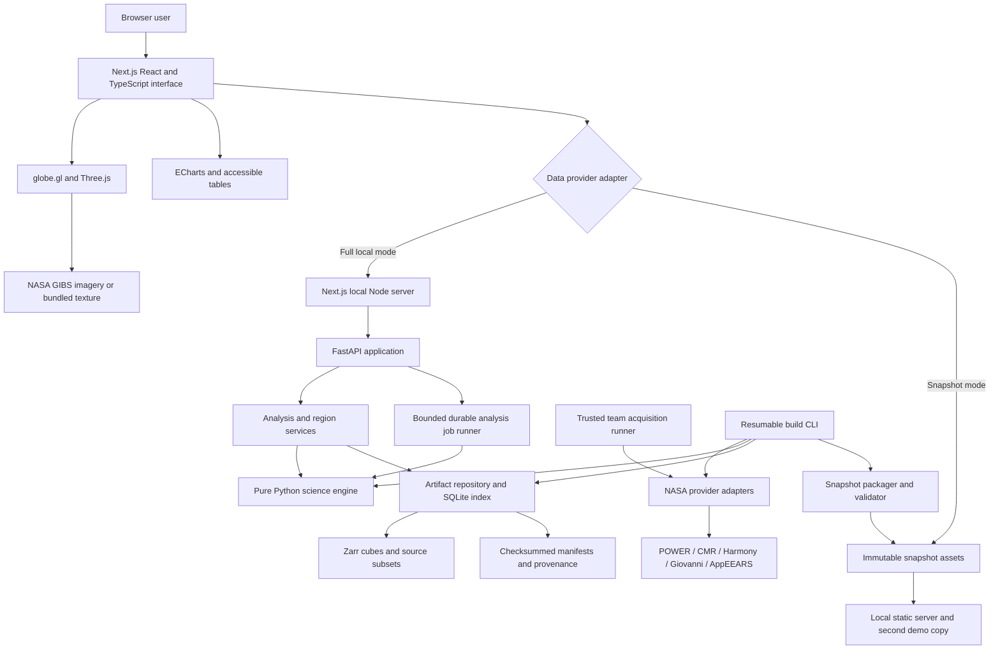

# Technical Design: Earth Trend Detective

**Project:** NASA Space Apps Challenge 2026 — Be An Earth System Trend Detective!  
**Version:** 0.4 — user-approved Next.js architecture amendment on 14 November 2026; aligned with SRS v0.4. Local hosting and scientific gates remain. See [ADR-001](decisions/0001-nextjs.md).
**Prepared:** 13 November 2026, Asia/Colombo.  
**Scope authority:** [approved SRS](SRS.md), read in full, and [README](../README.md), including the challenge transcript. At the team's explicit request, the SRS was reconciled with the decisions below before implementation planning. This is a targeted document revision, not application implementation.

## Design basis and approval boundary

Build a modular Python application with a React interface, a visually distinctive Three.js globe, and reproducible NASA data artifacts. Run the full application locally, with a Next.js/Node frontend forwarding approved API requests to the loopback FastAPI backend, and a bounded worker using persistent SQLite/cube/artifact storage. NASA acquisition is a trusted team workflow; installed-cube analysis needs no live provider call. Keep the static snapshot and a second local copy for recovery. Public hosting is deferred by the team's latest decision; no cloud account or infrastructure is needed now.

The SRS defines a large P0: V01–V12 cube variables, V13 regional vegetation, at least ten global layers, regional analysis, three significance methods, seasonal analysis, forecasts, three stories, provenance, and scientific validation. This design preserves that scope. A two-day delivery is **high risk until data access, transfer volume, and processing speed pass the first milestone**. A fallback demonstration is not evidence that every P0 requirement passed.

Evidence labels used here:

- **[V-doc]** checked against provider documentation during design.
- **[V-live]** a public metadata request succeeded during design; this does not establish authenticated download or processing success.
- **[SRS]** carried from the approved specification; not independently reconfirmed here.
- **[D]** a selected technical choice within the reconciled scope; implementation evidence is still required.
- **[U]** an unresolved detail or implementation gate.
- **[Proposal]** a change or interpretation requiring explicit team agreement, not an approved requirement.

No application files, credentials, deployments, NASA processing jobs, or implementation tests are created by this document. Numerical examples below describe contracts and calculations, not observed environmental findings.

## 1. System architecture

### 1.1 Overall architecture and deployment modes

Use one repository and one Python package shared by a batch CLI and a FastAPI server. A bounded local worker executes processing outside the HTTP event loop. This is a modular monolith, with no Redis, Celery, Kubernetes, or separate scientific microservices.

| Mode | Runtime | Capabilities and limits | SRS mapping |
| --- | --- | --- | --- |
| Full local application | Next.js/Node frontend and FastAPI on loopback; local cube, SQLite, artifacts; optional internet | Arbitrary cells, boxes, polygons, global regions, recomputation, comparisons, exports; NASA jobs when connected | DEP-01, AC-35, RG-01–05, SC-01–04, AN-01–10, FC-01–02, DA-01–08 |
| Offline local application | Same application with validated cube and cached artifacts | All analyses supported by installed data, plus globe and stories; uncached provider requests explicitly unavailable | DA-09, REL-1 |
| Public snapshot (deferred) | Possible later static publication of the same snapshot | Not part of the current deployment commitment; no cloud resources provisioned | DA-09, future OD-02 review |
| Downloaded demo snapshot | Static build and snapshot served locally, or verified browser cache | Guaranteed demonstration package after download; no credentials required | AC-28, REL-1 |

The full local application is the deployment target (DEP-01/AC-35); the snapshot is its limited recovery mode. Unsupported region/product combinations return truthful availability reasons. If hosting is reconsidered later, an HTTPS site must never silently call a judge's localhost; public compute would require a separately reviewed deployment boundary.

### 1.2 Components and responsibilities

| Component | Responsibility | SRS requirements |
| --- | --- | --- |
| React application shell | Navigation, explanation level, theme, capability banner, onboarding, accessibility | ED-01–02, ED-05, USE-1–4, ACC-1–3, PRT-1 |
| Globe renderer | Basemap, trend and significance channels, relief, picking, time-lapse, anomaly ring, opposite regions | GL-01–07, SM-09, PERF-1 |
| Region/catalog modules | Geometry validation, presets, area/mask/coverage summary, rule-based variable discovery | RG-01–03, VC-01–03, DR-C4 |
| Analysis application service | Resolve requests, aggregate regional series, invoke science engine, rank scans and compare regions | SC-01–04, AN-01–07, AN-10, RG-05 |
| Pure science engine | Anomalies, slopes, uncertainty, significance, FDR, grades, detectability, forecasts | SM-01–12, AN-01–07, FC-01–02 |
| NASA adapters | POWER, Earthdata/CMR/Harmony, Giovanni, AppEEARS; authentication, quotas, polling and decoding | DA-02–07, SEC-2–3 |
| Resumable pipeline | Discover, subset, validate, normalize, aggregate, construct cubes, calculate layers and publish artifacts | DA-01, DR-C1–7, REL-2–3 |
| Artifact and provenance store | Local files, manifests, cache index, checksums, lineage, job state | DA-08–09, PV-01–02, MNT-1 |
| Case visualization and exports | Charts, explanations, Outlook, comparison, CSV/JSON/PNG/citations | VZ-01–03, VZ-07–08, VZ-10–11, FC-05, PV-02 |
| Evidence and learning content | Guided stories, glossary, validation results, credits, SI disclosure | ED-01–03, VL-01–02, SI-04–05, CMP-1–5 |

P1 modules attach to these boundaries: native-polygon AppEEARS, station/hydrology adapters, independent witnesses, robustness UI, advanced plots, optional catalog-only SI. P2 remains disabled. No accounts, upload system, attribution engine, event prediction, or paid service is introduced.

### 1.3 Architecture diagram



The local API accepts bounded analyses against the installed cube. Acquisition credentials remain in the trusted local runtime, outside the repository and browser bundle. Hosted mirrors are deferred and add no current dependencies.

### 1.4 Scientific data-flow diagram

```mermaid
flowchart LR
    R[Approved variable and window] --> M[Resolve version and inspect metadata]
    M --> Q[Quota and transfer preflight]
    Q --> A[Retrieve subset or service result]
    A --> RAW[Immutable source artifact and checksum]
    RAW --> QC[Decode fill values, QA and units]
    QC --> GRID[Conservative spatial aggregation and masks]
    GRID --> MONTH[Monthly values and coverage]
    MONTH --> REGION[Weighted regional series]
    MONTH --> YEAR[Annual 1-degree cell anomalies]
    REGION --> STATS[Anomalies, slopes and corrected tests]
    YEAR --> LAYER[Per-cell tests and global FDR]
    STATS --> FDR[Scan or seasonal FDR]
    FDR --> GRADE[Grades, caveats and Outlook]
    LAYER --> PUB[Versioned layers and snapshots]
    GRADE --> PUB
    PUB --> VIEW[Views, summaries and exports]
    RAW -. lineage .-> P[Provenance graph]
    GRID -. parameters .-> P
    STATS -. method and seed .-> P
    PUB -. hashes .-> P
```



Two invariants apply throughout: imagery is never treated as numeric science data; a regional trend is calculated from its aggregated time series, never from an average of cell slopes or p-values.

## 2. Technology stack

### 2.1 Selected stack and rationale

Exact patch versions will be pinned together after the installation smoke test. Do not assume that an untested newest release is compatible. Prefer stable releases supported by the team's Python and Node LTS installations; record runtime versions and resolved licences in the lockfiles and manifest (MNT-1, CMP-1).

| Area | Selection [D] | Why it fits the SRS |
| --- | --- | --- |
| Frontend | Next.js App Router + React + TypeScript | User-approved replacement for Vite/React Router; reuses Navida's native page/layout components and routing. Run a local Node server; no SSR scientific computation or automatic provider acquisition. Separate snapshot packaging remains R02. [Next.js documentation](https://nextjs.org/docs/app) |
| UI system | Tailwind CSS + shadcn/ui components built on Radix primitives; Lucide icons; system font stack | Modern, restrained space-themed panels with accessible dialogs, tabs, controls and keyboard behavior; customize owned components rather than introduce a large theme. USE-4, ACC-1–3. [shadcn/ui](https://ui.shadcn.com/docs) |
| State and data requests | Zustand for compact view state; TanStack Query for asynchronous requests and cancellation | Keep GPU objects and large arrays outside React state; distinguish a selected request from the last completed result. PERF-2–4 |
| Globe | globe.gl with Three.js; direct lifecycle wrapper in React | Strong visual customization for GL-03–07 with one rendering engine. MIT. [globe.gl](https://github.com/vasturiano/globe.gl) |
| Charts | Apache ECharts, tree-shaken chart modules; no ECharts-GL | Shared chart grammar for time series, heatmaps, stripes and fans; export and ARIA/decal support. Apache-2.0. [ECharts accessibility](https://echarts.apache.org/handbook/en/best-practices/aria/) |
| Backend | Python + FastAPI + Pydantic + Uvicorn | Typed request validation, OpenAPI contracts, scientific ecosystem, local serving of the production frontend. DA, AN, SEC-1–3. [FastAPI](https://fastapi.tiangolo.com/) |
| Numerical methods | NumPy, SciPy, statsmodels; pyMannKendall as complete-series reference and reviewed method implementation | Established numerical operations; isolated reproducible scientific methods. SM-03–12. BSD licences for NumPy/SciPy/statsmodels; MIT for pyMannKendall |
| Array processing | xarray, Dask with local scheduler, Zarr, numcodecs, h5netcdf/h5py, cftime | Labelled dimensions, chunked reads, explicit calendars and metadata. DR-C1–7; no distributed cluster |
| NASA access | earthaccess, harmony-py, fsspec/s3fs; httpx for POWER, Giovanni quota and AppEEARS | NASA discovery/authentication and provider-specific subsetting, with simple HTTP adapters where needed. DA-02–07. [earthaccess access guidance](https://earthaccess.readthedocs.io/en/stable/user/howto/access-data/), [Harmony](https://harmony.earthdata.nasa.gov/docs) |
| Geospatial processing | Shapely, pyproj, rasterio; sparse overlap weights using SciPy | Valid polygons, dateline handling, area calculations and GeoTIFF input without a heavyweight GIS service. RG-01–03, SM-02 |
| Database | Python sqlite3 in WAL mode for jobs, cache and artifact metadata | No accounts or collaborative writes; a single machine is sufficient. Numeric arrays remain in files. DA-08, REL-3 |
| Caching | Local content-addressed files + SQLite; browser HTTP cache/Cache Storage and IndexedDB | Avoid network dependence and duplicate processing. Separate immutable releases from mutable job status. DA-08–09 |
| Hosted storage | Deferred; local content-addressed files and SQLite suffice | No cloud database/account dependency for this release |
| Deployment | Local Next.js production server forwards approved API requests to loopback FastAPI; verified snapshot and second local copy | Full arbitrary-region workflow over installed data, reproducible offline recovery. DEP-01, OD-02, REL-1 |
| Verification | pytest, coverage, fixed reference fixtures; Vitest, Testing Library, Playwright, axe-core; licence/secret scanners | Statistical tests, contracts, visual and interaction acceptance, offline verification. VL-01–02, MNT-2, AC-01–34 |
| Packaging | pnpm lockfile and uv lockfile; documented one-command local setup | Fast repeatable setup; do not require Docker Desktop or a paid account. MNT-1 |

The cited library choices are not a completed dependency audit. Before installation approval is considered implementation-ready, inspect every resolved dependency's licence; do not import commercial component packs. Hosted services have service terms separate from open-source library licences. System fonts avoid extra font downloads and attribution complexity.

### 2.2 Globe engine decision: custom scientific presentation

**Select globe.gl + Three.js.** “Most visually appealing” is a design judgment, not a measurable engine property. This choice best supports the specific creative encodings in the approved SRS within one scene.

| Candidate | Strength for this project | Cost or tradeoff | Decision |
| --- | --- | --- | --- |
| globe.gl / Three.js | Free scene composition, atmospheric rim, data relief, ring geometry, custom picking and cinematic transitions | GIBS integration and geographic drawing require a small adapter; 64,800-cell performance must be measured | Selected |
| CesiumJS | Geospatial cameras, imagery providers and mature WMTS support | More scene constraints for an infographic-like globe and surrounding anomaly ring; unnecessary terrain/3D Tiles machinery for a 1° scientific grid | Contingency if globe.gl fails the rendering/geometry spike |
| MapLibre GL JS globe | Familiar vector/raster map styling and globe navigation | Less direct fit for custom relief geometry and scene-level ring composition | Not included in P0 |

Cesium's [WMTS imagery provider](https://cesium.com/learn/cesiumjs/ref-doc/WebMapTileServiceImageryProvider.html) and MapLibre's [globe example](https://maplibre.org/maplibre-gl-js/docs/examples/display-a-globe/) document their capabilities. No claim that any engine meets PERF-1 is made without the reference-laptop benchmark.

Rendering design:

1. Use a subtle, static GIBS Blue Marble texture, muted behind data. The atmospheric rim and background remain decorative and never encode scientific certainty. Avoid bloom on data colours.
2. Draw the 180 × 360 grid using batched/instanced Three.js geometry or a data texture, not 64,800 individual React components or globe.gl polygon objects. Maintain numeric typed arrays separately from display buffers.
3. Colour represents signed trend on fixed per-variable diverging scales. A second channel uses stipple or reduced opacity for q ≥ alpha. Missing cells use a separate hatch/transparent state.
4. Relief uses radial extrusion proportional to absolute standardized slope: `height / globe_radius = 0.02 × abs(slope_sigma_per_decade)` [D]. Never auto-rescale between variables or windows. Label the scale and document any necessary visible cap; capped cells must be marked, not silently flattened. Zero residual variance gives no standardized height.
5. Pick a cell by intersecting the base sphere and converting longitude/latitude to grid indices. Relief must not move the scientific location. Render region outlines above the cell layer without excessive z-offset.
6. Draw the annual anomaly ring with one mesh and one value per valid year. Time-lapse swaps annual data buffers; it does not recolour daily satellite pictures as if they were anomalies.
7. The lens converts its screen boundary into a geographic footprint on the visible hemisphere. Near the limb, clamp it to a supported footprint and explain the boundary; do not use an arbitrary screen rectangle as a geographic average.
8. Opposite-trends components use four-neighbour adjacency, wrap at ±180°, and rank by spherical area. Keep positive and negative components separate; publish the three largest of each. Comparisons do not imply a physical connection or cause.

Reduced motion disables rotation and animated transitions. A modest pixel-ratio cap, render-on-demand when idle, and bounded frame-buffer caching protect integrated graphics. The basic accessible 2D canvas/SVG view with numeric region controls is mandatory P0 under the reconciled PRT-1. The richer interactive 2D map remains GL-09 P1.

### 2.3 Local deployment constraints

The baseline is 16 GB RAM and 50 GB free disk (AS-04), subject to measured data size and memory use. Keep SQLite on a local filesystem. Limit workers, stream chunks and process one variable family at a time. No Oracle, Vercel, Supabase, hostname or cloud quota is required. Public hosting and optional mirrors are deferred; any future choice must recheck current free-service terms and scientific workload capacity.

### 2.4 Local release topology and operating boundary

Serve the Next.js frontend and approved `/api/v1` proxy routes from one loopback browser origin. Next.js/Node and FastAPI are separate local processes supervised by the launcher; FastAPI retains scientific/business processing and bounded work outside the HTTP event loop; numeric artifacts and SQLite survive process restarts. Separate the configured artifact directory from application source and secrets. Keep the TDD §8 limits, Host/Origin checks and acquisition nonce protection; do not expose the server on a LAN by default.

Readiness requires a compatible schema, verified release hashes, readable cube and sufficient disk. Liveness checks the process only. Publish validated builds atomically and keep a last-known-good release. Verify that the documented start command, restart, a non-preset polygon, changed controls, comparison and export all work on the reference laptop. Repeat installed-cube analysis with the network disconnected. A 202 response is progress, not completed analysis. Copy the release and checksums to a second device; the static snapshot remains explicitly limited to bundled results.

## 3. NASA data pipeline

### 3.1 Exact P0 products and variable bindings

The table names the selected products. A CMR collection record establishes identity and reported coverage; it does not prove individual granules are downloadable or that Harmony supports a particular operation. Resolve provider IDs from CMR, pin the version, and inspect one real source file before admitting each binding to the cube.

| ID | Exact product and variable | Source units → canonical/display units | Route, resolution, window and evidence |
| --- | --- | --- | --- |
| V01 | POWER MERRA-2 monthly UTC Zarr, `T2M` | **C → °C, identity** in the checked store; direct MERRA-2 K would require −273.15 | Public S3; native 0.5° × 0.625° [SRS]. Start 1981; end is last verified complete month. Variable/units [V-live] |
| V02 | `GPCPMON` 3.3; DOI `10.5067/MEASURES/GPCP/DATA306`; expected `precip` [U field binding] | Expected mm/day → mm/day [U until header checked] | CMR `C3405935516-GES_DISC` [V-live]; 0.5° [SRS]. **Retain approved 1983-01–2024-09 default** |
| V03 | `GPM_3IMERGM` 07 Final; `precipitation`; DOI `10.5067/GPM/IMERG/3B-MONTH/07` | Inspect units; mm/hr ×24 → mm/day; mm/day unchanged | CMR `C2723754851-GES_DISC`; Giovanni binding [V-live]; 0.1° → 0.5°. Approved 2001-01–2025-09 |
| V04 | `GLDAS_NOAH025_M` 2.1; `SoilMoi0_10cm_inst` | kg/m² → mm water, factor 1 | CMR `C1342986036-GES_DISC`; DOI `10.5067/SXAVCZFAQLNO`; 0.25° → 0.5°. Default starts 2001-03. Identity/binding [V-live] |
| V05 | Same GLDAS product; `Evap_tavg` | kg/m²/s ×86400 → mm/day | Shared download and mask with V04; units supported by GLDAS documentation |
| V06 | Same GLDAS product; `Qs_acc` | Monthly average of 3-hour accumulations, kg/m² ×8 → mm/day | This is surface runoff per unit area, **not river discharge**. Conversion [V-doc]; confirm file metadata |
| V07 | Same GLDAS product; `SWE_inst` | kg/m² → mm water, factor 1 | Same window/mask; real zero snow is valid, missing snow is not zero |
| V08 | `AIRS3STM` 7.0; **`TotH2OVap_A`** selected ascending branch [D]; descending retained as a separate available binding | Expected kg/m² → mm, factor 1 [U header] | DOI `10.5067/UBENJB9D3T2H`, CMR `C1701805662-GES_DISC` [V-live]. Giovanni monthly maps; native 1°; 2002-09 onward. Do not merge A/D or substitute AIRX3 |
| V09 | `OMNO2d` 003; `ColumnAmountNO2TropCloudScreened` | molecules/cm² ÷10^15 → 10^15 molecules/cm² | DOI `10.5067/Aura/OMI/DATA3007`, CMR `C1266136111-GES_DISC` and Giovanni binding [V-live]. **Daily source** → monthly maps → 0.5°. Default 2005 onward |
| V10 | `M2TMNXAER` 5.12.4; `TOTEXTTAU` | Dimensionless → dimensionless | DOI `10.5067/FH9A0MLJPC7N`, CMR `C1276812866-GES_DISC` [V-live]; monthly Earthdata/Harmony capability [U]. Native 0.5° × 0.625°. Demo from 2002; monthly cube preferred |
| V11 | `MODISA_L3m_CHL` 2022.0; monthly 9 km mapped `chlor_a` [D resolution; U header] | mg/m³ unchanged; log10 only in specified robust analyses | DOI `10.5067/AQUA/MODIS/L3M/CHL/2022.0`, CMR `C3380709133-OB_CLOUD` [V-live]. OB.DAAC HTTPS; aggregate to 0.5°; record begins July 2002 |
| V12 | POWER SYN1deg monthly LST Zarr, `ALLSKY_SFC_SW_DWN` | **W m-2 → W/m², identity** in checked store | Public S3, native 1°; start 2001. Variable/units [V-live]. End at verified SYN1deg coverage; do not append FLASHFlux |
| V13 | **`MOD13A3.061`** Terra monthly 1 km; `_1_km_monthly_NDVI`, optionally EVI separately | Native integer ×0.0001 → dimensionless; AppEEARS outputs may already be scaled | Product, layer, QA companion and scale [V-live]. AppEEARS area tasks for at least two presets. Regional only. DOI `10.5067/MODIS/MOD13A3.061` must be matched to catalog citation before publication |

V01 and V12 use these exact SRS paths, checked for their variable metadata:

- `s3://nasa-power/merra2/temporal/power_merra2_monthly_temporal_utc.zarr`
- `s3://nasa-power/syn1deg/temporal/power_syn1deg_monthly_temporal_lst.zarr`

Public metadata evidence: [T2M attributes](https://nasa-power.s3.us-west-2.amazonaws.com/merra2/temporal/power_merra2_monthly_temporal_utc.zarr/T2M/.zattrs), [solar attributes](https://nasa-power.s3.us-west-2.amazonaws.com/syn1deg/temporal/power_syn1deg_monthly_temporal_lst.zarr/ALLSKY_SFC_SW_DWN/.zattrs), [AppEEARS MOD13A3 layers](https://appeears.earthdatacloud.nasa.gov/api/product/MOD13A3.061). These endpoints were read successfully on 13 November 2026; no science arrays or authenticated jobs were downloaded.

The [NASA GLDAS README](https://ecsinfo.gsfc.nasa.gov/projects/ECS/repos/uvg/raw/input/README_GLDAS2.pdf?at=90e7d431b25f09dadb470249f66fa41a5dd0788c) resolves the SRS's runoff-unit uncertainty: multiplying the monthly `Qs_acc` value by 8 gives a daily amount; multiplying again by days in the month gives a monthly total. Never multiply this accumulated field by 86,400.

### 3.2 Reference and guided-investigation data

| Use | Selection | Integrity rules |
| --- | --- | --- |
| VL-02 and Rivers revisited | `SeaWiFS_L3m_CHL` 2022.0, monthly 9 km `chlor_a`; DOI `10.5067/ORBVIEW-2/SeaWiFS/L3M/CHL/2022.0`; CMR `C3113254690-OB_CLOUD` [V-live] | Use the ten SRS Appendix B boxes at native mapped resolution, not a 1° globe sample. Preserve SeaWiFS separately from MODIS |
| Wisconsin story | V10 MERRA-2 series plus classic Giovanni MODIS-Aqua AOD export as explicitly required | Candidate classic product `MYD08_M3` 6.1 and 550 nm combined dark-target/deep-blue AOD field [U exact Giovanni identifier]. Pin actual selected field/version, wavelength, QA, units and export header before use; do not label MERRA-2 as MODIS |
| Wetter here, drier there | Significant opposite-sign regions selected only after V02/V03 analysis | One common product and common time window; include a Giovanni-sourced series with provenance. No hand-picked claimed result before computation |
| Every story | At least one authentic Giovanni-sourced series | Bundle original service CSV/export and processing lineage, not merely a citation link. DR-01, AC-24 |

The paper's method text calls the span nine years, while its discussion explicitly gives **January 1998–December 2007**. Use that ten-year interval as the reproduction candidate [D], record the discrepancy, and visually confirm tables/figures before freezing the fixture. PDF text extraction was available during design; the screenshot service failed, so Appendix B coordinates remain pending visual verification. Modern R2022.0 reprocessing may differ from the historical product. This is a method reproduction with disclosed data differences, not a promise to reproduce p-values exactly. [Acker et al. paper](https://ntrs.nasa.gov/api/citations/20090042747/downloads/20090042747.pdf)

### 3.3 Newly observed metadata discrepancies

- CMR reports GPCPMON 3.3 through 2025-12, beyond the SRS's paused 2024-09 endpoint. Preserve the approved default; a later extension is a separate catalog/window decision after granule and caveat checks. [Live collection query](https://cmr.earthdata.nasa.gov/search/collections.umm_json?short_name=GPCPMON&version=3.3).
- CMR lists both OMNO2d 003 and 004. Continue with 003; never silently switch versions. [Collection query](https://cmr.earthdata.nasa.gov/search/collections.umm_json?short_name=OMNO2d).
- IMERG V07 metadata ends 2025-09-30. A V08 transition schedule is not proof V08 is available or interchangeable; no migration is in P0. [NASA transition notice](https://gpm.nasa.gov/data/news/update-imerg-v08-transition-schedule-aug-2026).
- The SRS caveat dates include anticipated mission events. Store `event_status = observed | planned | approximate`, source and checked date. Do not terminate a record solely because a shutdown was forecast, or call a future event observed. Retain applicable approved caveat warnings.

### 3.4 Adapter behavior and authentication

| Adapter | Operations | Authentication and failure policy |
| --- | --- | --- |
| POWER | Read consolidated Zarr metadata then slice needed variables/time/chunks; point REST for quick lookup only | Anonymous S3; point API not used to tile the globe. Explicit community/unit decoding; monthly annual-summary entries must not become a thirteenth month |
| Earthdata | CMR collection/granule search, provider HTTPS download, supported Harmony subsetting | Earthdata Login via earthaccess; temporary credentials remain local. Use external HTTPS from a laptop: direct protected S3 access may require cloud execution in us-west-2 |
| Giovanni | Check configured variables and `/quota` before each new job; Harmony request for area averages/CSV or time-averaged maps/GeoTIFF; poll, retrieve, cache | Local Earthdata token. Quota response describes fraction used; do not invent a free-job count. Stop at 90% used [D reserve policy], warn at 80%, and stop if quota cannot be checked |
| AppEEARS | GET product/layers; authenticate; POST area task; poll task status; enumerate bundle; download statistics and QA artifacts | Local AppEEARS bearer token, expiry-aware refresh. At most one submission in flight initially; two prepared regions first |
| GIBS | Read capabilities, retrieve static basemap image/tiles | Public, no Earthdata or Cesium ion token. Display acknowledgment; never analyze imagery pixels |

The [Giovanni tutorial](https://github.com/nasa/gesdisc-tutorials/blob/main/notebooks/How_To_Access_the_Giovanni_Averaging_Service_Using_Python.ipynb) documents the quota and Harmony workflow. The [configured-variable endpoint](https://api.giovanni.earthdata.nasa.gov/configured-variables/) was read live: AIRS V7 water vapour, OMI 003 cloud-screened tropospheric NO2, GLDAS fields, IMERG 07 precipitation, and **hourly** `M2T1NXAER_5_12_4_TOTEXTTAU` are listed. A configured field still needs a successful authenticated request.

For V10, hourly Giovanni output is a distinct source series from the monthly cube: aggregate its hourly samples to months using documented completeness rules, label it separately, and never splice it onto M2TMNXAER. For V08/V09, request each calendar month separately; one multiyear time-averaged map cannot support a trend. Annual-map fallback is permitted by SRS §5.2, but loses monthly analysis and must be labelled as such. At least ten complete layers are still required.

### 3.5 Acquisition and build workflow

1. Validate catalog entry, dataset version, source units, spatial bounds, temporal coverage and provider capabilities. Save the metadata snapshot or hash in the run manifest.
2. Estimate bytes and jobs using one representative subset. For monthly AIRS/OMI maps, multiply measured per-job cost by the number of required months before submitting the batch.
3. Build a deterministic work list by product/version, granule or service request, variable group, month and spatial chunk. Resume completed, checksummed work; do not resubmit known provider jobs after a restart.
4. Retrieve to a temporary artifact; check content type, expected dimensions, response status and checksum. Authentication HTML is not a NetCDF file. Move verified files atomically into the artifact store.
5. Decode fill values and QA, normalize dimensions/calendars/longitude, apply scale/offset once, convert units, then aggregate. Reject unknown units instead of guessing.
6. Persist monthly values, valid support, coverage, source footprint and flags. Build annual anomalies and per-cell statistics from these arrays, then apply layer-wide FDR.
7. Build prepared region series, stories, comparisons, forecasts and validation reports using the same scientific package as the API.
8. Publish a release manifest only after every included object passes integrity and scientific checks. Preserve the previous release for rollback; partial builds are never labelled complete.

### 3.6 Geography, resolution and weighting

- Use WGS84 longitude/latitude GeoJSON with `[longitude, latitude]`, normalized longitudes in `[-180,180)`, explicit cell bounds, and an explicit `global` region type. Split dateline-crossing shapes; represent polygons larger than a hemisphere without accidentally selecting their complement. Never calculate polygon area directly in square degrees.
- Use a 0.5° analysis grid for products whose native support is at least that fine; 1° globe cells. For aligned finer grids, use valid-support-weighted block aggregation. Otherwise use conservative cell-overlap weights.
- **Native-grid decision:** retain the 0.5° × 0.625° MERRA-2 grid for regional weighting and use conservative area-overlap aggregation for the 1° globe, as reconciled in DR-C1. AIRS/CERES remain at 1°. No interpolation creates finer independent information.
- Store cubes per native/analysis grid, not one artificially uniform array. Sparse region-overlap weights allow every product to participate in the same request without upsampling.
- Apply land/ocean support before coverage denominators. Whole-world GLDAS is a land-domain mean, not a global land-and-ocean mean. GLDAS has geographic limits; report outside-domain areas rather than manufacturing polar values.
- On a regular lat/lon grid, implement SRS `w_i = cos(latitude_i) × fraction_in_region_i`. Exact spherical cell-area factors are proportional on a uniform latitude grid and are used for physical area reporting. Native equal-area MODIS pixels use area/fraction weights, not an extra cosine factor.
- Compute `sum(w × valid × value) / sum(w × valid)` each month. Preserve the numerator and denominator; do not average already-normalized subregion means without their weights. Coverage is valid weighted support divided by all eligible weighted support.
- Regrid **monthly values/support first**, then calculate annual anomalies and trends at 1°. Do not average slopes, p-values or q-values from 0.5° cells into a 1° layer.
- Static land/ocean fractions and boundary masks need a pinned source/version/checksum. Prefer provider masks for variable eligibility; use a [GSHHG 2.3.7](https://www.soest.hawaii.edu/pwessel/gshhg/) coastline-derived mask [D] for general region summaries. Start with intermediate-resolution polygons, preserve lake/island nesting, and choose the Antarctic grounding-line boundary explicitly. Record that these are approximate shoreline fractions, not contemporary satellite land classification. GSHHG is distributed under LGPL; include its licence and attribution. Mask provenance is a required first-build artifact; no precise coastal fraction is claimed before it is built.

### 3.7 Temporal quality control and missing values

- Preserve actual monthly positions, time bounds and UTC/LST source convention. Missing months remain missing; no default interpolation, forward fill, zero fill or replacement by climatology.
- Preserve source QC flags. Apply fill values before numeric scaling. Do not delete unusual but valid observations simply because they alter a trend.
- For regional monthly coverage use ≥0.5, or ≥0.7 for AIRS/OMI/MODIS clear-sky products, as specified by SM-02. Require ≥80% usable months over at least ten elapsed years. A year requires ≥10 usable months. Native domain exclusion and missing observations are separate measures.
- For daily OMI to monthly aggregation, track usable days and coverage, not just the monthly mean. Proposed daily completeness threshold is 70% of expected days [D]; verify whether Giovanni outputs sufficient counts. Unknown coverage is not 100% coverage.
- AppEEARS: request monthly NDVI with its VI Quality/reliability layers. Use statistics CSV only if QA filtering, pixel support and area weighting can be demonstrated. Otherwise retrieve the area rasters/QA from the same task and calculate the weighted monthly mean locally, retaining the service statistics for comparison. At least two preset results must pass AC-27.
- AppEEARS may return physical values already scaled. Match actual output metadata and range; applying 0.0001 twice is an ingestion error. NDVI is an index, not a percentage; negative valid values are not automatically fill.
- Chlorophyll robust inference first computes the regional arithmetic mean of valid positive concentrations, then log10, then monthly climatology removal on that scale. Record this order. Raw reference-method series remains separate; nonpositive concentrations are invalid for the log branch.
- Changing spatial coverage can produce artificial trends despite passing thresholds. Show coverage series and flag systematic coverage change; do not silently harmonize it with invented observations.

### 3.8 Provenance and reproducibility

Every displayed numeric field points to a result/provenance identifier. Lineage includes source product/version/DOI, provider and resource, original field and units, query geometry/time bounds, granule/job IDs, checksums, retrieval time, native and analysis grids, mask, QA rules, valid support, transformations, window, baseline, tests, lag rules, FDR family, alpha, software versions, git SHA and random seed.

Record POWER store metadata and data hashes because a public store can update in place. Resolve “latest” to a concrete month before hashing requests. Save original provider artifacts where redistribution permits; signed download URLs and bearer tokens never enter public provenance. Export a sanitized endpoint and parameters instead.

All valid outputs are deterministic for a fixed artifact manifest, code version, configuration and seed. Record numerical tolerances for cross-platform comparisons; byte-identical floating point across different BLAS implementations is not assumed. GIBS imagery gets its own attribution and retrieval record and remains separate from analytical provenance.

## 4. Statistical analysis engine

### 4.1 Boundary and canonical inputs

The science package accepts validated arrays and configuration, never HTTP requests or provider credentials. Each input contains a regular calendar axis, observed values, coverage, validity mask, physical units, transformation, source domain and caveat registry. Public outputs include method name/version, sample count, valid interval, estimates, uncertainty, status and reasons. JSON uses `null` with a reason for unavailable quantities; it never uses NaN, Infinity, or zero as a missing estimate.

Use float64 for statistics. Express time as elapsed years from the first monthly midpoint using actual calendar positions; retain gaps. Multiply annual slopes by ten for per-decade display. For monthly rank calculations, month indices preserve ordering and known lag spacing. Do not substitute observation sequence numbers for elapsed time when months are missing.

### 4.2 Seasonality and trend estimates

| Step | Algorithm and safeguards | SRS |
| --- | --- | --- |
| Monthly climatology | Mean for each calendar month over selected baseline; default baseline equals analysis window. Require at least five usable observations per calendar month [D]. Report baseline counts and reject an unsupported baseline | SM-03, AN-02, AN-10 |
| Monthly anomaly | Observed regional mean minus that calendar month's climatology. Chlorophyll uses the log branch described in §3.7 | SM-03 |
| Annual anomaly | Equal-weight mean of usable monthly anomalies, at least ten months per year. Do not silently day-weight this reference-method series | DR-C3, SM-03 |
| Sen slope | Median of all finite pairwise anomaly differences divided by actual elapsed time. Use SciPy `theilslopes` with explicit `x`; retain its estimate, not an implicit index-time slope | AN-03, SM-04 |
| OLS | Regression with intercept on monthly anomalies; compute slope, unadjusted SE, R² and adjusted inference separately. Raw monthly and annual-anomaly regressions are separate reference results | AN-03–04 |
| Residual scale | Sample SD of detrended anomalies on the same transformation/time scale as the slope. Preserve method and degrees of freedom | SM-04 |
| Normalized magnitude | `10 × annual_slope / residual_SD`; undefined when SD is zero or numerically unresolved | SC-01, GL-03 |
| Percent change | For positive ratio-scale variables only: `100 × slope_per_decade / baseline_mean`. Require mean greater than both ten times documented reporting resolution and 0.1 residual SD [D], otherwise show “not meaningful near zero” | SM-04 |

Do not show a percent temperature trend in Celsius, or percent NDVI. The conventional raw-unit slope for chlorophyll is retained as a separate descriptive result. Robust log10 slope has units log10(mg/m³)/decade; its multiplicative interpretation is `100 × (10^slope_log_per_decade − 1)` percent/decade. Never relabel a log slope as mg/m³/decade. Display the raw-unit slope and robust significance on explicitly identified branches; if their direction differs, show the disagreement and prevent grade A.

For consistency with GL-02 and reconciled SM-04, the chlorophyll globe's primary legend uses raw-unit Sen slope; standardized relief and robust p/q use the documented transformed branch. Its legend must disclose this; there is no universal constant conversion from log slope to absolute concentration change.

### 4.3 Three significance results

**A. Reference method, Acker et al.** Fit raw monthly regional values against time using OLS with intercept. Report slope, R², F, numerator df=1, denominator df=n−2 and two-sided-equivalent F p-value. Repeat on annual anomaly means. For one predictor, verify F=t². Label this reference inference as uncorrected for serial dependence; it does not supply the principal significance badge. Use the exact paper window for reproduction and disclose reprocessing differences (AN-04a, VL-02).

**B. Primary, Hamed–Rao modified Mann–Kendall.** Use anomaly ranks, tie-corrected MK variance, detrended rank autocorrelation, continuity correction and a two-sided normal approximation. Freeze an explicit method configuration: detrend with Sen slope; inspect lags 1 through min(n−1,36) for monthly data and min(n−1,5) for annual data [D]; include significant rank autocorrelations at a fixed diagnostic 0.05 level. Diagnostic lag selection must not change when the user changes display alpha. Record variance correction and included lags. These finite lag caps are implementation choices requiring SM-12 validation, not thresholds attributed to NASA.

Do not blindly pass a gappy series to pyMannKendall: its [current source](https://raw.githubusercontent.com/mmhs013/pyMannKendall/master/pymannkendall/pymannkendall.py) removes missing observations before autocorrelation, compressing calendar gaps. Use it as a complete-series reference. A calendar-aware wrapper must preserve actual lag pairs and document the variance-correction extension for gaps. That extension is **[U] until validated on the required missing-month simulations**. If it cannot meet the validation gate, return `method_unvalidated_for_gaps` and disclose that the corresponding P0 acceptance is blocked; do not silently report naive MK as corrected MK.

**C. Secondary, OLS with AR(1) effective sample size.** Fit OLS on anomalies and calculate r1 from residual pairs exactly one calendar month apart. Require at least 24 such pairs [D]. Use the SRS formula:

`n_eff_raw = n × (1 − r1) / (1 + r1)`

For the conservative implementation, `n_eff = min(n, n_eff_raw)`: negative residual autocorrelation cannot create more observations than actually exist. If n_eff ≤2, no inferential result is returned. Use adjusted residual variance `SSE / (n_eff − 2)`, adjusted slope SE `sqrt((SSE / (n_eff − 2)) / Sxx)`, t=b/SE and Student-t df=n_eff−2; CI is b ± t-critical × SE. This is the selected effective-df approximation [D], to be compared against the cited Santer method and validated, not an exact general covariance estimator. Report raw/adjusted SE and n_eff side by side. Never clip a near-unit r1 silently to obtain a useful p-value.

Autocorrelation corrections are approximations. AR(1) does not cover arbitrary persistence, changing variance or structural breaks. If residual diagnostics indicate unresolved dependence, attach a method limitation and prevent a confident grade; a small p-value does not remove source caveats.

### 4.4 Confidence intervals and comparison

**Sen interval [D]:** select rank-based interval inversion for P0 latency. Sort all N pairwise slopes; use `C_alpha = z_(1−alpha/2) × sqrt(Var_corrected(S))` and the corresponding lower/upper rank positions around `(N ± C_alpha)/2`. Specify one-based rank rounding/clamping in the numerical fixture. With independent errors, match SciPy's rank interval; with autocorrelation, use the same recorded Hamed–Rao variance correction and label the interval approximate. This modified interval must pass empirical coverage validation. It is not the central 95% of pairwise slopes, and it is not a percentile interval of raw observations. [SciPy Theil–Sen documentation](https://docs.scipy.org/doc/scipy/reference/generated/scipy.stats.theilslopes.html)

If correction yields invalid variance or the interval fails coverage tests, block publication of the interval and resolve the method before accepting AN-03. A moving-block residual bootstrap is the scientifically preferable fallback candidate, but switching to it requires a latency benchmark and method-version change; do not present a fast independent-error interval as autocorrelation-aware.

**Trend line bands:** distinguish pointwise uncertainty of a fitted mean from a prediction interval for a new observation. For the OLS mean band, use the adjusted coefficient covariance, clearly labelled approximate; do not invent an intercept CI from SciPy's slope interval alone. The time-series chart identifies which estimator generated the line/band.

**Two-region difference (RG-05):** use one product, transformation, common window and valid calendar support. Compute `delta = slope_A − slope_B`, retaining both individual estimates. Use a paired moving-block residual bootstrap of both regional series, resampling identical temporal blocks so shared noise and overlap are preserved. Default 999 draws, 12-month blocks, deterministic seed [D]; test 6/24-month sensitivity in validation. Refit each draw and report percentile bounds of the slope differences. Do not combine independent SEs for overlapping regions. Too few valid contiguous blocks gives an explicit unavailable CI. Compare is outside the three-second Case Board benchmark unless a precomputed result exists.

### 4.5 Seasonal fingerprint and FDR

For each calendar month, fit the across-year slope and run the corrected MK branch on those observations, retaining missing years. Require ten valid years for that month [D]. Calculate Seasonal Kendall with period 12 and explicit year-by-month layout; explain its residual-dependence assumptions and show it as additional evidence, not a replacement for the primary test.

Benjamini–Hochberg implementation sorts valid p-values, calculates `min(1, min over j≥i of m × p_j / j)`, then restores original order. Invalid tests do not enter m; their exclusion reasons are retained. Store the full family membership and hash.

| Family | Members | Interpretation |
| --- | --- | --- |
| Regional scan | All analysable catalog variables requested for the same region/window/baseline | Case Board q; never recalculate after sorting/filtering visible rows |
| Seasonal fingerprint | Up to twelve valid monthly tests for one case | Month q values, with missing tests disclosed |
| Global layer | All valid 1° cells for one product, variable, window, method and baseline | Cell q; never only the current viewport |

There is no single universal q-value for a case. API fields include `family_kind` and `family_id`. A standalone case has no scan q unless opened with its scan context. Global-cell q and regional-scan q remain distinct.

Default alpha and Q are 0.05. Reconciled AN-10/SM-06 link the decision threshold for p and q; q values themselves remain unchanged, while confidence bounds use 1−alpha. A change of analysis window or baseline creates a new statistical result/FDR family.

BH controls FDR under particular dependence assumptions; spatially correlated cells and correlated variables do not imply a guarantee under every dependence structure. Repeatedly exploring windows creates additional selection effects not controlled by a single layer's q. Explain this limitation without adding a new multiple-testing method to P0.

### 4.6 Evidence grades and caveat logic

Implement the SRS A–D rules as an auditable decision function with reason codes, evaluated **D, then A, then B/C**.

- D: inadequate coverage/record or a concentrated apparent change near a registered caveat. Pending statistical validation is a separate `analysis_unavailable` state, not a fabricated grade.
- A: primary significance, q significance wherever a family exists, secondary significance with matching sign, sign stable under start/end shifts by ±2 years, and no overlapping caveat or a qualifying independent witness.
- B: primary p < alpha but at least one A condition fails. If q ≥ alpha, display “not significant after multiple testing” even though the SRS grade remains B; grade is not an FDR badge.
- C: primary p ≥ alpha, with detectability/emergence information where estimable.

The endpoint sensitivity calculations are mandatory P0 internals for grade A even though the visible robustness panel is P1. Evaluate four single-endpoint shifts and record ineligible short windows; an untestable check cannot count as passing. P1 witness availability must not be assumed in P0: if there is an overlapping caveat and no independent witness, grade A is unavailable.

**Concentrated-change rule [D]:** for each valid month boundary with at least 24 usable months on either side, compare medians of the preceding/following 24-month anomalies. Find the largest absolute shift. Flag it if its center is within ±12 months of a registered caveat, it exceeds twice the detrended residual SD, and it accounts for at least 60% of the absolute first-versus-last 24-month median change. Guard a zero endpoint difference explicitly. This is a conservative heuristic for AN-06/AC-15, not the P1 general change-point detector or a NASA standard. Test registered steps, smooth trends and noise; publish the thresholds and reasons.

Preserve source-specific caveat applicability: a warning about deep-soil production-stream discontinuities is not proof of a discontinuity in T2M or AOD. Display the SRS registry entry with its scope and evidence, not as a proven correction factor. Reanalyses/models always carry model labels.

### 4.7 Detectability and time of emergence

The Weatherhead expression in SM-08 needs careful sampling units. For equally spaced observations at m samples per year, annual slope omega, residual SD sigma_N and same-sampling lag-one phi, the leading approximation is:

`n_years ≈ [(3.3 × sigma_N / abs(omega)) × sqrt((12 / m) × (1 + phi) / (1 − phi))]^(2/3)`

For complete monthly sampling m=12 this reduces to the SRS expression. Applying that reduced expression unchanged to annual residuals would be dimensionally inconsistent with the sampling-rate derivation. **[U]** verify the coefficient and sampling convention against the full primary paper and an independent reference calculation before implementing. The accessible primary abstract confirms the dependence on variance, persistence and trend but did not expose the full equation during design. [Weatherhead et al.](https://doi.org/10.1029/98JD00995)

For P0, use monthly detrended anomaly noise and slope/year. With irregular missingness, do not merely replace m by observed count per year and claim the same accuracy: label the estimate unavailable unless the chosen approximation passes gap simulations. The headline horizon corresponds to 5% significance and 90% detection probability; if alpha is changed, either use the validated normal-critical-value generalization or retain an explicit fixed-5% label. Do not imply that it tracks a user threshold when it does not.

For near-zero slope return an unbounded horizon, represented by `value: null, reason: zero_or_unresolved_slope`; for nonstationary residuals or |phi|≥1 return unavailable. These are useful scientific outcomes, not UI errors. Years still needed are max(0, horizon − elapsed record length). This is conditional detectability, not a promise that more data will establish a real trend.

For SRS observed-trend emergence, use `ToE_k = t0 + k × sigma_N / abs(beta_per_year)`, k=1,2, with t0 explicitly the first valid month. Return fractional year and displayed year, transformation and noise scale. Label “if the trend continues”; distinguish this observed-data diagnostic from the P1 emergence-projection view. It is not a new forecast or a significance test.

### 4.8 Global layers, lens and scientific boundaries

Global layers use annual anomalies and at least ten valid years, while a regional Case File uses monthly anomalies. They may legitimately differ. A clicked 1° cell identifies its annual-layer result and the separate monthly Case File; no badge is silently carried across methods.

For SM-09, apply ordinary MK on annual anomalies unless lag-one residual correlation passes the fixed diagnostic test; then apply Hamed–Rao. Validate this switching procedure itself, not just the two methods separately. Store the per-cell method flag, valid years/month counts, coverage, raw/standardized slopes, p/q and uncertainty availability.

**Lens preview (reconciled GL-04/AC-04):** within 300 ms, summarize preloaded cells beneath the lens: dominant signs, significant area fractions and largest standardized cell changes. Label it “cell-level preview”, without a regional p-value or grade. “Open case” runs the exact regional scan for the same footprint. Averaging cell p-values, q-values or grades is prohibited.

### 4.9 Outlook and forecast skill

**Model choice (OD-03):** one candidate, trend + calendar-month seasonality + AR(1) residuals, fitted with statsmodels state-space regression/SARIMAX. Seasonal-naive and training-period monthly climatology are mandatory comparison baselines, not competing model-search families. Avoid automated hyperparameter search and external forecasting services.

**Trend continuation:** fit on the accepted analysis branch, simulate seeded AR(1) innovations and coefficient uncertainty, then reconstruct the seasonal signal. Use 2,000 paths [D], 80%/95% pointwise prediction intervals and a reproducible seed. Default H=min(10, half record length); maximum min(20, half record length) years. For monthly time series, evaluate the envelope across years within the same calendar month. AR(1) noise alone can plateau; slope uncertainty must be included to reflect increasing long-horizon uncertainty. Never widen intervals cosmetically to pass AC-19. Nonstationarity or failed covariance estimation yields no projection.

**Short-term skill:** choose 12 months as the P0 forecast horizon; 24 is allowed only with sufficient backtest support. Use at least 60 monthly origins with complete observed evaluation horizons, all ending at or before the final observation. At every origin, estimate climatology, transformations, coefficients and scaling from the training prefix only. Require at least five training years [D]. No future data enters preprocessing.

Calculate MASE using that origin's in-sample seasonal-naive MAE denominator, plus raw MAE and empirical interval coverage. Evaluate candidate and both baselines over identical target months. Show the forecast only if MASE <1, candidate MAE beats **both** baselines, and 95% interval coverage is within the SRS range 85–100%. If the seasonal-naive denominator is zero, training fails, or too few origins survive, forecast skill is unavailable. Freeze the gate before running white-noise fixtures; do not tune it to a selected seed.

Show 80%/95% empirical coverage, number of origins/targets, window and model in the skill panel. Overlapping horizons reduce independent evidence; passing this gate is not proof of future skill. Forecasts remain hidden/greyed with the SRS explanation when skill fails. Projection and forecast have separate chart styles and permanent labels, including **“Not a prediction”** for trend continuation (FC-01, FC-05).

For positive physical quantities, choose a justified transformation or flag unsupported negative outcomes; never silently truncate a Gaussian interval and claim unchanged coverage. Chlorophyll uses the documented log branch and back-transformed quantiles. Zero-valued precipitation/snow require a separate supported treatment or an unavailable Outlook reason; no unapproved event or nonlinear trend model is added.

### 4.10 Validation and scientific limitations

Validate complete-series numerical equivalence independently of the application, then use the SRS Monte Carlo suite to test corrected inference, interval coverage and grades (§9). No implementation is described as scientifically validated until those reports exist.

Known limitations must be visible in Methods and relevant case explanations: coarse spatial support; clear-sky sampling; changing masks; coastal optical complexity; reanalysis input changes; finite sample and autocorrelation approximations; log/raw estimand differences; window sensitivity; multiple exploration; conditional extrapolation; and inability to infer causes. A null or non-significant result remains a valid result. “Significant” is not “important,” and neither a p-value nor a CI is a probability that a causal explanation is true.

## 5. Backend design

### 5.1 Modules and dependency rules

| Module | Inputs → outputs | Boundary |
| --- | --- | --- |
| `catalog` | Versioned catalog/caveats → validated dataset bindings | Configuration only; new variables can reuse an existing adapter/transform, but a genuinely new file format still needs code |
| `geometry` | RegionSpec + grid → geometry hash, area, sparse overlap weights | Dateline, poles, fraction/mask rules; no statistics |
| `providers` | Product request → provider job/source artifacts | Own credentials, units metadata and provider error translation |
| `pipeline` | Work manifest → validated cubes/layers | Resumable per work item; calls science package |
| `series` | Cube + region + interval → values/coverage/lineage | Implements regional weighting and baseline inputs |
| `science` | Valid series/config → numerical result bundle | Pure functions; no filesystem, HTTP, UI text or secrets |
| `application` | Canonical request → cached/new result | Orchestrates eligibility, FDR, grades, comparison, Outlook and explanations |
| `repository` | Artifact bytes/manifests → checksummed objects/index rows | Local files/SQLite; hosted publishing adapter deferred |
| `jobs` | Durable job record → queued/running/completed task | Single bounded worker initially, separate process for CPU work |
| `api` | Pydantic request/response → HTTP | Thin transport; no scientific formula duplication |
| `exports` | Completed result → CSV/JSON/citations; chart-export instructions | Derived from exact stored result, not rounded UI values |

### 5.2 API surface

All routes are versioned under `/api/v1`. Static snapshot mode implements the same frontend data-provider interface from manifests and files; it does not pretend to run these server endpoints.

| Method/path | Purpose and response | SRS |
| --- | --- | --- |
| GET `/capabilities` | Mode, available products/windows, prepared cases, enabled operations, build/schema versions | DA-09, REL-1 |
| GET `/catalog` | Variables, definitions, units, versions, coverage, caveats, resource links | VC-01–03 |
| GET `/regions/presets` | Versioned public geometries and named search entries | RG-01 |
| POST `/regions/summary` | Geometry validation; area, eligible cells, land/ocean fraction, variable coverage and opposite-sign warning | RG-03 |
| GET `/layers` | Available variable/window/baseline/method layer manifests | GL-02, SM-09 |
| GET `/layers/{id}/manifest` | Dimensions, encodings, units, FDR family, frame URLs and hashes | GL-02–07, PV-01 |
| GET `/layers/{id}/cells/{cell_id}` | Annual-layer metrics, sparkline reference, provenance and Case File request context | GL-05 |
| POST `/scans` | Regional Case Board; cached result 200 or accepted job 202 | SC-01–04 |
| POST `/analyses` | One-variable Case File including monthly/annual branches | AN-01–07, AN-10 |
| POST `/comparisons` | Same-product two-region trends and paired difference CI | RG-05 |
| POST `/outlooks` | Continuation/forecast result or scientific unavailability reason | FC-01–02 |
| GET `/results/{id}` | Completed immutable result and field provenance references | PV-01 |
| GET `/jobs/{id}`; DELETE `/jobs/{id}` | Progress/status; cooperative cancellation without deleting source data | DA-02–03, PERF-4 |
| POST `/acquisitions` | Allowlisted catalog/preset provider job; local trusted runtime only | DA-02–03, DA-07 |
| GET `/provenance/{id}` | Sanitized lineage and citation information | PV-01 |
| GET `/results/{id}/export` | Format query selects CSV, JSON or citations; exact stored data or citation artifact | PV-02 |
| GET `/investigations`; GET `/validation`; GET `/methods` | Prepared content and real validation/configuration reports | ED-03, VL-01–02 |
| GET `/health` | Process alive; separate readiness fields for cube/snapshot availability | REL-1 |

PNG charts are exported in the browser through ECharts from the same completed result; no second server-side chart renderer is needed. Each PNG includes units, window, method, result ID and attribution/caveat footer. Case export combines CSV, JSON, PNG and citations in a browser-generated ZIP using an audited OSI-licensed utility if a single download is desired [D implementation detail].

### 5.3 Request contracts

Illustrative valid request shape; the selected dates/geometry are not claimed to produce a particular trend:

```json
{
  "schema_version": "1.0",
  "variable_ids": ["V01", "V02", "V04", "V05", "V06", "V07", "V10", "V12"],
  "region": {
    "kind": "bbox",
    "bbox": [-91, 42, -86, 47]
  },
  "window": {"start": "2003-01", "end": "2023-12"},
  "baseline": {"kind": "analysis_window"},
  "alpha": 0.05,
  "method_profile": "srs-p0-v1",
  "data_release_id": "<published-release-id>"
}
```

`RegionSpec` is a discriminated union: `global`, `cell` (grid/layer and cell ID), `bbox`, `polygon` (GeoJSON Polygon/MultiPolygon), or `preset` (ID/version). Support dateline splits explicitly. Start/end month strings are inclusive complete months. The baseline is either `analysis_window` or an explicit interval; it may require additional data beyond the analysis window and must pass climatology eligibility.

A scan must report each variable's actual window. The default shared interval is the intersection of available ranges; never silently let two supposedly comparable rows use different requested dates. Optional per-variable default windows are a separate UI selection with an explicit “different windows” warning. No arbitrary provider URLs, Python expressions, statistical code, or unknown catalog fields are accepted.

### 5.4 Response contracts

| Type | Required fields and semantics |
| --- | --- |
| `JobAccepted` | `job_id`, `request_hash`, `state`, `status_url`, `created_at`; HTTP 202 and Location header |
| `Series` | `time[]`, `value[]`, `coverage[]`, `valid[]`, `reason[]`, `units`, `transform`, `grid_id`, `provenance_id`; arrays have equal length and contain calendar gaps |
| `Estimate` | `value`, `units`, `ci_low`, `ci_high`, `confidence_level`, `ci_method`, `status`, `reason`, `provenance_id` |
| `TestResult` | `method`, `method_version`, `p`, statistic, df/effective_n as relevant, lag parameters, valid_n, `status`, `reason` |
| `FdrResult` | `q`, `family_kind`, `family_id`, family size, included variable/cell/month references and exclusion list |
| `AnalysisResult` | `result_id`, canonical request, source release, series refs, raw/log/reference branches, primary/secondary tests, slopes, seasonality, grade/reasons, caveats, detectability, provenance map |
| `ScanResult` | Region summary, analysed rows, unavailable rows with reason codes, actual windows, scan FDR family, sorting policy and completed result IDs |
| `OutlookResult` | Projection and forecast separated; model/seed/horizon, dated quantiles, skill metrics/origins, availability reason, permanent label |
| `ComparisonResult` | Both result refs, common support/window, difference estimate, paired-bootstrap configuration and warnings |
| `LayerManifest` | Release/grid IDs, cell ordering, byte order/dtype, missing masks, scales/units, method/window/baseline, alpha-independent p/q arrays, FDR family, frame hashes, attribution |

Example of honest scientific unavailability:

```json
{
  "status": "unavailable",
  "quantity": "percent_change_per_decade",
  "value": null,
  "reason": "interval_scale_variable",
  "units": "%/decade",
  "provenance_id": "<result-provenance-id>"
}
```

Scientific failure is not automatically HTTP 500: a valid query with insufficient data returns a completed result containing reasons. A structurally invalid query returns 422. Pending computations never display results from a different request as current.

### 5.5 Error handling and processing workflow

Use `application/problem+json` with `type`, `title`, `status`, safe `detail`, `code`, `request_id`, `retryable` and optional `retry_after_seconds`/field errors. Codes include `INVALID_GEOMETRY`, `OUTSIDE_PRODUCT_DOMAIN`, `INSUFFICIENT_COVERAGE`, `UNKNOWN_UNITS`, `AUTH_REQUIRED`, `PROVIDER_QUOTA`, `PROVIDER_TIMEOUT`, `ARTIFACT_INTEGRITY`, `SNAPSHOT_NOT_BUNDLED`, and `METHOD_VALIDATION_REQUIRED`.

HTTP mapping: 400 malformed JSON; 422 invalid geometry/parameters; 404 unknown immutable ID; 409 unavailable mode or incompatible configuration; 429 local/provider quota with Retry-After; 502 invalid upstream response; 503 provider unavailable. No provider token, signed URL, raw login HTML or secret-bearing stack trace is returned.

Workflow: validate → canonicalize/hash → capability/eligibility check → cache lookup → load weighted series → run science → assemble FDR/grade → persist immutable result/provenance → respond. A warm request expected to complete inside its deadline may return 200. Otherwise persist a job and return 202; this preserves responsiveness but **does not count as passing the two/three-second scientific completion targets**.

Job states: `queued → running → waiting_provider → running → succeeded`, or `failed/cancelled`. Save provider job ID before polling. Recover orphaned local work after restart without duplicate submissions. A cancellation may stop local polling while a NASA job continues; report that distinction. CPU work uses a bounded process executor, not FastAPI request background callbacks with no durable record.

## 6. Frontend design

### 6.1 Visual system and layout

Use a deep navy background, graphite surfaces, fine borders and restrained translucent panels. Keep text neutral and reserve saturated colour for data and a single focus/accent colour. Use a blue–orange diverging palette with tested lightness separation, tabular numerals, generous chart margins and compact unit labels. Shadows/blur must not reduce readability or overwhelm integrated graphics. No generated scientific imagery is needed.

Desktop layout: globe occupies the primary canvas, catalog/theme controls sit in a narrow left rail, and a resizable right panel holds region summaries and Case Boards. Case File expands into a focused chart workspace. At tablet widths, the panels become drawers/tabs; keep timeline, legend and status visible. Phones get a stacked chart/list experience, with globe best effort as specified by PRT-1.

### 6.2 Pages and reusable components

| Page/route | Main components | SRS |
| --- | --- | --- |
| `/` Living Globe | GlobeCanvas, VariablePicker, RegionTools, DetectiveLens, LayerLegend, ReliefToggle, TimeController, AnomalyRing, CellCard | GL-01–07, VC-01–03 |
| `/case-board` | RegionSummary, ParameterBar, RankedVariableTable, CoveragePanel, UnavailableVariables, OppositeTrendWarning | RG-01–03, SC-01–04 |
| `/case-file` | VerdictCard, MethodComparison, ViewSwitcher, TimeSeries, TrendStripes, SeasonalHeatmap, SignalNoiseGauge, ProvenanceDrawer | AN-01–07, AN-10, VZ-01–03, VZ-07, VZ-10–11 |
| `/compare` | SharedParameters, side-by-side case summaries, shared-scale series, DifferenceInterval | RG-05, UW-5 |
| Case File Outlook tab | ContinuationFan, ForecastFan, SkillTable, HorizonControl, permanent caveat | FC-01–02, FC-05, VZ-08 |
| `/investigations` | Three story cards, StoryStepper, focused highlights, TryItYourself | ED-03, UW-3 |
| `/methods` | Running method profile, validation tables, data coverage, scientific limitations | VL-01–02, UW-7 |
| `/glossary`, `/credits`, `/disclosure` | Definitions, dataset/service/library citations, development/runtime SI usage | ED-02, CMP-1–4, SI-04–05 |

A small manually maintained Methods page with real run reports is P0. Automatic generation from every configuration change is P1 PV-04; these must not be confused. Prepared case routes can use navigation state/session storage in P0; full persistent share URLs remain P1 PV-03.

### 6.3 Interaction flows

1. **Spin and spot:** skip/onboard → choose variable → fixed legend → relief/significance toggle → play/scrub years → click a cell → see layer method/window → open its monthly Case File.
2. **Investigate a place:** select preset/cell/box/polygon or drag lens → coverage and area summary → scan → ranked results and excluded variables → Case File → change controls → export the completed result.
3. **Compare:** choose opposite-sign components or two manual regions → enforce common variable/window → compare slopes and paired CI → retain warning that spatial differences do not establish cause.
4. **Outlook:** switch tab → conditional continuation and interval → separate backtest panel → forecast shown only if gate passed.
5. **Learn/check evidence:** choose one of three stories → steps use bundled data → finish within three minutes → “try it yourself”; Scientist level opens provenance and validation directly.

Discovery uses a deterministic table connecting the SRS themes and four example environments to catalog IDs. Search covers bundled preset names and coordinates; no third-party geocoder is required. No SI model is selected for P0 (OD-04). The disclosure page still documents SI-assisted development accurately.

### 6.4 Visualization rules and recommendation

- Time-series toggle between raw and anomaly branches; shaded gaps, raw markers, trend method, CI band and source-caveat markers. Use original units and labelled time axis.
- Stripes use annual anomalies with a fixed scale across the active comparison; missing years have a distinct hatch. The ring and chart must reference the same global-mean annual anomaly artifact.
- Seasonal heatmap uses year × month anomalies and a twelve-bar trend strip with explicit q badges. Do not colour only significant months without disclosing missing/invalid tests.
- Signal/noise gauge shows conditional horizon/emergence and unavailable/unbounded outcomes in text, not a fabricated finite dial position.
- Fan charts show historical observations and shaded 80%/95% intervals, with distinct styles for continuation and forecast. The skill badge is generated from stored metrics.
- Recommender precedence [D]: data issue → opposite-region comparison → seasonal concentration → significant grade A/B trend → non-significant gauge. Apply the SRS's five P0 scenarios. P1 distribution/spiral/triangle views remain absent until implemented; unsupported recommendations fall back to time series with a reason.
- All summaries use deterministic templates tied to the result object and explanation level. One formatting module controls units, significant digits and p/q formatting; exported JSON retains numerical precision.

### 6.5 Loading, error and empty states

| State | Behavior |
| --- | --- |
| Initial load | Load shell and one default layer; clear legend skeleton, no placeholder environmental values |
| Region analysis running | Keep globe usable, show named processing stage and job status; cancel available |
| Parameter change | Mark old chart as previous/stale until replacement finishes; cancel obsolete request and ignore stale responses by request hash |
| Provider queue | Show submitted/waiting state and elapsed time; no invented completion percentage or ETA |
| No valid coverage | Explain product domain/cloud coverage/record limitation; keep variable row with reason |
| No significant trend | Show magnitude, uncertainty and grade C where applicable; this is not an empty state |
| Forecast lacks skill | Preserve backtest table; show “no skill beyond the seasonal pattern” and hide/grey the forecast |
| Snapshot query not bundled | Explain offline limits and offer prepared regions or the full local application. Never silently change parameters |
| Network/provider failure | Serve the exact compatible cache entry with its retrieval date and a banner; otherwise show retryable error |
| Corrupt artifact | Reject it, retain last verified release; never plot partially decoded arrays |

### 6.6 Accessibility and responsiveness

Provide keyboard controls for camera reset/rotation, variable selection, timeline and region actions. Every pointer-only region flow has a form/preset equivalent; polygon entry supports an accessible coordinate editor. Focus remains visible; drawers/dialogs trap and restore focus correctly. Tooltips are reachable by focus, not hover alone.

Use semantic tables and text summaries for all charts and the globe. Enable ECharts ARIA explicitly and add custom explanations; library ARIA does not make a complex chart fully keyboard accessible. Announce completed analyses and errors through a polite live region. Use patterns/icons/text in addition to colour, at least WCAG AA text contrast targets, and respect `prefers-reduced-motion`. Controls aim for 44px touch targets [D]. Test down to tablet width, browser zoom and long units/labels.

The basemap is `BlueMarble_ShadedRelief_Bathymetry`, confirmed in [GIBS EPSG:4326 capabilities](https://gibs.earthdata.nasa.gov/wmts/epsg4326/best/1.0.0/WMTSCapabilities.xml) with JPEG/`500m` tile matrix set [V-live]. This matrix-set name does not mean the app analyzes 500 m measurements. Create a low-resolution equirectangular texture from the geographic service for globe.gl, bundle a verified fallback, and show NASA EOSDIS GIBS acknowledgment whenever either derived image is visible. Tile matrix dimensions and CRS axis order come from capabilities; do not treat geographic tiles as Web Mercator XYZ.

## 7. Data storage

### 7.1 Canonical models and artifact layout

| Model | Essential content | Persistence |
| --- | --- | --- |
| DatasetBinding | Catalog ID, product/version/DOI/CMR ID, field, native units, transform, domain/grid, coverage, access capability, evidence status | Versioned catalog file plus release manifest |
| Region | Canonical geometry/preset version, geometry hash, area, mask references | Request/result document; weights cached by geometry + grid + mask |
| Cube | Monthly values, coverage, validity/QA flags, cell/time bounds, source grid | Per-product Zarr groups; original source subsets retained separately |
| AnalysisRequest | Variables, exact region/window/baseline, alpha, method profile, release ID | Canonical JSON and hash |
| AnalysisResult | Series/estimate/test/FDR/grade/Outlook objects and field lineage | Immutable JSON, associated series CSV or compact arrays |
| Provenance | Source artifacts → transforms → result fields, methods, code/runtime versions, seed | Immutable JSON graph nodes |
| Job | Request hash, provider job IDs, stage, timestamps, attempts, status, safe error, result refs | SQLite |
| Layer | Grid/window/method manifest, per-cell arrays, frames, contiguous components | Binary objects + JSON manifest |
| SnapshotRelease | Included objects, lengths/checksums, capability manifest, build identity, attribution and validation status | Immutable manifest plus assets |

### 7.2 SQLite schema

This is a design schema, not a migration or implementation file. UTC timestamps use ISO 8601; SHA-256 hashes use lowercase hexadecimal; JSON columns contain validated canonical JSON text.

| Table | Key fields | Constraints/indexes |
| --- | --- | --- |
| `artifacts` | `sha256 PK`, `relative_path`, `media_type`, `bytes`, `created_at`, `kind`, `schema_version` | Path must stay under artifact root; bytes ≥0; content immutable |
| `provenance` | `id PK`, `artifact_sha FK`, `metadata_json` | Public metadata sanitized; graph dependencies verified |
| `provenance_edges` | `child_id FK`, `parent_id FK`, `role` | Composite PK; reject lineage cycles |
| `jobs` | `id PK`, `request_hash`, `kind`, `state`, `provider`, `provider_job_id`, `attempt`, `updated_at`, `error_json` | Index state/updated_at; deduplicate active equivalent requests; provider job ID unique within provider |
| `results` | `id PK`, `request_hash UNIQUE`, `artifact_sha FK`, `provenance_id FK`, `created_at` | Only completed validated results; request hash includes data/method versions |
| `cache_entries` | `cache_key PK`, `artifact_sha FK`, `provenance_id FK`, `expires_at`, `last_access_at` | Source metadata may expire; immutable result entries need no scientific TTL |
| `build_items` | `build_id`, `item_key`, `state`, `source_sha`, `output_sha`, `transfer_bytes`, `provider_job_id` | Composite PK; safe resume and byte accounting |
| `releases` | `id PK`, `manifest_sha FK`, `status`, `created_at` | `staging`, `validated`, `published`; atomic current-release pointer |

SQLite has one writer and WAL with a bounded busy timeout. Artifact writes are temporary-file → checksum → atomic rename → transaction referencing final file. On crash, unreferenced staging files are recoverable; never publish a database row referencing an incomplete cube chunk. Jobs are operational records, not user accounts. A later Supabase/Postgres mirror can reuse IDs and document columns without changing scientific contracts; no mandatory ORM or hosted schema is needed for P0.

### 7.3 Cube and layer formats

- Per-variable Zarr contains `value(time,lat,lon)` float32, `coverage` float32 or documented lossless fixed representation, `valid`/QA flags, coordinates, bounds and attributes. Compute from source float64 where needed; preserve native precision metadata.
- Initial chunk target: about 0.5–4 MB uncompressed, e.g. 12 months × 90 × 90 float32 cells; choose actual chunks after one-variable benchmarks. Source remote chunks are read as delivered; do not assume a tiny spatial request means a tiny transfer.
- Use lossless compression for scientific cubes. Keep analytical precision separate from display compression. A browser layer can carry float32 slope/p/q/sigma and compact count/flag arrays with explicit little-endian layout.
- Cell ID is `row × n_lon + column`, with row order and longitude origin fixed in the manifest. Adjacent layers share a grid ID; dateline and pole behavior are tested.
- Time-lapse display frames may use signed int16 anomaly values with a declared scale/offset and missing sentinel. They never become inputs to statistics. Quantization error must be less than half the smallest displayed tick [D] and validated against original data.
- Annual global-mean stripes are computed from the documented variable domain and monthly/annual aggregation rules, not an unweighted image average. Store coverage and domain labels with each year.

### 7.4 Cache keys and invalidation

Use a canonical request hash over source/provider, dataset/version, variable/branch, source artifact hashes, geometry/grid/mask hashes, time interval, baseline, temporal aggregation, QA policy, transform/units, method profile/parameters, alpha/confidence level, FDR family, code/schema version and seed.

Separate expensive numerical results from presentation: changing explanation level, colours or chart type never invalidates science. Alpha-independent estimates/p/q can be reused while CIs/grades are recalculated. Keep provider-source and derived-analysis caches separate; a revised source artifact invalidates dependent results through lineage. A q-value is cached with its complete family, never independently of its membership.

Provider metadata/availability has a short configurable freshness interval (default 24 hours [D]); a frozen data release remains immutable. Check actual quota before each new Giovanni submission even if catalog metadata is cached. Retryable provider errors have a brief negative cache to prevent storms. Successful provider artifacts do not disappear when the provider is offline.

### 7.5 Capacity and latency budget

Sizing below is arithmetic planning, not a measured compression claim:

| Artifact | Uncompressed estimate | Consequence |
| --- | --- | --- |
| One 0.5° global variable, 360 monthly values, float32 | 360 × 259,200 ×4 ≈373 MB | Twelve same-size variables ≈4.48 GB for values alone |
| Values plus coverage and flags | Approximately 2–3 times value storage, depending on encoding | Native source subsets and temporary files add further space; 50 GB must be checked |
| One 1° layer, 64,800 cells, about 24 bytes/cell | About 1.56 MB | Twelve layers ≈18.7 MB before compression |
| One 45-year int16 annual animation | 45 ×64,800 ×2 ≈5.83 MB | Load the selected variable lazily; do not preload all animations |
| Initial application budget [D] | ≤8 MB compressed shell + basemap + first layer | Leaves margin for PERF-3's five-second target at 50 Mbps |
| Complete demo snapshot target [D] | ≤150 MB compressed | Separate optional download/warm-up; not part of first paint |

For regional aggregation, cache exact numerator/denominator summaries for full spatial tiles and whole-world/preset regions. A polygon combines fully included tile summaries with weighted boundary cells; this is mathematically equivalent to the underlying weighted sums, not an approximate trend summary. Reuse region weights and monthly series when only statistical controls change. Do not retain all cubes eagerly in RAM.

A cold whole-world scan that reads several GB cannot honestly be promised in three seconds. Benchmark warm and cold paths separately. Full-scan PERF-2 and control-update AC-17 remain release gates: prewarming prepared cases satisfies the demo cases, not arbitrary cold requests. If completion exceeds the requirement, record the failure and seek agreement on a revised latency scope; showing a spinner is not a passing benchmark.

### 7.6 Offline packaging

Include the app shell, GIBS-derived texture and attribution, at least ten complete globe layers, selected annual animations, cell detail/sparkline data required by GL-05, all three stories, demo/preset Case Boards and Case Files, comparison examples, validation reports, glossary, methods and citations. Explicitly enumerate supported windows/baselines/alpha combinations in `capabilities`; do not imply arbitrary recomputation in a static package.

Cache a release atomically: download objects, verify hashes, mark ready, then change the active release pointer. Show “Offline demo ready” only after required objects are present. Browser quota/eviction can invalidate a cached site; the portable local static bundle is the reliable fallback. A remote site cannot load offline on a device that never downloaded it. Test both a warmed browser with network disabled and a fresh browser against the local bundle.

## 8. Security, performance and deployment reliability

### 8.1 Input and service protection

| Boundary | Initial limit/policy [D] | Purpose |
| --- | --- | --- |
| Region request | ≤256 KB JSON, ≤2,000 polygon vertices and 50 rings; reject invalid/self-intersecting shapes with a useful error | Bound geometry cost without limiting legitimate global-area analysis |
| Series request | ≤13 P0 variables, one explicit region, ≤600 monthly positions; comparisons limited to two regions | Bound pairwise slope work; reject unsupported oversized ranges explicitly |
| Parameters | Valid catalog IDs; finite coordinates; alpha in [0.01,0.10]; dates within selected release; horizon caps from FC-01 | Prevent invalid/unbounded computation; alpha range is configurable design choice |
| Local CPU jobs | Initially one heavy worker plus one provider polling task; queue capacity 20 | Protect the 16 GB laptop and interactive UI |
| Provider connections | Initially at most two active transfers overall and one submission per provider; slower if provider guidance requires | Respect SEC-3; these are client ceilings, not claims about provider quotas |
| External requests | Allowlisted HTTPS provider hosts/routes; bounded redirects, connect/read timeouts, size limits | Prevent SSRF, credential forwarding and accidental archive downloads |
| Retry | At most three retries for transient errors; exponential backoff with seeded jitter, honor Retry-After | Avoid load amplification; no blind retries for bad credentials or invalid requests |
| File handling | Internal generated paths, checksum validation, bounded decompression; no path from client controls destination | Prevent traversal and malformed artifact use |

Provider downloads enforce an estimated per-job byte budget and free-disk reserve. Large approved build work is partitioned into resumable chunks; a small-query API must not bypass limits by submitting a global full-resolution archive job. Do not log headers or complete authenticated URLs. Rate-limit the API in memory and disable anonymous acquisition endpoints if the local service is ever exposed outside localhost.

Bind FastAPI to loopback by default; use a strict origin/Host allowlist. Cross-origin browsers must not be able to consume a team member's Earthdata quota through localhost: require same-origin requests and a runtime nonce for acquisition mutations, reject untrusted Origin, and never enable wildcard CORS. This internal local-session protection does not add a user account feature.

### 8.2 Credential and privacy design

- Store Earthdata credentials/tokens in local environment variables or an external `.netrc`, as SEC-2 requires. Restrict file permissions; never use a `VITE_` environment variable for secrets.
- AppEEARS receives credentials only at its documented login endpoint; keep issued token server-side and refresh at expiration. Use least-privilege hosting upload tokens only during publication.
- No Earthdata password, provider bearer token or signed download URL enters frontend assets, exports or snapshots. Credentials stay in the trusted local acquisition runtime outside Git. No hosting administration key is required for the local release.
- No application tracking, advertising or user profiles. Avoid persistent personal region histories; local preferences hold only explanation level and display settings. Redact application logs. Host access logs are provider-controlled and must be documented rather than claiming the host collects nothing.
- Add a secret scan before commits and a client-bundle scan before publication. Include build logs, source maps and exported manifests in the review. No credential is needed to view a snapshot.

After implementation approval, the team operator configures Earthdata locally, provider authorizations and Giovanni quota. Use secret stores or external local files; do not paste credentials into chat. No cloud account or hostname is required. No account creation, paid upgrade or deployment occurred during planning. CDO tokens are unnecessary for the selected tokenless NCEI route.

### 8.3 Performance design and measurable targets

| Target | Implementation mechanism | Measurement and fallback |
| --- | --- | --- |
| 30 fps globe, 20 fps time-lapse | Instanced cells, small draw-call count, typed buffers, capped pixel ratio, predecoded adjacent frames | Ten-second spin and time-lapse on AS-05 laptop; keep 1° fidelity, first reduce decoration/pixel ratio |
| Lens ≤300 ms | In-memory cell summary in Web Worker; no NASA request | Measure pointer stop to visible labelled preview; exact scan is a separate result |
| Scan ≤3 s | Local cube, weighted tile summaries, cached geometry/series, vectorized statistics | Test prepared, arbitrary box, polygon and world separately; report cold/warm latency |
| Case controls ≤2 s | Reuse loaded monthly series, numerical cache, debounced cancellation, separate rendering | Measure completed core outputs and dependent views; Outlook backtests update separately with explicit pending state under AC-17 |
| Initial snapshot ≤5 s | Route/code splitting, one layer, bundled texture, no external fonts, compression and immutable caching | 50 Mbps throttled cold browser; disclose device/network configuration |
| Cube ready ≤12 h | Early provider preflight; grouped GLDAS acquisition; resumable tasks; restricted variables | Extrapolate measured throughput/job quota after first sample; do not claim this from archive size alone |

Use performance timings and structured stage logs without personal identifiers. A Web Worker can summarize loaded cell arrays; all inferential calculations remain in Python or precomputed artifacts to avoid a second JavaScript statistics implementation.

### 8.4 Reliability and release process

Use immutable release IDs and cache-control on hashed assets; the small release pointer is revalidated. Verify app schema compatibility before loading a snapshot. Serve the last complete release if a publish is interrupted. Keep a second local copy of the final demo and its checksums.

Before judging, run offline smoke tests, rehearse with the exact computer/browser, check disk space and provider token expiry, and open every prepared story once. Do not update datasets, dependencies or statistical parameters during the final demonstration. Keep a verified second local copy and a recorded demonstration as recovery aids.

## 9. Testing strategy

### 9.1 Test layers

| Layer | Required tests | Acceptance mapping |
| --- | --- | --- |
| Pure numerical unit tests | Time-axis gaps, constant series, ties, known slopes, degenerate variance, conversions, ranks/F=t², FDR restore order/family changes, alpha bounds | AC-13–17, MNT-2 |
| Geometry/aggregation | Equal-area constant fields, analytic latitudinal field, world, dateline, polar polygons, holes, fractional coastal cells, weighted sums, domain masks | AC-07–09, DR-C1–4 |
| Provider contract tests | Sanitized saved metadata/CSV/NetCDF/GeoTIFF fixture, scaled/fill values, unsupported units, empty response, quota/auth/timeout/polling | AC-25–27 |
| Pipeline integration | Interrupted job/build resume, checksum failure, exactly-once publication, cache identity, manifest granule/job completeness, unit/QA provenance | AC-25–29, REL-2–3 |
| API integration | Schema validation, 200/202/error contracts, cancellation, stale request handling, unavailable science results, SSRF/path rejection | AN-10, SEC-2–3, PERF-4 |
| Frontend component | Mode/level controls, chart method/unit labels, keyboard focus, gaps and pending states, glossary coverage, recommendation fixtures | AC-18–23, AC-33 |
| End-to-end | UW-1, UW-2, UW-3, UW-5, UW-6 and UW-7 with SI disabled; export lineage and offline flows | AC-01–29, AC-33 |
| Release checks | Secret/client scan, dependency licence inventory, GIBS/source citations, bundle size, broken artifact hashes | AC-29, AC-32, AC-34 |

Aim for ≥90% line coverage in the science package (MNT-2), but prioritize branch/edge-case correctness. No test may only reproduce the implementation formula without an independent reference or meaningful invariant. Live-provider tests are opt-in, credentialed and quota-bounded; default CI is deterministic and uses real sanitized fixtures plus clearly labelled synthetic arrays.

### 9.2 Statistical correctness and validation report

Run the complete SM-12 suite with **at least 2,000 independently seeded simulations per scenario, each 300 months**: white noise, AR(1) phi=0.3/0.6, slopes at SNR 0.5/1/2, seasonal cycle plus trend, summer-only trend, step, and 20% missing months. Define SNR in the fixture manifest as total imposed linear change across the record divided by innovation/residual SD, explicitly distinguishing the two for AR processes [D]. Include a missing-at-random case and a seasonal/coverage-related missingness sensitivity case; the latter is diagnostic, not a promise to correct biased sampling.

For each method report false-positive rate, power, slope bias, interval coverage, eligible count and grade distribution; show Monte Carlo binomial uncertainty. AC-30 gates white-noise false positives at 3.5–6.5%, and corrected-test false positives at ≤10% for phi=0.6, with naive MK inflation assessed. Publish failing cases honestly and fix or block the affected method. Do not selectively omit failed realizations without reporting them.

Additional scientific gates [D]: nominal 95% interval coverage should fall within 90–98% in the supported core scenarios; slope bias should be near zero with uncertainty reported; no grade A for the registered-step fixture; constant/noise-only forecasts hidden for the fixed AC-20 fixture. These bounds are development criteria, not guarantees for real Earth observations.

AC-13's “within 5%” slope test and AC-14's “only summer months significant” cannot be guaranteed for every random realization. Use fixed documented acceptance fixtures plus aggregate Monte Carlo bias/power/FDR results. Never claim that setting SNR≥1 makes a finite-sample slope error deterministically ≤5%. If the approved criterion is intended as a universal probabilistic guarantee, flag it as mathematically unattainable rather than altering the test data after seeing results.

Maintain complete-series golden comparisons against SciPy/statsmodels/pyMannKendall and a separately reviewed reference notebook/script. Validate calendar-gap corrections independently. Method/configuration changes invalidate stored validation reports; each report includes manifest, seed scheme, dependency versions and code SHA. The Methods page distinguishes test outputs from measured environmental series.

### 9.3 Scientific dataset validation

1. Confirm each source field's units, dimensions, calendar, QC semantics and version on an actual granule/output. Check POWER T2M against its metadata and an overlapping point request with identical community/time definition.
2. Verify every conversion with fixed examples: 1 kg/m²=1 mm; 1 kg/m²/s=86,400 mm/day; 1 mm/hr=24 mm/day; GLDAS monthly mean 3-hour runoff of 1 kg/m²=8 mm/day; 273.15 K=0°C only for a Kelvin source.
3. Compare whole-world V01 against an independent latitude-weighted calculation within 0.01°C (AC-07). Test pole/dateline and masked land/ocean cases; report full native resolution and exact weights.
4. Compare a regional series with Giovanni only after matching product/version, variable, region, time support, QA and weighting. Treat unexplained differences as findings, not automatic local-code errors or proof Giovanni is equivalent.
5. Reproduce the ten SeaWiFS boxes with raw monthly OLS/F and annual anomalies. Display published and current results, including Amazon/Congo/Orinoco negative non-significant and Pearl positive p=0.068 as the SRS reference expectations. Distinguish monthly and annual p-values and explain version/window/aggregation differences. Coordinates and published-table values require visual verification before signing off AC-31.
6. Keep Wisconsin MODIS-Aqua and MERRA-2 evidence separate. The scenario is a guided question, not a preset claim that smoke has a significant upward trend.
7. P1 witnesses must measure the same physical quantity before comparison. The current P0 AIRS V08 is water vapour, so it cannot serve as a temperature witness for V01. AIRS near-surface temperature would require a separate explicitly approved P1 catalog binding. Likewise V10 AOD is not MERRA-2 precipitation.

### 9.4 Acceptance coverage matrix

| Criteria | Design/test owner area | Required evidence |
| --- | --- | --- |
| AC-01–06 | Globe and artifact layers (§2.2, §4.8) | Performance capture, fixed scales, q patterns, matching click/lens regions, anomaly-ring equality, contiguous-area test |
| AC-07–09 | Geometry/series/compare (§3.6, §4.4) | Global mean oracle, coverage/mask fixtures, paired difference CI |
| AC-10–12 | Catalog/discovery/scans (§3.1, §5, §6.3) | Required fields, four place examples, ≥8 valid land variables on eligible test regions, latency |
| AC-13–17 | Science engine (§4) | Reference fixtures, Monte Carlo report, seasonal tests, grade reasons, detectability notebook, update timings |
| AC-18–20 | Views/Outlook (§4.9, §6) | Five recommendation fixtures, all P0 variable states, interval/skill/backtest evidence |
| AC-21–24 | Learning/SI (§6) | SI-off workflows, disclosure, glossary, three timed stories; SI-on portion applies only if P1 SI ships |
| AC-25–28 | Adapters/pipeline/snapshot (§3, §7) | Successful authenticated subset jobs, resume/transfer manifest, cache hit, two NDVI presets, network-disabled run |
| AC-29–31 | Provenance/validation (§7, §9) | Export-field lineage, full validation suite, paper reproduction table |
| AC-32–34 | Security/accessibility/compliance (§8, §6.6) | Secret scan, keyboard/reduced-motion check, OSI inventory and citations |

Usability validation uses at least three people outside the team, each completing a story unaided in ≤3 minutes; collect the SRS engagement/clarity ratings. This evidence cannot be replaced by screenshots or an automated browser pass. Test Chrome, Edge and Firefox, and simulate absent WebGL2 without assuming MapLibre can supply a non-WebGL renderer.

## 10. Implementation readiness

### 10.1 Proposed repository structure

The following is a plan only; none of these implementation files are created by this TDD.

```text
earth-system-trend-detective/
  README.md
  docs/
    SRS.md
    TECHNICAL_DESIGN.md
    methods/                  # Reviewed algorithms, caveat evidence, licence inventory
  web/
    src/
      app/                    # Routes, layout, capability and explanation-level context
      features/
        globe/ regions/ catalog/ case-board/ case-file/
        compare/ outlook/ investigations/ evidence/
      components/             # Owned shadcn/ui and accessible scientific widgets
      data/                   # HttpProvider and SnapshotProvider
      workers/                # Tile decoding and cell-preview summaries
      contracts/              # Generated API types, no duplicated science
      styles/
    public/                   # Small shell assets, no credentials or full cubes
    tests/
  backend/
    src/earth_trend/
      api/ application/ catalog/ geometry/ providers/
      pipeline/ series/ science/ repository/ jobs/ exports/
      cli.py
    tests/
      unit/ integration/ contracts/ scientific/
    pyproject.toml
    uv.lock
  config/
    catalog/ caveats/ regions/ method-profiles/ investigations/
  validation/
    reference/ fixtures/ reports/
  scripts/                    # Setup, build, validate, snapshot and run entry points
  artifacts/                  # Ignored generated data, SQLite, cubes, snapshots
  pnpm-lock.yaml
  .github/workflows/          # Checks only; no automatic bulk NASA downloads
```

Large artifacts stay outside Git; install validated cubes/manifests and snapshots in the local release directory. Commit small sanitized fixtures where redistribution is permitted. Dependency direction is `api/cli → application/pipeline → science + series + geometry + repository/provider interfaces`. Providers never depend on frontend code; science never depends on providers. Generate TypeScript contracts from Pydantic/OpenAPI after schemas stabilize, then check them for drift.

### 10.2 Technical risk register

| Risk | Consequence | Mitigation / go-no-go evidence |
| --- | --- | --- |
| Giovanni quota or long monthly-map jobs | AIRS/OMI cube misses first-12-hour gate | Quota preflight, one measured job, reserved budget, early story exports; annual-map fallback only as SRS allows, with lost capability disclosed |
| Harmony unsupported for selected collection/operation | A catalog entry cannot be processed as designed | Inspect capability and one authenticated subset; use provider HTTPS subset/download when feasible and record actual route |
| Global transfer/storage | Laptop/network cannot finish cube | Per-variable measured projection and resumable work; grouped GLDAS fields; streaming aggregation; stop before exceeding storage reserve |
| Regional/statistical latency | AC-12/AC-17 unmet for cold or expensive work | Cached weighted series and exact tile summaries, benchmark early; do not equate asynchronous UI with completion |
| Gap-aware HR or CI correction fails calibration | Invalid scientific significance/uncertainty | Independent method review, SM-12 validation; suppress unsupported inference and record a blocker |
| Baseline/window/caveat differences | Misleading comparisons or grade A | Explicit common support, provenance, endpoint sensitivity, conservative grade logic |
| AppEEARS statistics lack usable QA/coverage | V13 mean cannot meet SM-02 | Fetch task area/QA outputs and compute locally; confirm at two presets before expanding |
| Globe frame rate or drawing correctness | Visual P0 fails on integrated graphics | Instanced spike, few draw calls, standard camera, numeric region entry; swap to Cesium only before substantial UI coupling |
| Local memory, disk, power or environment failure | Full local demo unavailable | Early capacity benchmark, bounded workers, reproducible start command, second release copy and verified snapshot |
| Different reprocessing in reference paper | Numerical reproduction differs | Compare methods/results transparently; retain published and current values and identify differences |
| SRS breadth exceeds two days | Feature completion becomes nominal rather than real | Assign parallel team workstreams, gate P1/P2 until P0 evidence exists, record unmet P0 explicitly |

### 10.3 Decisions resolved and items requiring clarification

| ID / topic | Decision or blocker | Approval/verification consequence |
| --- | --- | --- |
| OD-01 globe | globe.gl + Three.js, instanced scientific layer | Selected; frame-rate result pending |
| OD-02 hosting | Local Next.js/Node frontend + FastAPI science backend; persistent cube/SQLite; snapshot recovery | Updated by user on 14 November (ADR-001); validate production Node launch, stop/restart, reference laptop and second-copy restore. Public hosting deferred |
| OD-03 forecasting | Trend + month seasonality + AR(1), compared against both approved baselines | Validate rolling-origin behavior and scientific transformation limits |
| OD-04 SI | None in P0; deterministic discovery and explanations | P1 SI remains optional; disclosure still mandatory |
| OD-05 resolution | 1° display, 0.5° analysis where native support allows; native MERRA-2 | Reconciled in SRS DR-C1; validate area-overlap weights |
| OD-06 basemap | GIBS BlueMarble_ShadedRelief_Bathymetry + bundled derived texture | Capability verified; image retrieval/CORS/offline checks pending |
| Requirement counts | Build catalog V01–V13, target all twelve cube variables, minimum ten valid globe layers | Uses stricter §2.1 scope than VC-01/AC-10's ≥10 catalog threshold; no silent variable reduction |
| ≥8 analysable variables | Coverage cannot guarantee eight everywhere | Reconciled SC-01/AC-12: fix eligible benchmark regions before testing; show truthful exclusions everywhere |
| Lens latency | Cell-level preview followed by exact regional scan | Reconciled GL-04/AC-04; no averaged regional p/q |
| Two-second update | Completed core statistics ≤2 s on loaded series; background Outlook | Reconciled AN-10/AC-17; visible pending/cancellation and separate cold timings |
| 2D fallback | Small canvas/SVG fallback P0; richer map P1 | Reconciled GL-09/PRT-1; test WebGL failure explicitly |
| Grade A internals | Run endpoint sensitivity in P0 despite P1 robustness UI | Required by SM-07; no independent witness assumed until P1 |
| Chlorophyll units | Separate raw-unit magnitude from log robust inference; label both | Reconciled SM-03/04; test branch-direction disagreement |
| Alpha and FDR | Same selected threshold for p/q decisions; q values fixed | Reconciled AN-10/SM-06; test alpha-only changes |
| Statistical gates | Gap-aware HR, adjusted Sen CI, OLS effective-df calibration, Weatherhead convention | Method verification blockers before scientific release; no fabricated certainty |
| Source metadata | Some headers, QC/count semantics, exact POWER source edition/citation, classic MODIS-AOD binding remain unverified | Requires actual source artifacts; missing identity/units block that binding |
| GPCP latest coverage | CMR now reports later end date | Retain SRS cutoff; expanding it is a separate reviewed change |
| Reference paper | Nine-year wording vs explicit ten-year dates; coordinates not visually checked | Verify PDF table/figures and use a documented reproducibility window before AC-31 |
| Credentials | Public metadata verified, authenticated processing untested | Configure Earthdata locally after design approval; check provider authorizations/quota in milestone 1 |
| Free-plan eligibility/licences | Hosting terms and transitive dependency licences need deployment/install review | No paid upgrade or non-OSI package introduced automatically |

The team authorized reconciliation of the reviewed design into the SRS before planning. Its latest 14 November decision restores local hosting; SRS/TDD v0.3 supersede the intervening Oracle choice. Two active Devin tasks remain the planning limit. Scientific gates remain unverified: a failed gate produces an unavailable result and an explicitly incomplete requirement. Document reconciliation does not authorize implementation.

### 10.4 Recommended first implementation milestone

**Milestone 1: verified data and rendering vertical slice, approximately the first 3–4 hours after approval.**

Scheduling clarification from the detailed implementation plan: retain hour 4 as the authentic data/reference-regression/rendering checkpoint. A complete slice with independently checked corrected inference is planned for H8–12; the earlier complete-slice target is aspirational, not permission to skip method validation. See [Implementation Plan §9](IMPLEMENTATION_PLAN.md#9-time-boxed-execution-roadmap).

Deliver one V01 source-to-result path using real POWER Zarr data: inspect metadata, read a representative subset, validate units/missingness, aggregate one regional monthly series, calculate the three required test branches and a provenance-backed result, and render one genuine 1° layer with the calibrated legend. The full-record global layer build can continue as a measured job; do not claim it complete from a regional subset.

In parallel team workstreams, configure Earthdata locally; check Giovanni quota and submit one small area-average request, one AIRS/OMI map request, and two AppEEARS preset NDVI tasks; probe Earthdata download/subsetting for the remaining product families. Benchmark a clearly labelled synthetic 64,800-cell render fixture if the genuine layer is not ready; it must never become environmental demo data.

Exit evidence: exact source fields/units confirmed, one successful authenticated provider path, one checksummed cached series/result with all methods identifiable, known-slope numerical fixtures passing, preliminary corrected-test calibration, a 30 fps rendering measurement, and projected bytes/job-hours for every remaining P0 family. Log any provider or scientific failure immediately. No broad UI build should hide failure of this critical path.

### 10.5 Two-day implementation sequence

The detailed dependency-aware schedule and assignment plan in [IMPLEMENTATION_PLAN.md](IMPLEMENTATION_PLAN.md) supersedes this preliminary sequence. In particular, use the approximately 39-hour submission window, freeze features by hour 24, and reserve the remaining time for validation, deployment, rehearsal and submission. The rows below retain the original sequencing rationale, not a second executable timetable.

| Window | Work and owners by role | Gate |
| --- | --- | --- |
| Hours 0–4 | Data lead: metadata/auth/quota and early provider jobs. Science lead: pure functions and oracle fixtures. Frontend lead: globe/interaction spike. Integration lead: schemas/setup | Milestone 1 evidence; decide whether data volume and methods are feasible |
| Hours 4–12 | Resumable cube build, grouped GLDAS, GPCP/POWER, first chlorophyll subsets, AIRS/OMI jobs; scientific validation running; typed Case Board/File shell | PERF-5 cube gate and authentic cached story sources; quota/transfer review |
| Hours 12–24 | Finish core analysis/FDR/grades/seasonality; region tools, calibrated layers, lens/click/time-lapse/opposite components; NDVI presets and provenance | ≥10 valid layers, ≥8 valid variables on benchmark land regions, all P0 tests available or explicitly blocked |
| Hours 24–32 | Outlook backtests/intervals, two-region CI, three stories, charts and three explanation levels, exports | AC-13–24 scientific/UI evidence; real reference reproduction table |
| Hours 32–40 | Snapshot packaging, offline drill, keyboard/contrast checks, browser/performance tests, complete Monte Carlo report | AC-25–34 and no silent scientific failures; record incomplete criteria |
| Final window | Three external usability runs, fix critical issues, freeze data/dependencies, credits/disclosure, local/demo rehearsal | Reproducible release with known limitations; P1 only if every required P0 gate has passed |

The event window stated by the SRS is 14 November 09:00 through 15 November 23:59 local time. Use the team's event-local clock for submission; if that is Asia/Colombo it allows approximately 39 hours, not a full 48. Compress the final work windows accordingly and preserve the release/testing buffer. The SRS event timing is treated as supplied project context, not independently verified event guidance.

If the first data gate fails, the team may explicitly approve a smaller demonstration release; list unmet P0/acceptance IDs and preserve the original SRS. Do not relabel missing P0 work as P1, silently replace a NASA product, or ship a screenshot as a computed result. No additional feature proposals beyond the documented interpretations above are included.

## 11. Verification record and references

### 11.1 What was checked for this design

Checked on 13 November 2026:

- Read all 943 lines of `docs/SRS.md` and the complete README, including appendices and transcript. Existing user changes were not modified.
- Public POWER metadata returned `T2M` with units `C`, and `ALLSKY_SFC_SW_DWN` with units `W m-2`.
- AppEEARS product endpoint returned MOD13A3.061 NDVI/EVI and QA layers, native scale 0.0001 and scaled valid-range metadata.
- CMR UMM collection queries confirmed product/version/DOI/concept IDs for GPCP, IMERG, GLDAS, AIRS, OMI, MERRA-2 aerosols, MODIS-Aqua chlorophyll and SeaWiFS chlorophyll.
- Giovanni configured-variable list confirmed the bindings named in §3.4. No authenticated quota call or processing job was made.
- GIBS capabilities confirmed the selected Blue Marble layer and tile format/matrix set. No scientific measurements were inferred from this imagery.
- Reviewed primary provider/library documentation, free hosting terms, the paper's extractable text, and pyMannKendall's handling of gaps. Several Earthdata catalog HTML pages returned 403; CMR metadata was used instead. The paper screenshot attempt failed, and full Weatherhead equation verification remains open.
- No authenticated downloads, scientific computation, performance benchmark or application acceptance test was run. All described implementation results remain future acceptance evidence.

Source-document identity at design time (SHA-256):

```text
README.md    93d411f7bbe5c8c3ceb27580bbe3f4cb306daf18cc0c22f25d7528f26aeccb84
docs/SRS.md  fc093fcf46093174ded6fbf776f659b03c94e5fee03f228c93368c4c378329b7
```

### 11.2 Primary reference index

References below supplement the approved SRS Appendix A; the SRS remains the scope authority. A live metadata result is not a scientific validation result.

| Area | Sources |
| --- | --- |
| POWER data/access | [AWS access](https://power.larc.nasa.gov/docs/services/aws/), [remote Zarr tutorial](https://power.larc.nasa.gov/docs/tutorials/service-data-request/aws/), [monthly API](https://power.larc.nasa.gov/docs/services/api/temporal/monthly/) |
| CMR collection verification | [GPCP](https://cmr.earthdata.nasa.gov/search/collections.umm_json?short_name=GPCPMON&version=3.3), [IMERG](https://cmr.earthdata.nasa.gov/search/collections.umm_json?short_name=GPM_3IMERGM&version=07), [GLDAS](https://cmr.earthdata.nasa.gov/search/collections.umm_json?short_name=GLDAS_NOAH025_M&version=2.1), [AIRS](https://cmr.earthdata.nasa.gov/search/collections.umm_json?short_name=AIRS3STM&version=7.0) |
| CMR additional products | [OMI](https://cmr.earthdata.nasa.gov/search/collections.umm_json?short_name=OMNO2d&version=003), [MERRA-2 aerosol](https://cmr.earthdata.nasa.gov/search/collections.umm_json?short_name=M2TMNXAER&version=5.12.4), [MODIS-Aqua CHL](https://cmr.earthdata.nasa.gov/search/collections.umm_json?short_name=MODISA_L3m_CHL&version=2022.0), [SeaWiFS CHL](https://cmr.earthdata.nasa.gov/search/collections.umm_json?short_name=SeaWiFS_L3m_CHL&version=2022.0) |
| NASA processing services | [Giovanni Python tutorial](https://github.com/nasa/gesdisc-tutorials/blob/main/notebooks/How_To_Access_the_Giovanni_Averaging_Service_Using_Python.ipynb), [AppEEARS API](https://appeears.earthdatacloud.nasa.gov/api/), [Harmony documentation](https://harmony.earthdata.nasa.gov/docs), [earthaccess](https://earthaccess.readthedocs.io/en/stable/user/howto/access-data/) |
| Product interpretation | [GLDAS README](https://hydro1.gesdisc.eosdis.nasa.gov/data/GLDAS/GLDAS_NOAH025_3H.2.0/doc/README_GLDAS2.pdf), [MOD13 Collection 6.1 guide](https://lpdaac.usgs.gov/documents/621/MOD13_User_Guide_V61.pdf), [IMERG transition](https://gpm.nasa.gov/data/news/update-imerg-v08-transition-schedule-aug-2026) |
| Basemap | [GIBS access basics](https://nasa-gibs.github.io/gibs-api-docs/access-basics/), [capabilities](https://gibs.earthdata.nasa.gov/wmts/epsg4326/best/1.0.0/WMTSCapabilities.xml) |
| Statistical references | [Acker et al.](https://ntrs.nasa.gov/citations/20090042747), [Hamed–Rao DOI](https://doi.org/10.1016/S0022-1694(97)00125-X), [Santer et al. PDF](https://www.arl.noaa.gov/wp_arl/wp-content/uploads/documents/JournalPDFs/SanterEtal.JGR2000.pdf), [Weatherhead DOI](https://doi.org/10.1029/98JD00995), [Hawkins–Sutton DOI](https://doi.org/10.1029/2011GL050087) |
| Numerical implementation | [SciPy Theil–Sen](https://docs.scipy.org/doc/scipy/reference/generated/scipy.stats.theilslopes.html), [pyMannKendall source](https://raw.githubusercontent.com/mmhs013/pyMannKendall/master/pymannkendall/pymannkendall.py), [statsmodels missing data](https://www.statsmodels.org/stable/missing.html), [SARIMAX](https://www.statsmodels.org/stable/_modules/statsmodels/tsa/statespace/sarimax.html) |
| Rendering/UI | [globe.gl](https://github.com/vasturiano/globe.gl), [Cesium WMTS](https://cesium.com/learn/cesiumjs/ref-doc/WebMapTileServiceImageryProvider.html), [MapLibre globe](https://maplibre.org/maplibre-gl-js/docs/examples/display-a-globe/), [shadcn/ui](https://ui.shadcn.com/docs), [ECharts ARIA](https://echarts.apache.org/handbook/en/best-practices/aria/) |
| Hosting/frameworks | [Vite](https://vite.dev/guide/), [FastAPI](https://fastapi.tiangolo.com/), [Vercel pricing](https://vercel.com/pricing), [Vercel fair use](https://vercel.com/docs/limits/fair-use-guidelines), [Supabase pricing](https://supabase.com/pricing) |

**Approval checkpoint:** review the reconciled documents and [implementation plan](IMPLEMENTATION_PLAN.md). No implementation, dependency installation, infrastructure change or provider processing has begun. Explicit approval is required before starting the planned development tasks.
