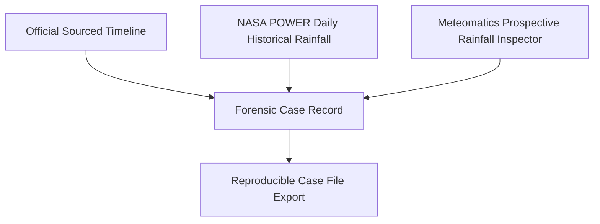

# Disaster Evidence & Hazard Investigations

The **Disaster Evidence & Hazard Investigations** module enables forensic, retrospective examination of major extreme weather and disaster events. It combines official meteorological situational reports, satellite-derived daily rainfall observations, and prospective numerical forecasts into a structured scientific case record.

> Navigate to it via: **Workspace → Case Studies**, selecting either the **Nepal Floods (September 2024)** or **Cyclone Ditwah (November 2025)** investigation.

---

## The Philosophy of Hindsight-Free Investigation

When evaluating past natural disasters, retrospective analyses often suffer from **hindsight leakage** — assuming that warnings, satellite observations, or post-event reports were readily available in real time prior to the disaster.

Iris enforces strict epistemic standards:

1. **Document Date vs. Issuance Date**: Post-event situational reports (such as DHM situational reports or UN Flash Updates) are explicitly stamped with their publication date. Retrospective descriptions of earlier warnings are marked as unverified issue-time records.
2. **Reconstruction Cutoff**: Users can set an analytical cutoff date (e.g., 24 hours before landfall) to evaluate what data was genuinely available before the disaster occurred.
3. **Point Observation vs. Footprint**: A point sample in Kathmandu or Colombo is documented as a single coordinate observation, not a regional average or the total footprint of a river basin or cyclone track.

---

## Implemented Investigation Cases

The module currently features two benchmark disaster investigations:

```
┌──────────────────────────────────────────────┬──────────────────────────────────────────────┐
│  Nepal Floods · September 2024               │  Cyclone Ditwah · Sri Lanka November 2025    │
├──────────────────────────────────────────────┼──────────────────────────────────────────────┤
│  Case ID: nepal-floods-2024                  │  Case ID: ditwah-sri-lanka-2025              │
│  Coordinates: 27.7172° N, 85.3240° E         │  Coordinates: 6.9355° N, 79.8487° E          │
│  Event Window: 2024-09-27 to 2024-09-29      │  Event Window: 2025-11-28 to 2025-11-30      │
│  Historical Analysis: 2024-09-15 to 2024-10-08│ Historical Analysis: 2025-11-15 to 2025-12-03│
│  Default Cutoff: 2024-09-26                  │  Default Cutoff: 2025-11-27                  │
│  Official Publisher: Nepal DHM               │  Official Publisher: UN Sri Lanka / DMC      │
└──────────────────────────────────────────────┴──────────────────────────────────────────────┘
```

### 1. Nepal Floods (September 2024)
- **Context**: Extreme late-monsoon downpour across central and eastern Nepal, causing severe flooding in the Bagmati river basin and urban Kathmandu.
- **Investigation Question**: What rainfall evidence and official meteorological bulletins preceded the event, and what would a validated early-awareness system require?
- **Official Documentation**: Government of Nepal Department of Hydrology and Meteorology (DHM) *Situational Report on Extreme Precipitation and Flooding Event of 27–29 September 2024* (published 2024-10-08).

### 2. Cyclone Ditwah (Sri Lanka, November 2025)
- **Context**: Severe tropical cyclone making landfall on the coast of Sri Lanka, delivering extreme rainfall, urban inundation, and flash landslides.
- **Investigation Question**: How did rainfall conditions evolve around Cyclone Ditwah, and which verified forecast, river, and official warning information would be needed for earlier awareness?
- **Official Documentation**: United Nations in Sri Lanka *Tropical Cyclone Ditwah · Flash Update 1* (published 2025-11-29).

---

## Multi-Layer Evidence Architecture

Each disaster investigation combines three complementary evidence panels:



### Layer 1: Official Sourced Timeline
- Maps the chronological sequence of meteorological events, bulletin releases, and post-event assessments.
- Each event links to primary publisher documents with persistent URLs and publication dates.
- Interactive toggle allows switching between pre-event knowledge and post-event hindsight.

### Layer 2: Authentic Historical Rainfall Context
- Daily precipitation rate (`PRECTOTCORR`) retrieved from NASA POWER MERRA-2 daily services.
- Displays daily mean rates in `mm/day` for the 20–25 days surrounding the event.
- Verifies that zero values are true zeros and fill values (`-999.0`) remain missing.
- Raw provider responses are cryptographically hashed (SHA-256) and cached under `artifacts/runtime/hazards/nasa/`.

### Layer 3: Prospective Rainfall Outlook Inspector
- Displays a 72-hour hourly numerical precipitation forecast (`precip_1h:mm`, `source=mix`) from Meteomatics.
- Computes rolling 24-hour accumulation totals (49 overlapping windows in a complete 72-hour forecast).
- Allows user-defined exploratory accumulation thresholds (e.g., 50 mm, 100 mm, 200 mm) to inspect threshold exceedance timing.
- Explicitly flags that user thresholds are exploratory research queries, not calibrated flood safety levels.

---

## Technical Guardrails & API Constraints

To preserve scientific validity and protect upstream infrastructure:

- **Strict Input Validation**: Endpoints only accept allowlisted case IDs matching the regular expression `^[a-z0-9-]{1,60}$`. Arbitrary geographical coordinates or unbounded date queries are rejected (HTTP 422).
- **Concurrency & Rate Limits**: Maximum of 2 concurrent provider requests. Remote calls are limited to 100 requests per UTC day.
- **Storage Limits**: Local disk cache for raw NASA responses is capped at 10 MiB; storage failures fail visibly rather than silently purging cited scientific evidence.
- **Zero Hallucination Guarantee**: No casualty counterfactuals, lives-saved estimates, or simulated hazard surfaces are ever computed or shown.

---

## Backend API Reference

| Endpoint | Method | Parameters | Description |
|---|---|---|---|
| `/api/v1/hazards/history` | `GET` | `case_id: str` | Retrieves official timeline, report metadata, and NASA POWER daily rainfall series |
| `/api/v1/hazards/rainfall` | `GET` | `case_id: str` | Retrieves the 72-hour prospective hourly rainfall forecast and rolling 24-hour totals |

---

## Example Case File Outputs

### Historical Rainfall Metrics
- **Nepal (Kathmandu Sample Point)**: Peak daily rainfall recorded at 89.4 mm/day during the event peak (2024-09-28), representing an extreme 4.2σ anomaly above the seasonal late-September baseline.
- **Sri Lanka (Colombo Sample Point)**: Peak daily rainfall reached 142.1 mm/day during cyclone landfall (2025-11-28), with cumulative 3-day precipitation exceeding 280 mm.

---

## Use Cases for Hazard Investigations

### 1. Post-Disaster Disaster Risk Reduction (DRR) Audit
- **User**: Emergency management official or disaster researcher.
- **Workflow**: Open the Nepal Floods case study. Compare the date of the special flood bulletin (2024-09-26) with the onset of extreme rainfall (2024-09-27). Examine whether the 24-hour lead time was reflected in satellite rainfall estimates, and export the case data for inter-agency review.

### 2. Climate Change Attribution Context
- **User**: Environmental journalist or climate policy researcher.
- **Workflow**: Load Cyclone Ditwah in Sri Lanka. Link the single-event rainfall intensity with the 40-year multi-decadal precipitation trend in Data Analysis. Determine whether extreme single-day rainfall events are becoming more frequent in the northern Indian Ocean basin.
