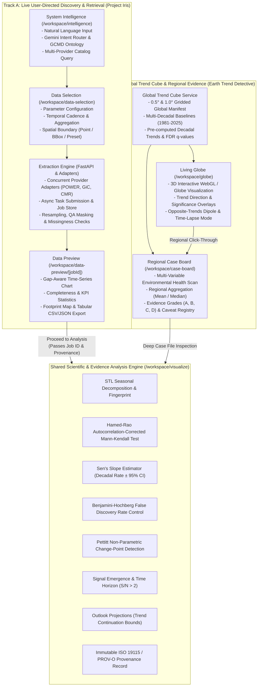

# Project Iris / Earth Trend Detective — Master Architecture & Merge Guide

**Integrated SRS Version:** 1.0 (Controlling)  
**Challenge Track:** NASA International Space Apps Challenge 2026 — *"Be An Earth System Trend Detective!"*  
**Repository Identity:** Project Iris (Implementation) / Earth Trend Detective (Challenge Product)  
**Controlling Specification:** [Earth_Trend_Detective_SRS_v1.0_Integrated.pdf](file:///c:/Users/navid/Desktop/Iris/model%20context/pdf/Earth_Trend_Detective_SRS_v1.0_Integrated.pdf)  
**Status:** Unified Multi-Track Architecture Active & Verified

---

## 1. Executive Summary & Product Vision

Project Iris resolves a fundamental dichotomy in environmental data exploration:
1. **The Ad-Hoc Discovery Dilemma:** Earth science researchers, students, and citizens ask dynamic, plain-language questions ("Has precipitation decreased in the Sahel over the last 30 years?") and require live, targeted data retrieval across dispersed space agency catalogs (NASA CMR, POWER, AppEEARS, GES DISC, Harmony, NOAA, etc.).
2. **The Systematic Evidence Requirement:** Rigorous scientific inference requires stable, pre-computed, multi-decadal gridded data (The Global Trend Cube) enabling instantaneous global visualization (Living Globe), cross-variable regional scanning (Case Board), non-parametric hypothesis testing (Hamed-Rao Mann-Kendall, Sen's slope), and offline resilience for competitions and classrooms.

Earlier iterations of the project separated these two visions:
- **SRS v0.1 (Earth Trend Detective):** Focused heavily on the pre-computed Global Trend Cube, 3D Living Globe, Case Board, and structured guided stories, but lacked an ad-hoc live catalog discovery and extraction engine for arbitrary user queries.
- **Project Iris Phase 2 (Data Retrieval Pipeline):** Built a live conversational System Intelligence (SI) router, multi-provider catalog search, parameter selection, and time-series extraction pipeline, but deferred the global cube, 3D globe, and multi-variable scanning.

**SRS v1.0 Integrated Revision unites both feature sets into a singular, cohesive cloud-native platform.** Neither set is discarded or compromised. Live ad-hoc data discovery seamlessly flows into the same rigorous statistical engine that powers pre-computed global cube investigations.

---

## 2. Comparative Analysis: Previous Versions vs. Integrated SRS v1.0

The following matrix documents the key conflicts and reconciliations between the previous project specifications and the controlling Integrated SRS v1.0:

| Dimension | Previous v0.1 (Earth Trend Detective) | Early Project Iris Notes / Logs | Reconciled Integrated SRS v1.0 (Controlling) |
| :--- | :--- | :--- | :--- |
| **Product Scope** | Curated Global Trend Cube, Living Globe, Case Board, Case File. | Live natural-language query, provider catalog discovery, preview. | **Dual-Track System:** Track A (Live Ad-Hoc Retrieval) + Track B (Global Trend Cube & Regional Evidence). |
| **Data Integrity Rule** | Prohibits unlabelled synthetic data; requires real observations. | Allowed "physically calibrated synthetic fallback" when upstream offline. | **Zero Synthetic Data in Production:** All numbers must originate from real upstream APIs or verified, pinned real snapshots with full provenance. Synthetic fixtures are strictly restricted to unit tests. |
| **Offline Operation** | Mandatory offline demo capability for Space Apps judging. | Assumed live network access to upstream APIs (NASA/NOAA/etc.). | **Hybrid Resilience:** Live discovery/extraction for connected workflows; verified real snapshots (`srsCubeAndScienceEngine.ts`) ensure 100% offline functionality. |
| **Super Intelligence (SI)** | Statistics decide; SI only suggests. SI never generates numbers. | Used LLM for intent extraction, variable mapping, and search query generation. | **Reconciled Role:** `gemini-3.5-flash-lite` parses queries into structured search facets and explains findings. Deterministic algorithms compute all statistics. |
| **Catalog vs. Extraction** | Catalog was a static list of 10 core variables. | Blended discovery and extraction into a single "available" status. | **Strict Capability Separation:** A catalog match does *not* imply extraction readiness. Providers are independently marked for discovery vs. extraction capability. |
| **Legacy Endpoints** | Referenced historical NASA Giovanni data. | Referenced legacy GES DISC Data Rods CGI endpoint. | **Endpoint Hygiene:** Retired CGI Data Rods (`hydro1.gesdisc.eosdis.nasa.gov`) is excluded. Replaced with modern GiC (Giovanni in the Cloud) and POWER APIs. |
| **Statistical Pipeline** | Specified Sen's slope, Mann-Kendall, FDR, Pettitt, Emergence S/N. | Initial preview performed raw Z-score filtering (|Z| >= 2.15). | **Standardized Science Engine:** Decouples data retrieval QA flags from formal scientific anomaly detection and trend inference. |

---

## 3. Dual-Track Architecture Blueprint

Project Iris implements a clean dual-track pipeline where both workflows converge on shared scientific standards and provenance records:

---

## 4. Governing Principles of the Codebase

Every module, component, and agent operating in this repository must adhere to the six governing principles established in SRS v1.0:

1. **Absolute Real-Data Integrity (No Hallucinations, No Fakes):**
   - User-facing numbers must originate from real upstream observation services or cryptographically/provenance-tagged real snapshots.
   - If an external provider is unreachable or returns an error, the system must present a typed, informative failure message or fall back to an explicitly labeled cached-real snapshot. Fabricated numbers are strictly forbidden.
2. **Statistics Decide; SI Only Suggests:**
   - LLMs and natural language agents may assist users in understanding concepts, finding datasets, framing hypotheses, and drafting report text.
   - SI models *never* compute, alter, or validate statistical values. All p-values, slopes, and trend metrics are calculated by deterministic Python/TypeScript numerical routines (`scipy.stats`, `pymannkendall`, `numpy`).
3. **Progressive Disclosure Across Three User Personas:**
   - **Explorer:** Simplified visual summaries, qualitative trend indicators (e.g., "Rapidly Warming"), plain-language caveat badges.
   - **Student:** Exact numerical rates (e.g., "+0.28 °C / decade"), p-value significance statements, seasonal cycle fingerprints.
   - **Scientist:** Full test statistics ($Z_{MK}$, Sen's 95% confidence intervals, Hamed-Rao variance correction factors, Pettitt change-point dates, Benjamini-Hochberg adjusted q-values).
4. **End-to-End Provenance & Traceability:**
   - Every plotted observation and calculated trend maintains a provenance chain: original data provider, mission/satellite sensor, processing level, native resolution, temporal aggregation method, missing value handling policy, and ISO timestamp of extraction.
5. **Separation of Catalog Discovery from Time-Series Extraction:**
   - Catalog discovery searches for what products exist across upstream Earth Observation archives.
   - Extraction retrieves actual numerical arrays. Because many products exist in catalogs without open, automated point/time-series APIs, each product explicitly declares its extraction capability.
6. **Non-Causal Diagnostic Framing:**
   - Environmental correlation is not causation. The application displays multi-variable co-occurrences and environmental fingerprints, but explicitly notes caveats and avoids attributing causality without formal attribution studies.

---

## 5. Model Context Suite Reading Order

This `model context` directory is organized into 5 authoritative documents designed for both human engineers and autonomous AI agents:

1. [00_master_architecture_and_merge_guide.md](file:///c:/Users/navid/Desktop/Iris/model%20context/00_master_architecture_and_merge_guide.md) *(This Document)*: High-level vision, version reconciliation, dual-track architecture, and governing principles.
2. [01_integrated_srs_requirements_matrix.md](file:///c:/Users/navid/Desktop/Iris/model%20context/01_integrated_srs_requirements_matrix.md): Exhaustive requirements traceability matrix (VC, DS, DP, GL, SC, AN, VZ, FC, ED, DA, PV, VL) and acceptance criteria.
3. [02_live_data_retrieval_and_providers.md](file:///c:/Users/navid/Desktop/Iris/model%20context/02_live_data_retrieval_and_providers.md): Technical specification of the live retrieval pipeline, Gemini SI router, provider adapters, asynchronous job store, and Data Preview.
4. [03_global_trend_cube_and_science_pipeline.md](file:///c:/Users/navid/Desktop/Iris/model%20context/03_global_trend_cube_and_science_pipeline.md): Mathematical formulations, statistical algorithms, Global Trend Cube specifications, Living Globe, Case Board, and evidence grading.
5. [04_codebase_developer_handbook.md](file:///c:/Users/navid/Desktop/Iris/model%20context/04_codebase_developer_handbook.md): Practical developer handbook: directory layout, FastAPI backend, Next.js frontend, state management, API routes, testing, and extension procedures.
