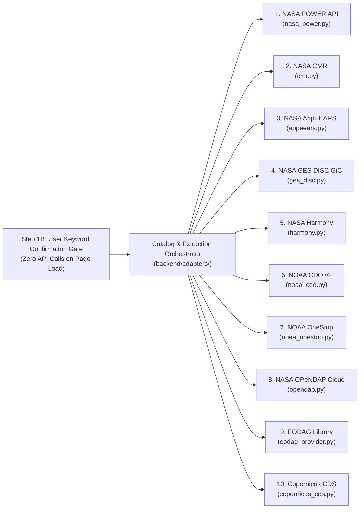
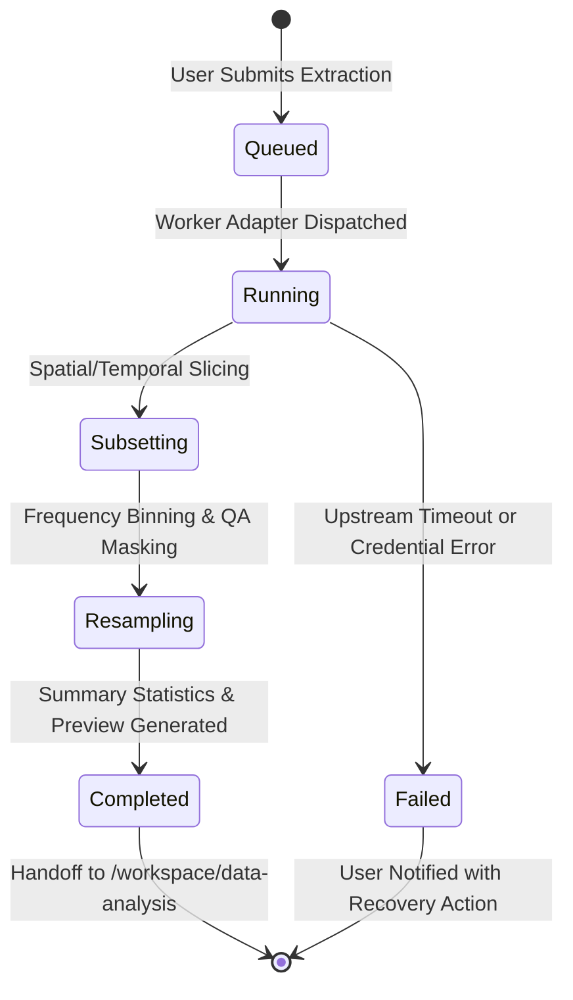

# Project Iris — Live Data Retrieval Pipeline & Provider Specifications

**Controlling Specification:** SRS v1.0 Integrated Revision  
**Parent Document:** [00_master_architecture_and_merge_guide.md](file:///c:/Users/navid/Desktop/Iris/model%20context/00_master_architecture_and_merge_guide.md)  
**Implementation Modules:**  
- Backend: `backend/adapters/`, `backend/providers/`, `backend/services/llm_router.py`, `backend/services/job_store.py`  
- Frontend: `src/app/workspace/intelligence/`, `src/app/workspace/data-selection/`, `src/app/workspace/data-preview/`, `src/lib/dataRetrievalEngine.ts`

---

## 1. System Intelligence (SI) & Natural Language Intent Router

The discovery workflow begins when a user submits a natural-language query, research question, or environmental headline in `/workspace/intelligence` (e.g. *"Show me drought trends and soil moisture in the Horn of Africa over the past 20 years"*).

### 1.1 Intent Parsing Architecture (`backend/services/llm_router.py`)

1. **Primary LLM Model:** Google Gemini (`gemini-3.5-flash-lite`), operating in **Structured JSON Output** mode with a typed Pydantic response schema (`ExtractedIntent`).
   - *Model Selection Rationale:* High inference speed, zero cold-start delay, and generous free-tier allocation (500 requests/day, 15 RPM).
2. **Deterministic GCMD Fallback:**
   - If the Gemini API key is unset, rate-limited, or offline, the router immediately engages a deterministic rule-based tokenizer utilizing the **NASA Global Change Master Directory (GCMD) Earth Science Ontology** and an internal **Geographical Gazetteer** (50+ global climate hotspots, river basins, and countries).
   - This ensures 100% operational uptime without network external dependencies.
3. **Intent Normalization Cache:**
   - Extracted intents are cached locally with a 24-hour TTL keyed by the normalized query hash, eliminating redundant LLM API calls for identical or similar student questions.

```json
{
  "subject_domain": "Drought & Hydrology",
  "scientific_category": "Terrestrial Hydrology",
  "keywords": ["soil moisture", "drought", "evapotranspiration", "precipitation"],
  "target_variables": ["GWETTOP", "PRECTOTCORR", "soil_moisture"],
  "inferred_region_name": "Horn of Africa",
  "inferred_spatial_level": "regional",
  "inferred_bbox": [3.0, 33.0, 15.0, 51.5],
  "inferred_center": [9.0, 42.25],
  "inferred_start_date": "2004-01-01",
  "inferred_end_date": "2024-12-31",
  "inferred_frequency": "Monthly",
  "target_apis": ["nasa_power", "ges_disc", "appeears"]
}
```

---

## 2. Upstream Provider Registry & Adapters (10 Live Platforms)

Project Iris maintains 10 isolated live API provider modules under `backend/providers/` and an orchestrator registry under `backend/adapters/catalog_adapters.py` and `extraction_adapters.py`. See [api_data_retrieval_implementation.md](file:///c:/Users/navid/Desktop/Iris/model%20context/api_data_retrieval_implementation.md) for the complete per-provider endpoint and debugging reference.



### 2.1 Provider Detailed Specifications

#### 1. NASA POWER API (`backend/providers/nasa_power.py`)
- **Upstream Service:** NASA Prediction of Worldwide Energy Resources (POWER) API v2.10.0.
- **Base URLs:**
  - Point API: `https://power.larc.nasa.gov/api/temporal/monthly/point`
  - Regional API: `https://power.larc.nasa.gov/api/temporal/monthly/regional`
- **Supported Parameters:**
  - `T2M`: Near-Surface Air Temperature (°C)
  - `PRECTOTCORR`: Bias-Corrected Precipitation (mm/day)
  - `GWETTOP`: Topsoil Moisture Index (fraction 0–1)
  - `ALLSKY_SFC_SW_DWN`: Surface Shortwave Downward Irradiance (kWh/m²/day)
  - `RH2M`: Relative Humidity at 2 Meters (%)
- **Temporal Span:** 1981-01-01 to Present (Monthly / Daily).
- **Execution Model:** **Synchronous** (direct sub-3s HTTP GET request).
- **Authentication:** None required (Open Access).

#### 2. NASA GES DISC GiC (`backend/providers/ges_disc.py`)
- **Upstream Service:** Giovanni in the Cloud (GiC) Time Series Service.
- **Endpoint:** `https://api.giovanni.earthdata.nasa.gov/timeseries`
- **Supported Datasets:** Modern-Era Retrospective analysis for Research and Applications, Version 2 (MERRA-2) and Global Land Data Assimilation System (GLDAS-2.1).
- **Parameters:** Soil moisture layers (`GLDAS_NOAH025_M_2_1_SoilMoi0_10cm_inst`), Runoff, Evapotranspiration.
- **Critical Architecture Rule:** Legacy Data Rods CGI (`hydro1.gesdisc.eosdis.nasa.gov/daac-bin/access/timeseries.cgi`) is **officially retired** and excluded from production code. GiC modern REST endpoints are used exclusively.
- **Authentication:** NASA Earthdata Login Bearer Token.

#### 3. NASA CMR API (`backend/providers/cmr.py`)
- **Upstream Service:** NASA Common Metadata Repository (CMR) Search API v2.
- **Base URL:** `https://cmr.earthdata.nasa.gov/search/collections.json`
- **Role:** Comprehensive catalog search across millions of Earth science granules. Queries by keywords, spatial polygon/bbox, and temporal ranges.
- **Status:** **Discovery: Fully Verified.** Extraction: Catalogs map granules; direct point time-series extraction delegates to Harmony or AppEEARS.

#### 4. NASA AppEEARS API (`backend/providers/appeears.py`)
- **Upstream Service:** Application for Extracting and Exploring Analysis Ready Samples.
- **Base URL:** `https://appeears.earthdatacloud.nasa.gov/api/`
- **Supported Products:** MODIS Land Surface Temperature (MOD11A2), Vegetation Indices (MOD13A2), VIIRS Surface Reflectance.
- **Execution Model:** **Asynchronous Batch Job**.
  - Step 1: Submit area/point extraction task (`POST /api/task`).
  - Step 2: Poll task status (`GET /api/task/{task_id}`).
  - Step 3: Download resulting GeoTIFF / NetCDF / CSV bundle on completion.
- **Authentication:** NASA Earthdata Login Bearer Token.

#### 5. NASA Harmony API (`backend/providers/harmony.py`)
- **Upstream Service:** NASA Harmony Transformation Service.
- **Base URL:** `https://harmony.earthdata.nasa.gov/`
- **Role:** Cloud-native spatial subsetting, re-projection, and format conversion (e.g. NetCDF to Zarr/GeoTIFF) across Earthdata Cloud collections.
- **Execution Model:** Asynchronous cloud job with STAC item catalog output.

#### 6. Open-Meteo Geocoding API (`backend/providers/geocoder.py`)
- **Base URL:** `https://geocoding-api.open-meteo.com/v1/search`
- **Role:** Fast, open geocoder resolving city, country, mountain range, and river basin queries to exact WGS84 latitude/longitude centroids and bounding boxes.

---

## 3. Data Selection & Parameter Configuration (`/workspace/data-selection`)

Once a user selects a dataset from System Intelligence, they proceed to `/workspace/data-selection` to configure precise extraction parameters:

1. **Authoritative Temporal Clamping:**
   - Start and End dates are validated against the product's true temporal coverage (`temporal_extent_start` to `temporal_extent_end`).
   - Quick presets: *Last 1 Year*, *Last 5 Years*, *Last 10 Years*, *Full Available Record*.
2. **Temporal Cadence & Physical Aggregation Guardrails:**
   - Options: `Daily`, `8-Day`, `16-Day`, `Monthly`, `Seasonal`, `Yearly`.
   - **No Oversampling:** Selecting a frequency finer than native resolution (e.g. Daily for a Monthly product) is strictly disabled in the UI and rejected by backend schemas.
   - **Physical Aggregation Rules:** Flux variables (Precipitation, Runoff) mandate `sum`; state variables (Temperature, Soil Moisture, NDVI) mandate `mean`.
3. **Spatial Boundaries & Reduction:**
   - **Point Mode:** Single latitude/longitude with interactive map crosshair.
   - **Bounding Box Mode:** Min/Max coordinates with live rectangle drawing on Leaflet.
   - **Regional Presets:** Built-in boundaries for global reference regions (Sahel, Aral Sea, Amazon, Mediterranean, Lake Chad, Ganges-Brahmaputra).
   - **Spatial Reduction:** Area Mean, Area Median, or Preserve Grid (for multi-cell spatial analyses).

---

## 4. Asynchronous Job Architecture & Persistence (`backend/services/job_store.py`)

To handle both instant synchronous APIs (POWER) and long-running asynchronous batch tasks (AppEEARS, GiC) transparently, Iris utilizes a unified **Job & Result Store**:



### 4.1 Persistence & Deduplication Strategy
- **Durable Disk Store:** Jobs are persisted to `backend/jobs_store.json` (auto-recovered across backend server restarts).
- **Request Normalization & Caching:** Extraction requests are normalized (ordered coordinates, clamped ISO dates, normalized variable keys) and hashed using SHA-256. If an identical request was already computed, the cached result is returned immediately with `cache_hit=True`.
- **Durable Result Fingerprint:** Every completed extraction generates a unique `result_id` with a SHA-256 checksum over the observation series:
  $$\text{SHA256}(\text{timestamps} + \text{values} + \text{flags})$$
  ensuring immutable reproducibility when passed to the science analysis workspace.

---

## 5. Data Preview & Quality Assurance (`/workspace/data-preview/[jobId]`)

Before any time series is passed to statistical trend analysis, it must pass inspection on the Data Preview screen:

1. **Four-Stage Progress Monitor:**
   - `Request Submitted to Provider` $\rightarrow$ `Subsetting and QA Masking` $\rightarrow$ `Temporal Resampling` $\rightarrow$ `Ready for Preview`.
2. **Completeness & Missingness KPIs:**
   - Reports: Total Observations, Valid Count, Missing Count, Completeness %, Mean, StdDev, Min (with date), Max (with date).
   - **Automated Alert:** If missing observations exceed **15%**, a prominent amber alert banner is displayed with a caveat note.
3. **Gap-Aware Interactive Visualization:**
   - Plotted using continuous timestamps. Gaps or nodata intervals are left open (not interpolated with deceiving straight lines) with shaded vertical bands indicating missing periods.
   - Interactive range zoom, moving average smoothing overlay (visual only), and tooltip inspection showing raw values and QA flags.
4. **Footprint Map & Paginated Data Grid:**
   - Leaflet map displaying exact query bounding box, centroid, and bounding coordinates.
   - Paginated, searchable tabular grid with UTC Timestamps, Numerical Values, Units, and Quality Reason Codes (`VALID`, `MISSING_SOURCE`, `OUT_OF_BOUNDS`, `QA_FLAGGED`).
5. **Immutable Export & Handoff:**
   - **Download CSV / JSON:** Exports full tabular data with ISO 19115 compliant metadata headers (source agency, product ID, bounding coordinates, license, retrieval timestamp).
   - **Proceed to Analysis:** Routes directly to `/workspace/data-analysis?jobId={job_id}` carrying the verified immutable result into the scientific Case File.
