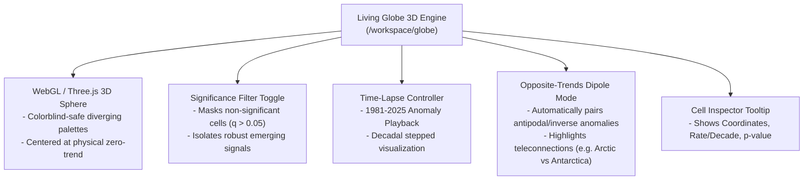

# Project Iris / Earth Trend Detective — Global Trend Cube & Science Pipeline

**Controlling Specification:** SRS v1.0 Integrated Revision & Appendix A  
**Parent Document:** [00_master_architecture_and_merge_guide.md](file:///c:/Users/navid/Desktop/Iris/model%20context/00_master_architecture_and_merge_guide.md)  
**Implementation Modules:**  
- Backend: `backend/services/cube_service.py`, `backend/services/science_pipeline.py`  
- Frontend: `src/app/workspace/globe/`, `src/app/workspace/visualize/`, `src/lib/srsCubeAndScienceEngine.ts`, `src/lib/statistics.ts`

---

## 1. The Global Trend Cube Specification

The **Global Trend Cube** is a pre-computed, version-controlled multidimensional geospatial data product designed for high-performance interactive exploration on the 3D Living Globe.

### 1.1 Gridded Layer Architecture
- **Version Identifier:** `v1.0.2-SRS-2026.11`
- **Spatial Grid:** Regular global latitude/longitude grid at **0.5° $\times$ 0.5°** and **1.0° $\times$ 1.0°** resolution ($360 \times 180$ cells).
- **Temporal Baseline:** Continuous monthly records from **1981-01 to 2025-12** (45 full calendar years = 540 monthly time slices).
- **Storage & Ingestion:** Processed via NetCDF-4/Zarr and surfaced to the web tier through compact, pre-sliced JSON/GeoJSON cell vectors.

### 1.2 Core Curated Layers (`CUBE_LAYERS`)

| Layer ID | Parameter Description | Primary Mission / Reanalysis Source | Physical Units | Zero-Center Color Palette |
| :--- | :--- | :--- | :--- | :--- |
| `cube_t2m` | Near-Surface Air Temperature (2m) | NASA POWER / MERRA-2 | °C | Coolwarm (Blue to Red) |
| `cube_precip` | Total Precipitation Rate | NASA POWER / GPCP v2.3 / CHIRPS | mm/day | BrBG (Brown to Teal) |
| `cube_soilm` | Topsoil Moisture Index (0–5 cm) | NASA POWER / GLDAS Noah v2.1 | 0–1 fraction | YlGnBu (Yellow to Deep Blue) |
| `cube_ndvi` | Normalized Difference Vegetation Index | Terra/Aqua MODIS (MOD13C2) | Index (-1 to +1) | PiYG (Pink to Forest Green) |
| `cube_solar` | Surface Solar Radiation Downward | NASA POWER / CERES SYN1deg | kWh/m²/day | Plasma (Purple to Gold) |
| `cube_rh2m` | Relative Humidity at 2 Meters | NASA POWER / MERRA-2 | % | PuOr (Orange to Purple) |

Each grid cell `CubeCellRecord` encapsulates:
- Centroid coordinates (`lat`, `lon`) and cell bounding box
- 45-year mean baseline and standard deviation
- Long-term **Sen's Slope** (scaled to rate per decade)
- **Hamed-Rao Mann-Kendall p-value** and **Benjamini-Hochberg FDR q-value**
- Evidence Grade (`A`, `B`, `C`, `D`) and active Caveat flags

---

## 2. Living Globe 3D Engine (`/workspace/globe`)

The **Living Globe** renders the Global Trend Cube as a dynamic, interactive 3D virtual sphere:

## 3. Peer-Reviewed Statistical Analysis Pipeline

The heart of Project Iris is its deterministic, peer-reviewed statistical engine (`backend/services/science_pipeline.py` and `src/lib/statistics.ts`). Every formula strictly follows published climatological literature.

### 3.1 Seasonal Adjustment & Seasonal Fingerprint
For complete, regular monthly observations with at least two annual cycles, the backend applies robust STL with period 12. It uses the estimated seasonal component $S(t)$ to produce:
$$Y(t) = T(t) + S(t) + R(t)$$
- $T(t)$: STL trend component.
- $S(t)$: Estimated 12-month seasonal component.
- $R(t)$: STL residual.

The trend tests use the seasonally adjusted observation $A(t)=Y(t)-S(t)$; the UI presents the selected seasonal-adjustment method. When valid monthly coverage is incomplete or irregular, the backend uses calendar-month climatology adjustment instead, without interpolating missing values. This fallback is not STL.

The **Seasonal Fingerprint** visualizes observed year-by-month anomalies as a heatmap to highlight seasonal shift patterns (e.g. earlier spring warming or delayed monsoons); missing or QA-excluded months remain blank.

### 3.2 Non-Parametric Sen's Slope Estimator
Sen's slope provides a robust, outlier-resistant estimate of trend magnitude:
$$\hat{\beta} = \text{median} \left\{ \frac{x_j - x_i}{t_j - t_i} \right\} \quad \forall \; i < j$$
- **Decadal Rate Scaling:** For monthly series ($12 \text{ steps/year}$), the decadal change rate is:
  $$\text{Rate}_{\text{decade}} = \hat{\beta} \times 120$$
- **95% Non-Parametric Confidence Interval:** Calculated using the normal approximation to the rank distribution of pair slopes:
  $$C_\alpha = z_{1 - \alpha/2} \sqrt{\frac{N(N-1)(2N+5)}{18}}$$
  The lower and upper bounds correspond to the $M_1$-th and $M_2$-th sorted slopes, where $M_1 = \frac{N'-C_\alpha}{2}$ and $M_2 = \frac{N'+C_\alpha}{2}$.

### 3.3 Hamed-Rao Modified Mann-Kendall Test
Standard Mann-Kendall tests severely over-reject the null hypothesis in the presence of positive serial autocorrelation (common in temperature and soil moisture series). Iris implements the **Hamed-Rao (1998)** modified test:

1. Compute standard Mann-Kendall score $S$:
   $$S = \sum_{i=1}^{n-1} \sum_{j=i+1}^n \text{sgn}(x_j - x_i)$$
2. Detrend the series using Sen's slope and compute significant empirical lag-$k$ autocorrelation coefficients $\rho(k)$.
3. Compute the variance correction factor $\eta$:
   $$\eta = 1 + \frac{2}{n(n-1)(n-2)} \sum_{k=1}^{n-1} (n-k)(n-k-1)(n-k-2) \, \rho_S(k)$$
4. Correct the variance: $\text{Var}^*(S) = \text{Var}(S) \cdot \eta$.
5. Compute the standardized test statistic $Z_{MK}$:
   $$Z_{MK} = \begin{cases} \frac{S - 1}{\sqrt{\text{Var}^*(S)}} & \text{if } S > 0 \\ 0 & \text{if } S = 0 \\ \frac{S + 1}{\sqrt{\text{Var}^*(S)}} & \text{if } S < 0 \end{cases}$$
6. Calculate the two-tailed p-value from the standard normal cumulative distribution: $p = 2 \cdot [1 - \Phi(|Z_{MK}|)]$.

### 3.4 False Discovery Rate (Benjamini-Hochberg FDR)
When testing thousands of grid cells across the globe or multiple variables simultaneously, the probability of false positives increases dramatically. Iris applies the **Benjamini-Hochberg procedure**:
1. Rank all $m$ raw p-values in ascending order: $p_{(1)} \le p_{(2)} \le \dots \le p_{(m)}$.
2. Compute the adjusted significance threshold for each rank $k$:
   $$p_{(k)} \le \frac{k}{m} \cdot Q, \quad Q = 0.05$$
3. Compute the Benjamini-Hochberg $q$-value:
   $$q_i = \min_{k \ge i} \left\{ \frac{m \cdot p_{(k)}}{k} \right\}$$
Only cells with $q \le 0.05$ are displayed as statistically significant on the Living Globe.

### 3.5 Pettitt Non-Parametric Change-Point Detection
Identifies the exact date when an abrupt regime shift occurred:
$$U_{t,T} = \sum_{i=1}^t \sum_{j=t+1}^T \text{sgn}(x_i - x_j), \quad K_T = \max_{1 \le t \le T} |U_{t,T}|$$
The change-point occurs at the time $t$ maximizing $|U_{t,T}|$, with significance:
$$p \approx 2 \exp\left( \frac{-6 K_T^2}{T^3 + T^2} \right)$$

### 3.6 Signal Emergence & Time of Emergence (ToE)
Determines whether an observed trend has emerged beyond the noise of natural climate variability:
$$\text{Signal}(t) = |\hat{\beta}| \cdot \Delta t, \quad \text{Noise} = \sigma(\text{Residuals})$$
$$\text{Signal-to-Noise Ratio (S/N)} = \frac{\text{Signal}(t)}{\text{Noise}}$$
- **Emergence Threshold:** Trend signal is formally emerged when $S/N \ge 2.0$ (exceeding $2\sigma$ natural noise boundary with 95% confidence).
- **Time of Emergence (Year):** The calendar year when $S/N$ permanently crossed 2.0.

### 3.7 Outlook Projections (Trend Continuation)
Projects historical trends into future decades (2030, 2040, 2050):
$$\hat{Y}(t_{\text{future}}) = \bar{Y}_{\text{recent}} + \hat{\beta} \cdot (t_{\text{future}} - t_{\text{recent}})$$
- Uncertainty bounds $[\hat{Y}_{\text{lower}}, \hat{Y}_{\text{upper}}]$ are projected using Sen's 95% slope confidence intervals.
- **Mandatory Caveat Display:** Accompanied by prominent disclaimers explaining that this is a mathematical trend continuation projection, not a general circulation climate model (GCM) simulation.

---

## 4. Evidence Grading Framework & Caveat Registry

To prevent over-interpretation of noisy or short satellite records, every trend finding is evaluated against an objective **Evidence Grade (A, B, C, D)**:

| Evidence Grade | Required Record Length | Data Completeness | Significance Level | Interpretation & Diagnostic Meaning |
| :---: | :---: | :---: | :---: | :--- |
| **Grade A** | $\ge 30$ Years | $\ge 90\%$ Valid Bins | $p \le 0.01$ (Hamed-Rao) | **High Confidence Trend:** Climatologically robust multi-decadal signal exceeding natural variability. |
| **Grade B** | $\ge 20$ Years | $\ge 80\%$ Valid Bins | $p \le 0.05$ (Hamed-Rao) | **Moderate Confidence Trend:** Statistically significant signal with minor caveats or shorter baseline. |
| **Grade C** | $\ge 10$ Years | $\ge 70\%$ Valid Bins | $p \le 0.10$ | **Emerging / Indicative Trend:** Weak or noisy signal; requires cautious interpretation. |
| **Grade D** | $< 10$ Years or any length | $< 70\%$ Valid Bins | $p > 0.10$ | **Inconclusive / Insufficient Evidence:** High variability or missing data; trend cannot be reliably asserted. |

### 4.1 Integrated Caveat Registry
The system automatically tags relevant physical and instrumental caveats:
1. `CAVEAT_SATELLITE_ORBIT_DRIFT`: NOAA/AVHRR or older satellite records subject to afternoon equatorial crossing time drift.
2. `CAVEAT_SENSOR_TRANSITION`: Transition between sensors (e.g. MODIS Terra to Aqua or GLDAS v2.0 to v2.1 in 2000).
3. `CAVEAT_URBAN_HEAT_ISLAND`: High local temperature trends in rapidly urbanizing grid cells.
4. `CAVEAT_IRRIGATION_UNCOUPLED`: Soil moisture / vegetation greening disconnected from local precipitation due to human groundwater pumping.
5. `CAVEAT_LAND_OCEAN_MASK`: Grid cells straddling coastlines where mixed water/land pixels affect optical or thermal reflectance.
