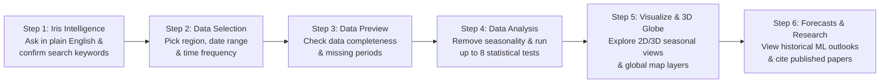

# Project Iris — Platform Methodology, User Workflow & Solution Uniqueness

**Challenge:** NASA International Space Apps Challenge 2026 — *"Be An Earth System Trend Detective!"*  
**Public Methodology Page:** `/methodology` (`src/app/methodology/page.tsx`)

---

## 1. How the Entire Web Platform Works

Project Iris turns decades of public satellite observations, climate reanalyses, and weather station records into clear, verifiable **Case Files**. Rather than requiring coding or specialized GIS tools, Iris connects four main investigation pathways inside one workspace:

### Pathway 1 — Custom Investigation (Ask a Question $\rightarrow$ Build a Case File)
Start with any plain-English question about the environment. Iris translates your question into scientific search keywords, searches across **10 public space and weather catalogs**, retrieves the data for your selected region and date range, checks data quality and missing periods, and runs up to **8 statistical tests** to determine whether a real trend exists.

### Pathway 2 — 3D Living Globe (Explore Global Satellite & Climate Maps)
Explore **11 monthly global environmental layers**—including air temperature, skin temperature, dew point, precipitation rate, snow depth, surface and root-zone soil wetness, relative humidity, wind speed, surface pressure, and sunlight—on an interactive 3D globe or 2D world map. You can view the entire planet or focus on a specific region, step through historical months, and click any grid cell to read its measured value, unit, and date.

### Pathway 3 — Environmental Forecasts (Historical Machine Learning Outlooks)
Select one of six benchmark locations or pick any custom point or bounded region on Earth. Iris trains local machine learning models strictly on historical observations to estimate upcoming conditions across **13+ environmental variables** (rainfall, temperature, soil moisture, vegetation greenness, evapotranspiration, snow cover), displaying a **10th-to-90th percentile uncertainty range** and comparing every model against simple historical baselines.

### Pathway 4 — Case Studies & Connected Research
Step through guided multi-decade climate investigations (`IR–042` Los Angeles warming, `IR–038` Central Valley soil drying, `IR–031` Amazon canopy stress, `IR–024` Himalayan snow retreat), examine the **September 2024 Nepal Floods** and **November 2025 Cyclone Ditwah in Sri Lanka** by comparing pre-event warnings with daily rainfall observations, and connect any dataset directly to peer-reviewed scientific articles.

---

## 2. Step-by-Step Guide: The 6 Steps a User Follows

### Step 1 — Ask Your Question & Confirm Keywords (`Iris Intelligence`)
1. Type a question in plain English (for example, *"Monthly rainfall and soil moisture trends in Sri Lanka"* or *"Temperature trends in California"*).
2. Review the suggested search scope: topic, region, date range, and recommended frequency.
3. Add or remove search keywords and select which of the **10 public data catalogs** to search.
4. Click **Confirm and search** to view matching datasets and pick one that is ready for retrieval.

### Step 2 — Choose Your Region, Timeframe & Frequency (`Data Selection`)
1. Review the dataset's official date coverage, resolution, measurement unit, and source agency.
2. Pick a start and end date (or use quick presets like *Last 5 Years*, *Last 10 Years*, or *Full Record*) and choose a supported time step (*Daily*, *8-Day*, *16-Day*, *Monthly*, *Seasonal*, or *Yearly*).
3. Click a point on the interactive map, draw a region box, or search for a city, river basin, or country by name.
4. Click **Extract data** to retrieve the observations from the source archive.

### Step 3 — Check Data Quality & Missing Periods (`Data Preview`)
1. Check the summary cards showing total observations, valid data count, missing count, completeness percentage, average, and min/max values.
2. Inspect the preview chart: any missing periods are shown clearly as shaded gaps rather than connected with misleading straight lines.
3. Confirm your study area on the footprint map and browse the sortable table of observations and quality labels.
4. Download the clean table as CSV or JSON, or click **Proceed to analysis**.

### Step 4 — Run Step-by-Step Statistical Tests (`Data Analysis`)
1. Check the compatibility banner at the top to see which statistical tests fit your data's time step and length.
2. Choose how to handle seasonality: *Automatic seasonal removal*, *Calendar-Month averages*, *STL decomposition*, or *No adjustment*.
3. Select from **8 statistical method cards**, adjust settings if needed, and click **Run** (one test at a time or several together).
4. Switch between **Explorer**, **Student**, and **Scientist** explanation modes and download chart images or your complete Case File.

### Step 5 — Explore 2D/3D Seasonal Patterns & Global Maps (`Data Visualization` & `3D Living Globe`)
1. In **Data Visualization**, explore linked panels side by side: 2D and 3D Time Tracks, 3D Seasonal Landscapes, 3D Seasonal Orbits, and multi-location trend comparisons.
2. Press **Play** on the time scrubber to step through observations and see every open chart highlight the same date together.
3. In the **3D Living Globe**, choose from 11 monthly global variables, pick a region or the whole Earth, select a month, and click any cell to inspect its measured value.

### Step 6 — Generate Forecasts, Review Case Studies & Cite Literature (`Forecasts`, `Case Studies` & `Existing Research`)
1. In **Forecasts**, pick a benchmark location or select a new point or region on the map, choose a target variable, and view short-term predictions with 10th–90th percentile uncertainty ranges.
2. In **Case Studies**, step through guided investigations with interactive checkpoints or inspect the Nepal Floods (2024) and Cyclone Ditwah (2025) timelines.
3. In **Existing Research**, find peer-reviewed scientific papers and datasets matching your study variable and region, and copy citations in one click.

---

## 3. Uniqueness of Our Solution: Six Core Differentiators

1. **AI Helps You Search; Math Decides the Answer**:
   The AI assistant only translates your plain-English question into search keywords and explains completed results in clear language. It never invents, guesses, or alters numbers. All statistics, trend rates, and grades are calculated by standard mathematical formulas—and a built-in keyword dictionary keeps search working even offline.
2. **100% Real Observations—Never Filled with Fake Data**:
   When satellites or weather stations miss readings due to cloud cover or maintenance, Iris never hides those gaps or draws straight lines across missing months. Missing periods remain clearly visible in both 2D charts and 3D seasonal views.
3. **One Search Across 10 Public Space & Weather Agencies**:
   After you confirm your search keywords, Iris searches 10 public catalogs at once (NASA, NOAA, and European Copernicus archives) and clearly labels which datasets support immediate time-series retrieval in the workspace.
4. **Multiple Statistical Tests That Check Each Other**:
   Instead of relying on a single trend line that can be skewed by one extreme El Niño year, Iris compares standard linear regression against outlier-resistant non-parametric tests (Mann–Kendall and Sen's slope) and adjusts for month-to-month weather persistence before awarding a high Evidence Grade.
5. **Honest Machine Learning Forecasts & Disaster Cutoffs**:
   Forecast models train strictly on historical observations and are tested against simple benchmarks (persistence and seasonal averages). If a model does not beat those simple baselines on past test periods, Iris clearly labels it as an **Experimental Preview** and reports the exact error difference.
6. **Built for Everyone: Explorer, Student & Scientist Modes**:
   Every Case File lets you switch between plain-English takeaways (**Explorer**), intermediate explanations (**Student**), and full statistical details (**Scientist**), while connecting your findings directly to published scientific literature.

---

## 4. The 8 Statistical Analysis Methods & 4 Seasonal Adjustments

### Part A — Four Ways to Handle Seasonality
| Seasonal Option | When to Use It | How It Works |
| :--- | :--- | :--- |
| **Automatic (Recommended)** | 12+ observations | Uses smooth STL seasonal decomposition for complete monthly records (24+ months), or switches to Calendar-Month Averages when months are missing. |
| **STL Seasonal Decomposition** | Complete monthly records (24+ consecutive months) | Separates the series into a smooth trend, a repeating 12-month seasonal cycle, and remaining short-term variation, then removes the seasonal cycle. |
| **Calendar-Month Averages** | Multi-year monthly records (even with gaps) | Subtracts each calendar month's multi-year average (Jan–Dec) from each observation without filling gaps. |
| **No Seasonal Adjustment** | Yearly data or pre-adjusted series | Analyzes the raw observations directly without removing a seasonal cycle. |

### Part B — Eight Statistical & Visual Diagnostic Methods
| # | Method Name | Category | What It Tests & Why It Matters | Supported Data |
| :-: | :--- | :--- | :--- | :--- |
| **1** | **Linear Trend (OLS t-Test)** | Parametric Trend | Fits a straight trend line over time and tests whether the slope is statistically significant while adjusting for weather persistence. | All time steps ($\ge 6$ points) |
| **2** | **Mann–Kendall Trend Test** | Non-Parametric Trend | Tests whether values consistently rise or fall over time without assuming a bell-curve distribution, corrected for month-to-month persistence. | All time steps ($\ge 6$ points) |
| **3** | **Seasonal Kendall Test** | Seasonal Trend | Compares January only with January, February only with February, etc., across years so seasonal swings never mask a long-term trend. | Monthly data ($\ge 24$ months) |
| **4** | **Sen's Slope Rate of Change** | Rate of Change | Takes the median slope across all pairs of points so isolated extreme weather years cannot distort the decadal rate of change. | All time steps ($\ge 6$ points) |
| **5** | **Pettitt Change-Point Detection** | Regime Shift Screen | Scans all dates to find when a sudden step-change or shift occurred in the record. | All time steps ($\ge 10$ points) |
| **6** | **Anomaly Review** | Extreme Event Screen | Flags unusual highs and lows (such as heatwaves, heavy rain, or droughts) beyond normal seasonal variation. | All time steps ($\ge 6$ points) |
| **7** | **Seasonal Fingerprint Heatmap** | Calendar-Month Pattern | Arranges anomalies into a Year $\times$ Month grid alongside 12 monthly rates of change to show which seasons are shifting fastest. | Monthly data ($\ge 12$ months) |
| **8** | **Full Case File Diagnostics** | Overall Reliability | Assigns an Evidence Grade (A–D), generates annual warming/anomaly stripes, and checks trend stability across all start/end year pairs (Trend Triangle). | All time steps ($\ge 12$ points) |

---

## 5. Evidence Grades (A–D) & 10 Connected Data Providers

### 5.1 Evidence Grades (A–D)
- **Grade A — High-Confidence Verified Signal**: At least 15 years of data, 90%+ valid coverage, statistically significant trend ($p < 0.05$), strong agreement between parametric and non-parametric tests, and no major sensor caveats.
- **Grade B — Credible Trend with Minor Caveats**: At least 10 years of data, 80%+ valid coverage, statistically significant trend ($p < 0.05$), and consistent slope direction across methods, with documented seasonal or sensor notes (such as monsoon cloud cover).
- **Grade C — Emerging Signal Requiring Longer Baseline**: 8–14 years of data, 70–80% coverage, or borderline significance ($0.05 \le p < 0.15$) where natural year-to-year variability is still large.
- **Grade D — Inconclusive or Coverage-Limited Record**: Fewer than 8 years of data, under 70% valid coverage, non-significant results ($p \ge 0.15$), or conflicting trend directions.

### 5.2 Ten Connected Public Data Providers
1. **NASA POWER**: Global air temperature, precipitation rate, soil wetness, humidity, wind, pressure, and solar radiation (plus 11 monthly 3D globe layers).
2. **NASA GES DISC (Giovanni in the Cloud)**: GLDAS land hydrology (soil moisture, runoff, evaporation) and MERRA-2 climate series.
3. **NASA AppEEARS**: High-resolution MODIS and VIIRS vegetation greenness (NDVI), land surface temperature, and evapotranspiration.
4. **NASA Earthdata Catalog (CMR)**: Master directory of NASA satellite missions and collections.
5. **NASA Harmony**: Cloud regional subsetting service for NASA Earth observation datasets.
6. **NOAA Climate Data Online (CDO)**: Ground weather station daily and monthly records (temperature, rainfall, snowfall, wind).
7. **NOAA OneStop**: NOAA enterprise catalog for climate, ocean, and atmospheric collections.
8. **NASA OPeNDAP Cloud**: Direct single-cell extraction from cloud-hosted global reanalysis grids.
9. **EODAG Federated Search**: International gateway across European and global Earth observation archives.
10. **Copernicus Climate Data Store (CDS)**: ECMWF ERA5 and ERA5-Land global climate reanalysis records.
